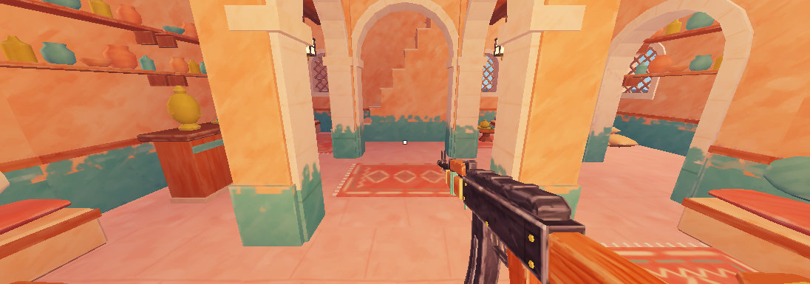
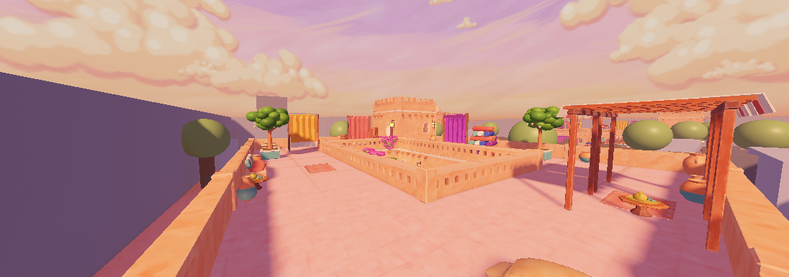
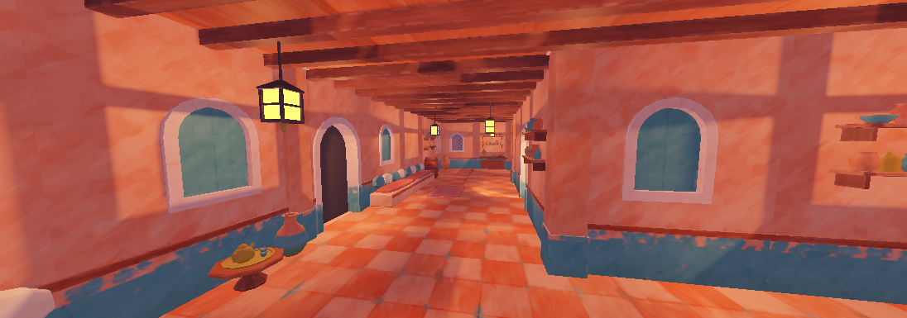
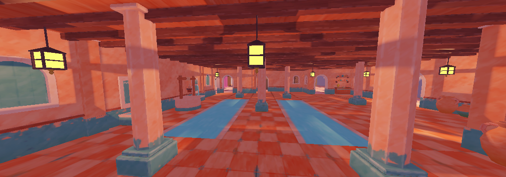
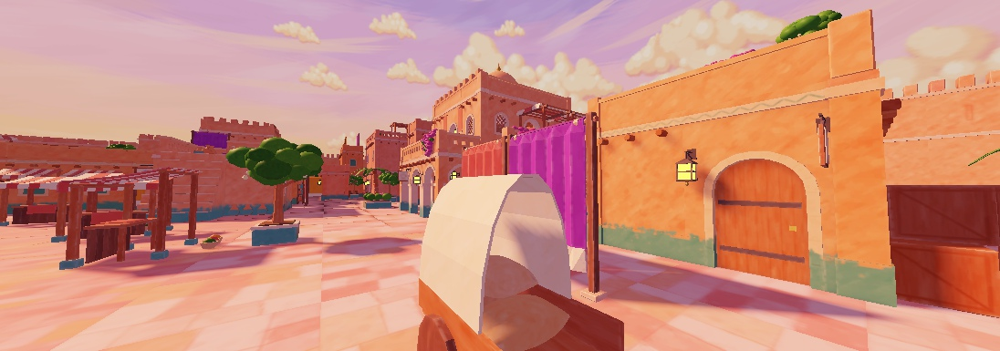
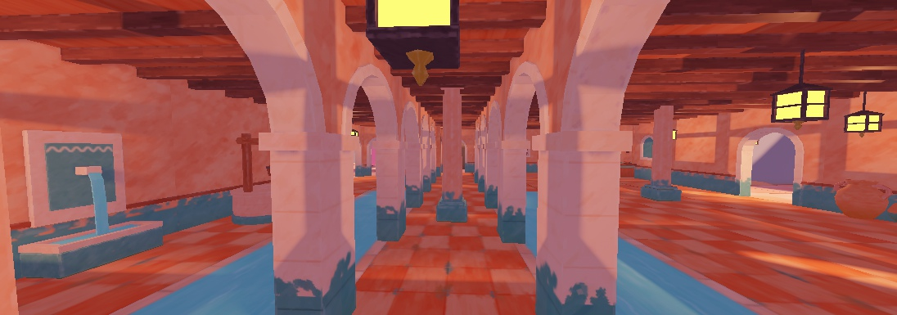
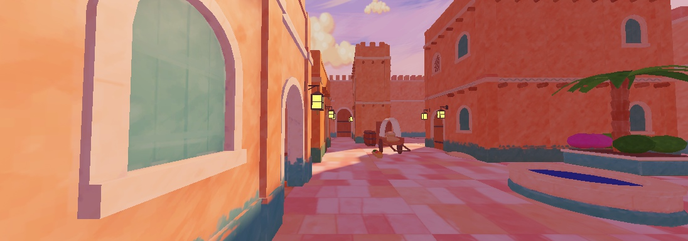
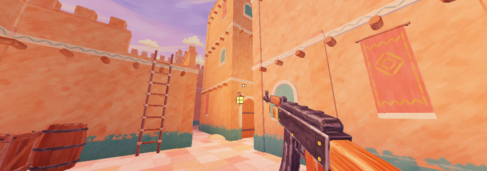
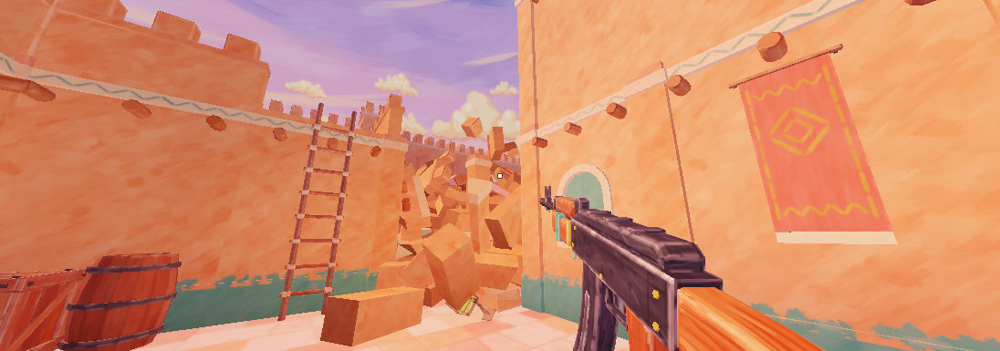

# Handoff: continue this project on the PC with Roblox Studio

Everything so far was made in a cloud session that cannot reach Roblox Studio. This file gives a new Claude session on the PC the full context and tells it what to do next. Read it all before touching anything.

**Start here:** do the jobs in [What to do next](#what-to-do-next), in order.

---

## 1. The game

A Roblox tactical FPS built around duels.

- 1v1 and 2v2 duels
- Stylized, painted visuals
- Buy guns, attachments, utility and armor
- Utility to gain an edge
- Interactive, destructible environment
- Streaks and events
- A big map

**How "big map" and "duels" fit together:** one large walled desert village, split into duel zones. Each round uses one zone and closes the streets into the others. The owner agreed to this.

**The repo** is `infieryy/short-horror-game-roblox`, branch `claude/stoic-faraday-5tm9kr`. The FPS lives in `desert-fps/` (the repo's name is from an older project). No pull request exists; do not open one unless asked.

## 2. The method

The owner follows the YorusDevs way of building Roblox games with AI. The rules that matter:

1. **Concept art first.** Every asset is judged against it: "same artist, same day?"
2. **Build by code.** Every model is a recipe (a script that builds it and paints it). No generated 3D models, no generated textures, no hand edits to outputs. To change a piece, change its recipe and run it again.
3. **Paint stroke by stroke.** Textures are brush strokes written as numbers. No noise, no gradients.
4. **Gameplay before beauty.** Plan on a grid, build gray boxes, playtest, then make it pretty.
5. **Look at every result.** Render or screenshot it and compare it with the reference before calling it done.
6. **Every mistake becomes a rule in a script,** so it is fixed once.

### The look (do not change without asking)
- One colour family per material, measured from the concept art.
- Every surface starts as one flat colour.
- Each stroke is one small step lighter or darker than the paint under it.
- Plaster strokes all lean up and to the right. Wood strokes follow the grain.
- Turquoise is the accent: a band at the foot of walls, cloth wraps on weapons, the band on the smoke grenade.
- No painted shadows. Where surfaces meet, a dark glaze that leans toward lavender, never gray.
- A pale brushed highlight on protruding edges.
- Everything fully matte.
- Roblox lighting to match: Future technology, lavender-blue OutdoorAmbient, warm lavender Ambient, sun slightly dimmer than default so bright walls don't burn out.

## 3. How the owner likes to work

- **Finish the job.** Work autonomously to the end state. Ask only for decisions that are really theirs (product direction, spending, irreversible actions).
- **Stay in scope.** Build what was asked. Leave a TODO for anything else.
- **Save constantly.** The PC can drop without warning. In Studio, stop any playtest and save (Ctrl+S) after every step and at least every 5 minutes; confirm the save landed. Keep every Luau build script you run in `desert-fps/build/NN_name.luau` so the place can be rebuilt by replaying them. Export finished systems to `.rbxm` in `desert-fps/backups/`. Commit and push often.
- **Verify by looking.** Screenshot the viewport and read the logs after visual or gameplay changes.
- **Luau:** idiomatic, ModuleScripts, server authoritative, validate and rate-limit every remote, game data in config modules.
- **Reports:** lead with the outcome, then what changed, assumptions, what was and wasn't verified, and exactly one recommended next task.
- **Feedback style:** short and blunt ("looks good", "urs is really trash", "fix blob"). Take it literally, fix it, show a render.

### What the owner has said about the work so far
| Thing | Verdict |
|---|---|
| Concept art (20 images) | Their own, made in ChatGPT |
| Map pilot pieces (walls, door, crate, barrel) | "they look good!" |
| Destruction | Must feel jagged, "like bam I just broke something with a missile". Grid cuts were rejected; the current shard cuts were made in response. |
| Destruction in Studio (holes left where shards were removed) | "reads a bit scattered". "Walls and props should crumble, they shouldnt feel like part there and part not." So a piece is never left with parts missing: see the status notes. |
| Rifle | "looks good", then asked for more hand-painted detail and brushed edges, then "looks pretty sweet" |
| Pistol | Asked for a Desert Eagle. Said the result looks like a Glock, but "it ok". **Open flaw, not a blocker.** |
| Knife (karambit) | First version "really trash". Remade from their reference photo: "much better". |
| Smoke grenade | "Good great amazing excellent" |
| Weapons in general | Must be modular: separate parts for animation, rigging and attachments. Not destructible. |

ChatGPT refuses to draw weapon concept art for them, so weapons are built from real-world proportions (or a reference photo they send) and painted in the game's style.

## 4. What exists

```
desert-fps/
├── README.md            game notes, zones, style rules
├── HANDOFF.md           this file
├── reference/           the owner's concept art (do not regenerate)
│   ├── concept/         aerial master view (the target for everything), street view
│   ├── zones/           one eye-level image per duel zone
│   ├── kit/             walls, doors, windows, beam ends, parapets, ladders, stairs, awnings
│   ├── props/           prop sheet
│   └── sky/             dune panorama, sky (NOT seamless yet), sandstorm
├── plan/                the map plan
│   ├── PLAN.md          zones, fairness checks, results, images
│   ├── zones.py         each zone as 14 rows of text (top half; bottom half is rotated)
│   ├── planner.py       checks fairness, draws the plan, writes out/plan.json
│   └── out/             plan.json, metrics.json, one PNG per zone, town overview
└── assets/              the asset pipeline
    ├── README.md        how it works, every piece, rules
    ├── config.py        EVERY number: scale, palette, paint rules, sizes, break settings
    ├── build.py         geometry, UVs, bake, checks, export
    ├── brush.py         the brush engine
    ├── paint.py         the look rules
    ├── chunks.py        cuts pieces into shards; splits weapons into parts
    ├── recipes/         one file per kind of piece; gun.py is the shared weapon toolkit
    ├── run.py           builds pieces
    ├── preview.py       renders pieces
    └── out/             FINISHED FILES, ready to import
```

### The map plan
- 1 cell = 8 studs. Each zone is 28 x 28 cells (224 studs). The town is a 3 x 3 grid of districts plus a ring road and wall, 736 studs across.
- Seven duel zones: Rooftops, Tea House, Courtyard House, Market Square, Dye Works, Gate, Cistern (underground). Two reserve districts (Caravan Yard, Potters' Row) are placeholder housing.
- Each zone's bottom half is its top half rotated 180 degrees, so both spawns get identical routes.
- All seven pass the paper checks: both teams can meet in 6 to 8.4 s, nobody can see the other spawn, longest sightline under 200 studs, three routes each.
- **Limits:** sightlines are only checked at ground eye level. Timings are estimates. Nothing has been playtested.
- `plan/out/plan.json` holds every zone as a full grid of characters. The legend is at the top of `plan/zones.py`.

### The assets (all in `assets/out/<piece>/`)
| Piece | Triangles | Breaks into / parts |
|---|---|---|
| `wall_plain` | 256 | 12 shards |
| `wall_window` | 676 | 12 shards + lattice |
| `wall_door` | 700 | 11 shards + lintel |
| `door` | 688 | 6 shards |
| `crate` | 1,468 | 8 debris shards |
| `barrel` | 728 | 7 debris shards |
| `rifle` | 1,772 | 11 parts |
| `pistol` | 996 | 8 parts |
| `knife` | 1,328 | 4 parts |
| `smoke` | 632 | 4 parts |

Every piece folder contains:
- `<piece>.fbx` and `<piece>.obj`: the whole mesh
- `<piece>_low.fbx` and `.obj`: a low-detail mesh using the same texture
- `<piece>.bundle.fbx`: every mesh of the piece in one file. This is the file that is uploaded to Roblox.
- `<piece>.png`: one 1024 px texture shared by every mesh of that piece
- `chunks/` and `<piece>.break.json` (map pieces), or `parts/` and `<piece>.parts.json` (weapons)
- `report.json`

Renders for reference: `assets/out/preview.png`, `compare.png` (next to the concept art), `broken.png` (blast damage), and `<weapon>-side.png`, `-front.png`, `-left.png`, `-parts.png`.

### File formats the game code will read

**Axes.** Meshes are built Z-up with 1 unit = 1 stud. The data files are already converted to Roblox axes (Y up): a Blender point (x, y, z) is written as (x, z, -y). Weapons point along +X.

**`<piece>.break.json`** (walls, door, crate, barrel)
- `mode`: `chunks` (every shard has its own health and stays until destroyed) or `shatter` (the prop has one `health`; when it breaks, swap it for the shards as debris).
- `chunks[]`: `id`, `mesh`, `center` and `size` of the shard's bounding box relative to the piece origin, `material`, `health`, `collision` ("Hull"), `grounded` (stands on the ground), `touches` (which piece edges it reaches: left, right, top, bottom), `neighbors` (shards it touches).
- Piece origin: bottom centre.
- Health numbers are placeholders until weapon damage exists.

**`<piece>.parts.json`** (weapons)
- `parts[]`: `id`, `mesh`, `center`, `size`, `triangles`.
- `sockets[]`: `name`, `position`, `forward`, `up`. Names used: `muzzle`, `optic`, `underbarrel`, `magazine`, `stock`, `aim_rear`, `aim_front`, `blade_base`, `blade_tip`, `ring`, `charm`, `smoke`.
- `joints[]`: `part`, `type` (`slide` with a distance in studs, `hinge` with degrees, `detach` with a direction), `pivot`, `axis`, `amount`.
- Weapon origin: where the hand goes (top of the grip, middle of the knife handle, middle of the can).

## 5. Known flaws and open decisions

**Not verified anywhere**
- Game code so far: the graybox builder, destruction, and the shooting for rifle, pistol and knife (see "The shooting, and the weapon animations"). No round logic, no shop.
- `assets/run.py` does not repaint identically on another machine (see the status notes below).

**Flaws**
- The pistol reads as a Glock, not a Desert Eagle.
- The knife's guard hook is simpler than the reference, and the grip panel texture reads faintly.
- Wall pieces all share one base colour so they join without a seam. Texture variants per building ("every wall its own mix") are not made.
- Every wall of a type cracks in the same pattern.
- The sky image is not seamless and is not cut into skybox faces.

**Decisions waiting for the owner**
- Windows: the kit has wooden lattice windows (they block shots until broken); the map plan treats windows as open sightlines. Pick one.
- Weapon sizes are true to scale. They may need to be bigger in first person.
- Shard count per wall (about 12). More is more jagged but more parts.
- Whether beam ends go on every wall or only at the roofline.

**Not built yet**
- Kit pieces still missing: a tower roof, round-topped parapets, curved and walled stairs, the other ladder styles.
- Map edge: the sky and the town wall are done; background cards, a sandstorm and the ground outside the wall are not.
- Attachments, more weapons, armor, the frag and flash grenades.

## 6. What to do next

Work through these in order. Stop and report after job 5.

### Status on 2026-11-26 (first PC session)

The Studio place is "FPS MAXXING" (place 82969491633504), saved to Roblox. `build/README.md` says how to rebuild it.

| Job | State |
|---|---|
| 0 Set up | Done |
| 1 Import and scale test | Done. The `.fbx` scale is exact (wall 8 x 12, crate 3.09, rifle 3.46 studs, the same as the `.obj`). The importer turned every mesh half a turn about the vertical axis; fixed in `assets/build.py` (`FBX_TURN`). Screenshots: `assets/studio/scale-wall.jpg`, `scale-doorway.jpg`. |
| 2 Matte look | Done. Every mesh has its texture as a SurfaceAppearance colour map. Lighting tuned against `assets/out/preview.png` (`build/03_lighting.luau` has the numbers and the reasons). Screenshot: `assets/studio/kit.jpg`. |
| 3 Import the rest | Done. All 10 pieces, 105 meshes, are in `ServerStorage.DesertFps.Meshes`, each within 0.001 studs of the position its data gives. 10 model uploads (one bundle per piece) and 10 textures; ids in `game/ServerStorage/DesertFps/Assets/AssetIds.luau`. |
| 4 Break test | Done, then changed at the owner's request: see "Rifle and crumbling" below. The first version matched `broken.png` (`assets/studio/broken.jpg`). |
| 5 Graybox | Done for Market Square. Results are in `plan/PLAN.md`. `zones.py` needed no change. |

### Rifle and crumbling (same session, after job 5)

The owner asked for: rifles destroy walls, crates and barrels shatter, and nothing left "part there and part not".

- **Destruction** (`game/ServerStorage/DesertFps/Destruction/`). Every piece has one health and is always complete. Walls and doors crack along their cuts at 66% and 33% health (the shards shift slightly; none is missing), then the whole piece crumbles, starting where it was hit. Crates and barrels burst outwards. Rubble lies 6 seconds, fades and is removed. A blast takes apart every piece it reaches. The numbers are in `DestructionConfig.luau`. A wall's health is the sum of its shards' health (about 1,100 to 1,200).
- The per-shard support data in the break files (`grounded`, `neighbors`, `touches`) is not used any more. The version that removed shards one by one and dropped unsupported ones is in git history (commit `04352e3`).
- **Rifle** (`game/ServerStorage/DesertFps/Weapons/WeaponService.luau`, `game/StarterPlayer/StarterPlayerScripts/DesertFps/WeaponClient.client.luau`, numbers in `game/ReplicatedStorage/DesertFps/Weapons/WeaponConfig.luau`). First person, automatic, 30 damage, 600 shots a minute, no ammo. The client sends where it fired from and the direction; the server checks the fire rate and that the shot starts at the shooter's head, then does the hit itself. The view model is built from the rifle's separate parts, and the bolt slides on each shot using the joint data.
- **Firing range.** `Workspace.KitShowcase` is now also the range: its walls, door, crates and barrels are breakable, and players spawn in front of it. `game/ServerStorage/DesertFps/DevConfig.luau` holds the two testing switches (spawn at the range; stand a destroyed piece up again after 8 seconds).
- Checked in a playtest: `assets/studio/rifle-crumble.mp4`, and `build/tests/break_wall.luau` (11 checks, all pass).
- Not built: reload and ammo, sounds, muzzle flash, hit marks, dust, damage to players, other players seeing the shooter's weapon or tracers, the other three weapons.
- Not checked: a real person aiming with the mouse (the test aimed the camera by script and held the trigger with simulated input), more than one player, phone or gamepad.

### The rest of the kit (same session)

The owner asked whether every map asset was built and imported. It was not, so 18 more pieces were built with the recipe pipeline, uploaded and imported: `corner`, `pillar`, `parapet_plain`, `parapet_crenel`, `parapet_corner`, `roof`, `stairs`, `ladder`, `plank`, `ground`, `stall`, `awning`, `cloth`, `sacks`, `well`, `pot_tall`, `pot_round`, `vase`. `assets/README.md` has the renders, the table and how the pieces fit together.

- All 28 pieces (236 meshes) are in `ServerStorage.DesertFps.Meshes`. 36 more uploads (18 models, 18 textures), all approved; ids in `AssetIds.luau`.
- `Workspace.KitShowcase` now also has one room built from the structural pieces and a row of the props (`assets/studio/kit-room.jpg`, `kit-props.jpg`).
- Every breakable piece was cracked and crumbled once on the server without errors.
- These pieces have not been judged by the owner yet. They were checked against the reference sheets by eye only.
- The map itself is still the gray Market Square graybox. Replacing gray boxes with kit pieces needs building recipes that read the plan; that is the next stage.
- Not checked: walking up the stairs, the collision of the stall, awning and well, how any of it looks from a player's eye level in a playtest.

### The whole town (same session)

The owner said "Build the entire map". `Workspace.Map` is now the whole plan built from kit pieces.

- **Builder:** `game/ServerStorage/DesertFps/Map/MapBuilder.luau` with its choices in `MapConfig.luau`; `Plan/PlanGrid.luau` reads the plan and composes the 92 x 92 town grid the way `planner.py` does. `build/06_build_map.luau` runs it: about 20,800 pieces in 7 seconds. `MapBuilder.build({ "market" })` rebuilds one district.
- **What stands where:** paving on every open cell; solid buildings as hollow shells of wall pieces with a roof slab per cell; rooms with door and window walls; corner posts where walls turn; parapets round roofs (plain on one story, crenellated above); crates, barrels and sacks as cover; stalls in Market Square; hanging cloths and vats in the Dye Works; pillars; ladders with an unseen truss to climb; stairs with an unseen ramp; plank bridges; the town wall with its gate.
- **New pieces for it:** `wall_upper`, `wall_upper_window`, `corner_upper` (upper stories carry no turquoise band) and `vat`. 32 pieces in all, 281 meshes; 8 more uploads.
- **Zones:** `Map.Zones.<zone>` holds each duel zone's spawns and its barriers (unseen and open until rounds exist). Players spawn at Market Square spawn A (`DevConfig.SpawnPath`). A destroyed piece stands up again after 30 seconds (`DevConfig.RebuildSeconds`).
- **Checked with bots:** lanes and meet points pass in all seven zones except one Rooftops lane; all 24 climbs from stairs onto roofs pass; ladders pass. `plan/PLAN.md` has the table and what the build showed, including a real mismatch between how the plan and a real flight of stairs work.
- **Stand-ins, no kit piece yet:** trees (a plain trunk and ball), shallow water (a flat sheet), the lamps under the Cistern ceiling (lights with no lantern).
- **Not there at all:** arches, the dome, the watchtower top, doors in doorways, awnings on buildings, banners, set dressing inside rooms beyond the planned cover, the sky, background cards, the desert ground outside the wall, the sandstorm.
- **Not checked:** frame rate on a real device, sightlines, anything with a real player beyond spawning and looking around.
- The showcase and firing range moved outside the south wall (z = 470). The Market Square graybox was removed; `build/02_build_market.luau` brings it back.
- Kit import moved into a module (`Assets/KitImporter.luau`); `build/04_import_meshes.luau` just calls it.

### Owner's verdict on the town, and what the source video shows (same session)

The owner watched the town and said: "Honestly ur not doing it right... Our map is nothing compared to that", pointing at the video the method comes from (YorusDevs, youtube.com/watch?v=uwIY2SN4zoI). The video was then watched from start to end. The town built above is **not** the standard to keep. Where it falls short:

- **Wrong kind of map.** His is one compact town, 40 x 32 cells, 15 buildings. Ours is 92 x 92 cells: nine districts, each as big as his whole map. The owner's aerial concept (`reference/concept/01-aerial-master.webp`) also shows one compact town where the market, tea house, courtyard house, dye works, cistern, gate and rooftops are places in the same town.
- **Buildings are not designed.** `MapBuilder` turns plan cells into rows of the same wall panel, so every building is a blank box. In the video every building is its own recipe with a job (spice hall, bathhouse, potter, tea house, dye works, watchtower...), its own footprint (L, U, H, ring round a courtyard), and it is built inside and out: arcades, balconies, beam ceilings, pools, a cistern under the street. Done in three passes: first try, maximum effort, match the concept.
- **The kit is too thin.** 32 pieces against his 183 recipes (5,946 placed pieces, 864 uploads). Missing: arched doors and arcades, corner pilasters with caps, string courses, patterned tile bands, shuttered and latticed windows, balustrades, stairs with side walls, beam-and-plank ceilings, lanterns that light up (he has 221), signs, banners, rugs, palms, planters, the dome, the tower roof.
- **Colour.** Measured again afterwards: our wall colour is the concept's (sunlit wall 252/184/131 in the concept, 251/170/123 in our palette). What was off: the paving had the wall's colour (the concept's is pinker and paler; fixed), most of the town stood in its own shade, and blank walls in one colour read as flat. The video's town is cream because its concept is.
- **No set dressing, no edge.** Rooms are empty; there is no painted sky, no background cards, no sandstorm, and the ground outside the wall is the dark baseplate.

What holds up: the recipe pipeline, the stroke painter, the grid plan with bot tests, the upload and import flow, crumbling destruction, the rifle.

Direction, confirmed by the owner ("Yes, pilot building"): rebuild as one compact town from the aerial concept, one designed building at a time, starting with a single pilot building taken all the way (shape, interior, paint, dressing, lamps) and compared with the concept before any other building is started.

**Narrow stairs, paused half-way.** The owner chose "Narrower stairs" for stairs cells that block streets. `stairs_narrow` (4 studs wide) is built and uploaded: model 108449498449682, texture 119584501687773. Not done: the entry in `AssetIds.luau`, `Ramps` in `DestructionConfig.luau` (`Vector3.new(4, 12, 8)`), collision fidelity in `KitImporter.luau`, the placement rule in `MapBuilder` (flight against the wall of the roof it serves, 2 studs off the cell centre), and the tests. It may be folded into the rebuild.

### Pilot building: the tea house (same session)





`Workspace.Buildings.TeaHouse` stands on a paved yard outside the town's south wall (x 150-182, z 420-452), and players spawn in front of it. It is the standard for every building from here on.

- **What it is:** 32 x 32 studs, 197 pieces. A porch of three arches; a hall round an arcaded atrium that is open through both stories to the dome; a counter with shelves behind it; stairs inside up to a gallery with balustrades; doors onto the porch roof and onto the wing roof, which has a pergola; a second flight of stairs outside. Divans, rugs, tea tables, 21 lanterns that light up, a sign, banners, bougainvillea.
- **How it is made:** the recipe `assets/buildings/teahouse.py` places kit pieces story by story. The Blender preview and the game both build from that one list (`BuildingData`, stood up by `Buildings/BuildingBuilder.luau`; `build/07_build_teahouse.luau` runs it).
- **24 new pieces** (see `assets/README.md`, "Dressed pieces and buildings"), 49 uploads, all approved (the first dome was replaced by one on a taller drum; models 92275624113220 and image 82345400361931 are unused). `stairs_narrow` is in use here. The kit is at 56 pieces.
- **Checked:** bots walk in at both doors, up both flights of stairs and onto both terraces (`build/tests/walk_teahouse.luau`, 6 of 6). Fourteen kinds of new piece were shot to zero health in a playtest and came apart without errors.
- **Lamps and low graphics.** The playtest client here runs on automatic (low) graphics, where lamps cast no shadows and shine through walls: at the first brightness the rooms washed out to white. Lamp range is set for that case (`BuildingConfig.luau`): a lamp lights its own cell and little more.
- **Indoor light (the owner: "something seems off... mainly interior lighting").** The rooms were purple and flat. Cause: Roblox's shade light leaks through walls and roofs one stud thick, so a room takes `Lighting.OutdoorAmbient` (violet), hardly `Lighting.Ambient`. Tested by setting OutdoorAmbient to orange: every room turned orange. Fix: the lamps do the warming (warmer and stronger, golden glass, four more lanterns in the atrium and a soft fill light under the dome), and OutdoorAmbient is a rosier violet. Target was the owner's interior concept, `reference/zones/tea-house.webp`: golden-pink rooms. Before and after: `assets/studio/teahouse-gallery-light-before-after.png`.
- **Light outside.** `build/03_lighting.luau` now also turns the bare ground to sand (it was the template's dark checkerboard), sets a peach-to-violet haze, switches the depth-of-field blur off and keeps bloom low enough that lamps do not throw a star off the rifle.
- **The sky is painted** (the owner said the indoor light was "much better", then this was finished). `assets/sky.py` paints the concept's violet sky with peach clouds stroke by stroke, 10,246 strokes on one flat picture of the whole sphere, and cuts it into six box faces; `build/08_sky.luau` sets them. Checked in Studio across the box edges from two opposite corners: no seams.
- **How Roblox turns the sky box** (found with `python sky.py test`, six labelled faces looked at along every axis): `SkyboxFt` looks along -Z and `SkyboxBk` along +Z, both upright; `SkyboxRt` is on the **-X** side and `SkyboxLf` on **+X**; on `SkyboxUp` the picture's right edge points to -Z and its top edge to +X; on `SkyboxDn` the right edge points to -Z and the top edge to -X. The table is in `sky.py`.
- Unused uploads from that test, safe to archive: images 107254333365792, 112165538698504, 113010172024457, 88017870290511, 108595521409435, 82504491675380.
- **The building is turned to face the afternoon sun.** A front in its own shade reads as dark terracotta. This will matter when the town is laid out.
- **Not done:** no painted background behind the wall (far towns, hills), no sandstorm. What hangs on a wall (lantern, banner, shelf, sign) stays in the air when the wall behind it is shot down. Frame rate is still unmeasured (this Studio session runs at 14 frames a second regardless). No door leaves in the doorways, no palm trees, no awnings on this building. The owner has not seen it in person yet.
- The old town (`Workspace.Map`) is still there, untouched, until the owner says what to do with it.

### The compact town, planned and grayboxed (same session)

The owner: "Yes, plan the town. Make it FPS optimized."

- **Plan v2** is in `plan/town.py` and written up at the top of `plan/PLAN.md`: 40 x 40 cells (320 studs), a market square, a landmark on each side (Tea House, Dye Works, Cistern Hall, Courtyard House), four houses in every corner. Five arenas, each a band of the town; all pass the planner's checks.
- **Graybox:** `Workspace.Graybox_town` at x = -700 (`build/09_graybox_town.luau`). Bots pass 41 of 41 routes (`build/tests/time_town_routes.luau`), within 3.2% of the planner's times.
- **"FPS optimized" was read both ways:** laid out for shooter play (lanes, timings, capped views, mirrored for fairness) and cheap to draw (small, short views, budgets per building, fewer shadow-casting lamps). The budgets are in `plan/PLAN.md`.
- **Frame rate could not be measured here**: 16 frames a second with an empty sky on screen. Triangle and draw-call counts were measured instead.
- **Redrawn uneven.** The owner: "No need to make it so symmetrical... give each player (when they spawn) enough options that its actually a hunt to find the player and a little bit tense (valorant kind of but for duels)". The first draft was a four-way mirror. The town in `plan/town.py` is now drawn by hand with every block different, the Tea House at its real 4 x 4 cells, and judged on new measures: places a player can be 4 and 7 s after spawning, places the two can collide, how much one spot can see, and an even split of the ground. Spawns are picked by search. All five arenas pass; bots pass 35 of 35 routes within 4.3%. The numbers above (41 routes, 3.2%) were the mirrored draft.
- The old town (`Workspace.Map`, 57,000 instances) is still in the place. It is the heaviest thing in it and can go once the owner agrees; `build/06_build_map.luau` rebuilds it.
- `GrayboxBuilder.build` now takes a town as well as a zone, and where to put it. `plan/out/plan.json` and `routes.json` carry the town under `towns.town`; `python plan/town.py` adds it (run it after `planner.py` or `routes.py`, which rewrite those files).

### Real buildings in the town: the Courtyard House (same session)


The owner: "Yes, build on" (stand the tea house in the town, build the next landmark to the same standard).

- **The town now has two real buildings** standing at their plan cells, the rest still gray boxes: `build/10_build_town.luau` (`Town/TownBuilder.luau`, `Town/TownConfig.luau`). The standalone tea house outside the old town is gone; `07_build_teahouse.luau` brings it back if wanted. Players spawn on the street in front of the Tea House.
- **Courtyard House** (`assets/buildings/courtyard.py`): 7 x 9 cells, 355 pieces, 90,000 triangles. A ring of long rooms two cells deep round a court with two orange trees and the well; a reception room, a kitchen under a one-room loft, a sitting room, a store, a guest room; 12 hanging lanterns, 16 wall lanterns; shuttered windows and pilasters on the street fronts; a pergola on the roof.
- **Its walls are generated from the plan** (`assets/buildings/layout.py`), so what is built is what was tested. Two new pieces: `wall2_shutter` and `tree`; 4 uploads, approved.
- **Bots: 35 of 35 routes pass through the real buildings**, five of them 10% to 16% slower than planned. The first run failed two routes and corrected the planner (no slantwise steps through doorways or past piers); see `plan/PLAN.md`.
- **Tea House changes:** its outside stairs are the full-width flight now (it fills its plan cell); the narrow flight is still the one inside.
- **The sun moved** to the south-west (latitude 58 in `03_lighting.luau`), so south and west fronts are both lit.
- **Not done / not checked:** the loft and both roofs of the Courtyard House cannot be reached (the plan has no stairs or ladder there). `build/tests/walk_teahouse.luau` was not re-run after the stairs changed. Nothing was shot down in the Courtyard House. The Courtyard House has not been seen by the owner. Frame rate unmeasured, as before.

### Roof props, the Dye Works, a paved town (same session)




The owner: "Decorate the top of courtyard house with props. Then do Dye works and set up the map floor so its not grey, that way we can see the blend with buildings."

- **Courtyard House roof:** two orange trees in planters, three racks of drying cloth, a sitting corner, barrels, crates, sacks, a stack of cloth bolts, pots, a tea table under the pergolas, lanterns on the loft. 384 pieces, about 116,000 triangles now. The roof still cannot be reached.
- **Dye Works** (`assets/buildings/dyeworks.py`): 301 pieces, about 86,000 triangles. An L of workshops round the vat yard, an office over the south end, awnings, the dyers' sign. Walls and everything in the yard are generated from the plan. Eight new pieces (16 uploads, approved): three cloth racks, three more vat colours, the bolt stack, the sign. Three dye colour families measured from the owner's concept.
- **The plan gained two vats** in the dyers' yard; all five arenas still pass.
- **The town floor is flagstone** (`Workspace.TownGround`, 1,115 tiles). The gray slab is still underneath.
- **Bots: 35 of 35 routes** with all three buildings in; six are 10% to 19% slower than planned.
- **Not done / not checked:** nothing in the Dye Works or on the roof was shot down. The Dye Works roof and office cannot be reached. The awnings were placed without a close look at how they meet the wall. The yard was checked in Studio, not in a Blender render. Frame rate unmeasured.

### Floors with detail, props with a reason (same session)





The owner: "this is okay but make the floor much better and more detailed to fit the theme also dont just slap random props because you feel like it. make it fill space but make sense to portray a theme".

- **Floors.** Seven new pieces (14 uploads, approved): three flagstone layouts for streets, clay tiles with turquoise insets for rooms, brick for courts, yards, the porch and the Market Square, dye-splashed stones round the vats, and sand drifts at wall feet (173 of them, picked by cell). Every stone has its own tone. See `assets/README.md`.
- **Props.** The Courtyard House roof was scattered filler (barrels, crates, bolts, sacks, pots). It is now four uses: a washing line on the north wing, a roof garden on the west wing (two orange trees, a row of pots), a sitting terrace under the pergolas (rug, tea table, two divans), and the kitchen's store by the loft door (grain sacks, two barrels). The Dye Works roof is two: drying lines over the dye kitchen, finished bolts by the office door. Its office has a desk and ledgers instead of a bolt stack; two banners instead of four.
- **Rule for every building from here on:** name what each area is for, then place only the groups that belong to it.
- Bots: 35 of 35 routes after the change.
- **Not done:** the upper floors and roofs still use the plain `floor` piece (flagstones in one tone). The streets' cover, trees and unbuilt houses are still boxes. Tea House props were not reviewed against the new rule.

### The Cistern Hall, started (same session)



The owner: "fix up the above with this feedback then start next building".

- **What stands:** `assets/buildings/cistern.py`, 226 pieces, about 29,000 triangles, in the town at its plan cells. A pillared hall with two channels of water between the pillars, two spouts in the north wall, the well head over the middle, jars waiting to be filled; the keepers' room at the south end with the counter, barrels and jars; three rain tanks on the roof; a trough outside. Three new pieces (6 uploads, approved): `paving_channel`, `paving_pool`, `spout`.
- **The plan changed:** six cells of the hall are now shallow water indoors (`u`, a cell kind added in `plan/town.py`; the game side knows it too). All five arenas still pass. The pool south of the hall is laid in `paving_pool`.
- **Bots:** 35 of 35; the seven Cistern Hall routes are within 3% of the plan.
- **Still to do on it:** it is the plainest of the four. No arches between the pillars (the concept has them), the outside was not looked at closely, the fall of water from the spouts was not checked in Studio, and nothing was shot down. The water looks bluer in Studio than painted, because the shade light is violet. Wading does not slow anyone yet.

### The whole town, built, and it comes down (overnight, 2026-11-27)




The owner, going to bed: "finish this entire map structure by structure... Do it in as much painstaking detail. Obsess over every building like it owes you money", "remember to make the environment fully destructible and physics based (buildings can collapse)", "Each house should feel, look, and be different. It should feel like a lively desert village".

**What stands now.** No gray boxes are left. `Workspace.Buildings` holds 52 recipes: the four large buildings, two small ones you can walk into, 44 houses, the street dressing and the town wall. 4,071 pieces, about 1,080,000 triangles, 210 lamps (52 of them cast shadows), on 1,034 paving pieces with 141 sand drifts. The kit has 95 pieces (19 new, 38 uploads, all approved).

- **The Cistern Hall is finished:** arcades over both channels, the water sellers' sign. 
- **44 houses** (`assets/buildings/houses.py`). Every solid block of the plan is a real, hollow, closed house. Each has an entry in `HOUSES`: who lives or works there, its own shade of plaster, its door, its sign, what its roof is used for, what stands outside it and what is inside. The list is in [assets/out/town-houses.md](assets/out/town-houses.md) and below.  
- **The Potters' Workshop** (`buildings/potters.py`): a U of open workrooms round the kiln yard; the kiln's fire is a light that goes out when the kiln is broken. **The Guard House** (`buildings/guardhouse.py`): one hall with the duty desk, two bunks and the guards' stores. Both take their walls from the plan like the large buildings.  
- **The streets** (`buildings/streets.py`): every cover spot, tree, cloth line, well, pillar, ladder, flight of stairs and plank of the plan, each named in a table with what it is and why it is there: stalls round the market well all facing it, the water carrier's cart loading at the well, the dyers' cloth across the east entrance of the square, pots waiting for the kiln, carts and a trough by the stable, seats outside the Tea House. A spot the plan has and the table does not name stops the build.  
- **The town wall** (`buildings/walls.py`): two stories of plaster and battlements in the ring of cells the plan keeps solid, 21 towers, and the gate in the south wall at the end of the street through the Gate Quarter. Behind it stand unseen walls 80 studs high (`Workspace.TownEdge`), so a hole shot in the town wall lets nobody out. 
- **One command writes all of it:** `python -m buildings.town` in `assets/` writes every generated recipe and `out/town.json` (which recipe stands at which plan cell, and where no sand is banked); `pack.py` packs that as `Town/TownData`; `TownBuilder.build()` stands the town in about 2 seconds. `TownBuilder.build({ "house_04_03" })` rebuilds one recipe.

**Buildings collapse** (`Destruction/Structure.luau`, rules in `DestructionConfig.Structure`).




- At the start of a game every piece in `Workspace.Buildings` is linked to what holds it up, worked out from the boxes round the pieces: a floor rests on the walls under it, an upper wall on the wall or floor below, a parapet on its wall, furniture on its floor; a lantern hangs from its ceiling; a sign, a banner, an awning, a door leaf and a corner post are fixed to their wall. 3,661 pieces, 6,699 links, and not one piece with nothing to hold it.
- When a piece is destroyed, whatever it was the last thing holding comes down too, and so on up the building, running outward at 45 studs a second. Breakable pieces crumble into their shards from the bottom (`Breakable.collapse`); loose pieces (lanterns, signs, rugs, banners) drop and lie as rubble.
- A floor slab with no wall under it stands while two slabs beside it stand. So the end of a house falls when its walls go and the middle of a hall does not.
- A shot knocks a lantern, a sign or a banner down directly.
- **Tested in a playtest** (`build/tests/test_collapse.luau`): with the four ground walls of its west end destroyed, the Captain's House went from 72 pieces to 49, that end down through both stories and the rest standing; with all eight ground walls destroyed the three-story Watchtower went from 68 pieces to 2 (the crates and the bunk inside). With the dev rebuild on, everything stood again 30 seconds later, lamps and banners included.
- A rifle (30 damage, 600 shots a minute) takes about 4 seconds to bring down one wall, so about 12 seconds for the end of a small house. There is no explosive yet; `Breakable.blast` is ready for one.

**The plan still holds.** Bots walked all 35 routes through the finished town: **35 of 35**, four of them more than 10% slower than planned, the worst 14%. `plan/town.py` knows the piers of the Cistern Hall's arcades; all five arenas still pass every check.

**Decisions made while the owner was asleep. Say if any should change.**
- **Houses are closed.** The plan tested them as solid boxes, so their doors are shut and their ground floors have shutters, not open windows. A house can be shot open and is hollow inside, with a few things that say whose it is.
- **House doors take four times their health** (`DestructionConfig.Tough`): 400, a second and a half of rifle fire. At their real strength every house could be opened in half a second, and the plan counts on houses being closed.
- **Each house's shade of plaster** is the painted texture multiplied by a colour (`SurfaceAppearance.Color`, ten tints in `houses.py`), not a new painting per house. It keeps to the wall family and costs no uploads, but it shifts the turquoise band a little too.
- **Goods in the street keep off the cells the test bots walk through** unless they are shallow (pots of plants, baskets, vases). 67 street cells have goods.
- **The gate** is in the south wall at column 8. The plan only says "the gatehouse".
- **`DevConfig.TestHooks`** (on): a `DevDamage` function a test script can call. Turn it off with the other dev switches for the real game.
- **The old town (`Workspace.Map`, about 57,000 instances) and `Workspace.KitShowcase` were left alone.** Deleting them was never asked for. (The owner said yes the next morning; they are gone. See "The optimisation test".)

**Not done, not verified.**
- **Frame rate is still not measured.** (It is now: see "The optimisation test".) The town is about 1,080,000 triangles; the estimate in `plan/PLAN.md` was 700,000. Houses are 568,000 of it and the street dressing 135,000. The heaviest pieces by count are barrels, plain and shuttered walls, bougainvillea, divans and trees.
- Nothing was judged by a person. Every picture here was looked at, but the owner has not seen any of it.
- Rubble does not hurt anyone, and a player standing on a roof that falls just drops.
- All roofs but six cannot be reached; what is on them is to be looked at.
- Collapse was tested on two houses, not on every building. The large buildings were not shot at all.
- Water still does not slow anyone. Arena barriers, rounds and team spawns are not built.
- The low-detail meshes every piece has are still not used.

| The 44 houses | | | | | | | |
|---|---|---|---|---|---|---|---|
| CharcoalShed | the charcoal burner's shed | 4 | 1 | clay | store | 37 | 10432 |
| TeaMerchantsHouse | the tea merchant's house, behind the tea garden | 8 | 2 | apricot | sitting | 78 | 24524 |
| ClayStore | the potters' clay store | 2 | 1 | terracotta | pots | 27 | 6188 |
| Watchtower | the watchtower | 4 | 3 | sand | lookout | 79 | 16756 |
| Barracks | the barracks: an L of two stories | 12 | 2 | peach | sleeping | 140 | 24996 |
| TeaStore | the tea store and packing rooms, across the lane from the Tea House | 8 | 1 | sand | drying | 90 | 22532 |
| Inn | the inn: a tall house with a low porch | 5 | 1/2 | rose | garden + sitting | 78 | 26692 |
| MasterPotter | the master potter's house | 4 | 2 | ochre | pots | 64 | 15088 |
| WatchmansHouse | the watchman's house | 2 | 1 | blush | garden | 34 | 9352 |
| GlazeStore | the glaze store, against the town wall | 2 | 1 | clay | kitchen | 27 | 6132 |
| Quartermaster | the quartermaster's store; a ladder goes up to its roof | 7 | 1 | sand | store | 67 | 17052 |
| ScribesHouse | the scribe's house, narrow and tall | 3 | 2 | dusk | garden | 59 | 15360 |
| OilStore | the lamp-oil store, against the town wall | 2 | 1 | ochre | tanks | 26 | 5776 |
| Bakery | the bakery | 4 | 1 | apricot | kitchen | 48 | 10752 |
| DryingLoft | the drying loft; a ladder goes up to its roof, where pots dry | 4 | 1 | peach | pots | 47 | 11168 |
| CaptainsHouse | the captain's house | 6 | 2 | lilac | sitting | 86 | 19780 |
| PottersGuild | the potters' guild hall, and its shop at the south end | 8 | 1/2 | terracotta | pots + pots | 113 | 26056 |
| Armourer | the armourer's workshop | 3 | 2 | clay | washing | 57 | 13468 |
| GlazeMixer | the glaze mixer's shed | 2 | 1 | sand | kitchen | 38 | 8056 |
| Cobbler | the cobbler's shop | 2 | 1 | rose | sleeping | 33 | 7240 |
| ShopRow | a row of six lock-up shops facing the market street | 6 | 1 | sand | shops | 82 | 19184 |
| MarketKiosk | the sherbet seller's kiosk; stairs go up to its roof terrace | 4 | 1 | peach | sitting | 45 | 11236 |
| MordantStore | the dyers' mordant store, built onto the Dye Works | 2 | 1 | dusk | cloth | 25 | 6564 |
| GardenersShed | the gardener's shed, against the town wall | 2 | 1 | blush | garden | 28 | 8816 |
| WeighHouse | the weigh house | 4 | 1 | ochre | store | 51 | 13228 |
| Carpenter | the carpenter's workshop | 2 | 1 | clay | store | 33 | 7880 |
| Arcade | the arcade: six cloth merchants' shops behind the pillars | 6 | 1 | peach | shops | 78 | 23756 |
| DyersHouse | the dyer's house | 2 | 2 | lilac | cloth | 46 | 10968 |
| WoolStore | the wool store | 2 | 1 | sand | drying | 35 | 6068 |
| Farrier | the farrier's forge | 2 | 1 | terracotta | store | 36 | 8988 |
| Grocer | the grocer's | 2 | 1 | apricot | drying | 38 | 8360 |
| CustomsHouse | the customs house, on the street to the gate | 4 | 2 | dusk | lookout | 66 | 14700 |
| WeaversWorkshop | the weavers' workshop; a plank crosses to its roof | 6 | 1 | rose | cloth | 61 | 10712 |
| FodderBarn | the fodder barn | 4 | 1 | sand | store | 43 | 9760 |
| CardersHouse | the carder's house; a ladder goes up to its roof | 4 | 1 | peach | washing | 38 | 7320 |
| WaterCarriers | the water carriers' house | 4 | 1 | blush | tanks | 46 | 10236 |
| MasterWeaver | the master weaver's house | 7 | 2 | lilac | cloth | 93 | 25412 |
| CartersLodge | the carters' lodging house | 6 | 2 | clay | washing | 80 | 16792 |
| Stable | the stable; stairs go up to its hay roof | 4 | 1 | ochre | store | 45 | 9608 |
| SpinnersCottage | the spinner's cottage | 2 | 1 | blush | cloth | 35 | 8624 |
| Shrine | a wayside shrine: one small whitewashed room | 1 | 1 | peach | bare | 26 | 5132 |
| Gatehouse | the gatehouse, beside the town gate | 2 | 2 | sand | lookout | 49 | 11480 |
| WashHouse | the wash house, by the overflow pool | 4 | 1 | dusk | washing | 46 | 9092 |
| WeaversShed | the weavers' shed, against the town wall | 4 | 1 | apricot | cloth | 33 | 6264 |

Notes for the next session:
- Studio's command bar (and an MCP `execute_luau`) gets its own copies of the modules. A test that calls `Breakable.damage` itself breaks the wall, but the running game's `Structure` never hears of it. Go through `ServerStorage.DesertFps.DevDamage`.
- `python -m buildings.town` needs `plan/out/town.json` and `routes.json` (run `plan/town.py` first after changing the plan).
- The Studio viewport on this machine is 1096 x 385, so screenshots are small and wide. `python preview.py teahouse` gives a larger Blender render for judging shape.
- `bmesh.ops.triangulate` and friends need `normal_update()` first on a freshly built mesh, or faces with a notch in them are cut wrongly.
- Test bots made with `CreateHumanoidModelFromDescription` log "Unable to load rbxasset://avatar/characterR15V3.rbxm" and six asset-type warnings in this Studio. They still walk.
- `Lighting.Technology` cannot be set by script any more. "Future" is now `LightingStyle = Realistic` with `PrioritizeLightingQuality = true`.
- `plan/planner.py` loads its fonts from a Linux path, so it cannot redraw the plan images on Windows. `plan/routes.py` works.
- Script changes go in `game/`, then `python build/pack.py`, then run `build/01_install_modules.luau` (it replaces scripts one by one and leaves the imported meshes alone).
- Uploads go through the Studio MCP from an approved folder. A `desert-fps` folder in the owner's Documents is approved; the repo is cloned in it, with a Python environment (`.venv`, Blender module 5.3) beside the clone.
- `assets/run.py` on Windows repaints the crate, barrel, door and two of the walls differently from the committed textures (the texture layout shifts with tiny rounding differences). So the committed meshes and textures were kept, and `assets/rebundle.py` rewrote only the `.fbx` files from the `.obj` meshes. Do not re-run `run.py` just to change export settings.
- Unused test uploads on the owner's Roblox account, safe to archive in the Creator Dashboard: models 99802333338004, 136057078609739, 126807788706610, 91141018994234.
- Roblox has no roughness number on a SurfaceAppearance. Nothing shines because `EnvironmentSpecularScale` is 0 and no roughness or metalness map is set.
- Shade in Roblox is lavender (look rule). In the Blender render it is warmer, because Blender bounces light off the orange ground.
- A few dark pin-pricks show along shard seams once a wall is in shards. Not investigated.
- Clients preload every kit mesh at start (`Preload.client.luau`). Without it, the shards of a piece appear one by one over about a second the first time it cracks.

### The optimisation test (2026-11-27)

The owner: "Can we test optimization on this map", with a list of what matters more than the triangle total (reused meshes, draw calls and materials, collisions, streaming) and "see what applies; due to our method some things may not apply here". The old town and the kit showcase were deleted first, on the owner's yes.

**The outcome.** Standing still, the town is cheap: it holds 60 frames a second from every viewpoint at the highest graphics level on this PC's integrated graphics. What was slow was a building coming down, and that is fixed for a house and four times better for the largest building.

**Measured standing still** (`build/tests/measure_views.luau`; graphics level 21, a 1096 x 385 window, Intel UHD P630; Studio caps at 60):

| Viewpoint | Draw calls | Triangles on screen | Frames a second |
|---|---|---|---|
| Spawn, looking south to the market | 86 | 393,000 | 60 |
| Market middle, looking west | 73 | 276,000 | 60 |
| Watchtower roof, the whole town in view | 93 | 703,000 | 60 |
| South-east street, looking north-west | 86 | 487,000 | 60 |
| Gate street, looking north | 91 | 681,000 | 58 |

- The processor spends 5 to 9 ms of each 16.7 ms frame on drawing. The game's own scripts are 0.1% of script time.
- From the watchtower roof the graphics chip is about 93% busy at level 21 and 58% at level 1. So this chip is at its limit there at the top level, in a small window.
- The triangle count is the same at every graphics level. Roblox only swaps in lighter meshes beyond 250 studs, and the town is 320 studs across.

**The owner's four points, checked.**
- **Reused meshes:** good as it is. 5,454 mesh parts are 70 different meshes and 80 textures.
- **Draw calls and materials:** good as it is. 65 to 93 draw calls for anything in view (211 at graphics level 10). One material, no transparency.
- **Collisions:** this is where the cost was. See below.
- **Streaming:** on already (192 / 384 studs). The whole town fits inside that, so everything stays loaded, which is right for a duel map this size: with a shorter reach, far walls would vanish from the roofs.

**What was wrong with collisions.**
- `KitImporter` set each mesh's collision shape after the mesh part existed. The property changed, the shape did not, and every clone went back to the default. So every placed piece and all 539 kinds of rubble collided as the default set of blocks. Now the shape is asked for as the part is made (`AssetService:CreateMeshPartAsync`), and it sticks: in the town, 616 pieces are precise, 2,109 are boxes, 4 are hulls and 2,725 are default; every shard is a hull.
- On its own that changed little. The cost of a collapse was rubble colliding with rubble.

**What changed for a collapse** (`DestructionConfig`):
- `RubbleStacks = false`: rubble lands on the ground and on what stands, and passes through other rubble.
- `RubbleBudget = 300`, `LightRubbleSeconds = 1.5`: with 300 shards already down, the next piece to crumble drops through the ground in one piece and is gone in a second and a half.

| Brought down at once (`build/tests/measure_collapse.luau`) | Before | After |
|---|---|---|
| Watchtower, 68 pieces: worst server frame | 169 ms | 34 ms |
| Watchtower: server frames over 33 ms | 69 | 1 |
| Watchtower: contacts at the peak | 35,610 | 4,651 |
| Watchtower: worst frame on the client | 162 ms | 37 ms |
| Courtyard House, 263 pieces: worst server frame | 689 ms | 119 ms |
| Courtyard House: pieces moving at the peak | 1,765 | 587 |

The Courtyard House "before" is with hull shards and no stacking but no budget; it was not measured in the first state. Pictures: `assets/studio/perf-watchtower-roof-view.jpg`, `assets/studio/perf-courtyard-house-collapse.jpg`.

**Also changed.**
- Clients no longer preload the 95 low-detail meshes, which are not placed anywhere (`Main.server.luau`).
- `Workspace.Map` (the old town) and `Workspace.KitShowcase` are gone: 57,888 instances. A copy is in `backups/old_town_and_showcase.rbxm`, and `build/05_kit_showcase.luau` and `06_build_map.luau` rebuild them. Four tests need them: `break_wall.luau`, `climb_stairs.luau`, `time_all_routes.luau`, `time_market_routes.luau`.
- The kit was imported again (4 minutes 51 seconds for 779 meshes) and the town rebuilt from it. Backup: `backups/town_optimized_with_kit.rbxm`. Place version 56.

**Checked after the change.** The test bots pass 35 of 35 routes; two run more than 10% slower than planned (worst 14%), where it was four before. The Watchtower still comes down to 2 pieces of 68.

**Decisions made here.**
- Rubble not piling up is a change to how a collapse looks: the rubble spreads flatter. It was judged on two screenshots. One line in `DestructionConfig` turns it back.
- The budget of 300 was picked by measuring, on this PC, which runs the server, the client and Studio together.

**Not done, not verified.**
- **Not measured on a phone, on a normal graphics card, or at full window size.** The graphics chip's own time per frame cannot be read here; "percent busy" is a rough guide.
- The collapse numbers are from Studio, where the server and the client share one processor. A live server has its own.
- The Courtyard House still gives a 119 ms frame when all 48 of its ground walls go in the same instant. No weapon does that yet.
- 700,000 triangles from a roof at the lowest graphics level is untested on a weak phone. The low-detail meshes every piece has (35% fewer triangles for the whole town) are still not used.
- The Captain's House test and `walk_teahouse.luau` were not run again.

Notes for the next session:
- Set a MeshPart's collision shape only through `CreateMeshPartAsync`. To check a shape, clone the part and read the clone, or cast rays at it: the property on the original can lie. At run time it always reads as Default.
- Studio's frame rate here is capped at 60 and sometimes drops to 15 for no reason the game causes. Before trusting a timing, set the graphics level by hand (Automatic falls to level 1) and read the frame time with the camera on the sky.
- Run `time_town_routes.luau` once per playtest. A second run in the same playtest comes out about 30% slow on every route.
- A Studio plugin (Elttob Reclass) costs about 9 ms of every frame in a playtest. It is not part of the game.
- After a collapse the dev rebuild sometimes takes two rounds: a few pieces stand up before what holds them and fall again.

### The shooting, and the weapon animations (2026-11-27)

The owner: "Can we start the actual fps system now. I want it to feel tactical like valorant. Players can trick out their guns and get util to find enemies on the map and shoot them. Different weapons do different things but a standard rifle can one tap to the head." Then, part way through: "also make animations in this pass: r15 anim skill".

**The outcome.** The shooting itself is built and tested, for the three weapons that have models: rifle, pistol, knife. A character holds, fires, reloads and slashes with animations made on the owner's animation kit. Attachments, the utility that finds enemies, the shop and rounds are not started.

**What a player has now.** Rifle (1), pistol (2), knife (3), heavy armor. Left mouse fires, right mouse aims down the sights, R reloads, Shift walks.

| | Rifle | Pistol | Knife |
|---|---|---|---|
| Head / body / legs | 160 / 40 / 34 | 78 / 26 / 22 (85% past 100 studs) | 50, or 100 from behind |
| Fires | held down, 600 a minute | one shot a pull | a slash every 0.55 s, 6.5 studs |
| Magazine, reserve, reload | 25, 75, 2.5 s | 12, 36, 1.75 s | |
| Runs at | 16 | 17 | 18 |
| Shot strays (degrees): still / walking / running / in the air | 0.2 / 0.66 / 5 / 8 | 0.35 / 0.45 / 2 / 5 | |

- **Health 100, armor 25 or 50.** Armor is a second bar that takes damage first. A rifle shot to the head kills through any armor at any range.
- **Recoil is a pattern, the same every time** (`WeaponConfig`, `Recoil.Pattern`): the rifle climbs 7.6 degrees over ten shots, then swings 2.2 degrees from side to side. The view climbs half of it and comes back by itself. A pause of 0.35 s ends the spray, so taps have to be that far apart to stay first shots.
- **Aiming down the sights** (rifle only): 1.25 times closer, shots stray three quarters as far, the player moves at three quarters speed.

**How a hit is decided.** The client works out where a shot goes and what it looks to have hit, and says so. The server checks the fire rate, the rounds left, that the shot starts at the shooter's head with nothing in between, and then tests the shot itself:
- against the town with a ray (walls still take damage and crumble);
- against the target's body as boxes of its own, at every moment of the last 0.35 s (`Combat/Hitboxes`), because a shooter sees everyone else a little in the past. The part the client named counts if the shot really crossed it; otherwise whatever part the shot did cross.

**Where it is.**
- Numbers: `ReplicatedStorage/DesertFps/Weapons/WeaponConfig`, `Combat/CombatConfig`, `Client/HudConfig`, `Weapons/AnimationConfig`.
- Shared sums (stray, recoil, damage, pace): `Weapons/Ballistics`.
- Server: `ServerStorage/DesertFps/Combat/Combat` (who can be hurt, armor then health), `Combat/Hitboxes`, `Combat/Dummies`, `Weapons/WeaponService` (what each player carries; fire, reload, switch, stance).
- Client: `StarterPlayerScripts/DesertFps/WeaponClient` (keys, the shot, recoil on the view, aiming), `Client/Viewmodel` (the weapon in front of the camera), `Client/Hud`, `Client/CharacterAnimator`.
- Three target dummies stand in the market while there are no opponents (`DevConfig.Dummies`): one unarmored, one in heavy armor, one in heavy armor pacing 24 studs.

**Tested in a playtest** (`build/tests/test_weapons.luau`, six checks, all ok, and by hand through the same hook):
- Rifle: one to the head kills with no armor (24 studs) and through heavy armor (57 studs); four to the body through heavy armor; three to the legs with none.
- Pistol: two to the head through heavy armor; four to the body with none. Knife: 50 from the front, a kill from behind, nothing from 11 studs.
- Twenty rounds in two seconds held down. A reload moves the right rounds. A dummy walking at 16 studs a second is hit when tracked.
- The server refused or corrected every false claim tried: 20 shots sent in one frame (2 landed), a shot starting beside the target, a leg shot claimed as a head shot (34 damage, not 160), a shot at the sky claimed as a hit, nonsense arguments.

**The animations** (`animations/README.md`): eight, R15, chest and arms only so the legs keep walking. Made in Blender with the kit on the Desktop ("Roblox Animation Kit"), the real weapon models in the rig's hand. Checked on a standard R15 character in Studio: the rifle comes out level and pointing dead ahead, the left hand 0.17 studs from the handguard. All eight play on the live character at the right moments. Pictures: `assets/studio/fps-rifle-hold-third-person.jpg`, `fps-pistol-hold-third-person.jpg`, `fps-rifle-aiming.jpg`, `fps-hud-rifle.jpg`, `fps-rifle-reload-frames.png`.

**Decisions made here.**
- Valorant's numbers were taken as the starting point (damage, armor, fire rate, magazine). Run speed stays 16 so the plan's route times hold.
- Armor is a plain second bar. Valorant's absorbs two thirds of each hit instead; the rifle's one shot to the head kills either way.
- The weapon everyone else sees is a Roblox Tool in the right hand, with the backpack bar switched off.
- Dummies are one flat lavender-gray.
- The chest turns 32 degrees in the rifle hold, because a blocky arm cannot reach the handguard otherwise.

**Not done, not verified.**
- **No second player has been in it.** Seeing another player's shots, being hit, the kill feed between players and whether another client sees the animations are untested. (This PC had about 300 MB of memory free with Studio and Blender open.)
- The animations are uploaded (the owner said yes; eight assets, all approved; ids in `AnimationConfig` and `animations/README.md`). They load from those ids in a Studio playtest. Not checked in a published game.
- No sound at all: no shots, no footsteps.
- No crouch. No wall penetration: a banner or a cloth stops a bullet.
- (Arms in first person were added the same day; see the next section.)
- The server trusts the direction a client sends, so a cheat could send shots with no stray. It does check everything else.
- Hit boxes are the avatar's own parts, so a player with a small avatar is a smaller target. Not decided: one standard body for everyone.
- Touch controls are not designed. A fire and a reload button appear on a phone; aiming and walking do not.
- Attachments (the rifle and pistol have the sockets for them), more weapons, the utility, the shop, rounds, teams.

**A video of a playtest** was recorded for the owner (58 s, in `Documents/desert-fps/recordings/`, outside the repository): each weapon on the dummies, a reload, aiming at the pacing dummy, the knife from behind, the character from outside, and a kiosk wall shot down in 6.9 s. The run is scripted through the test hook, since nobody was at the keyboard.

Notes for the next session:
- Roblox's player list is switched off: it sat on top of the kill feed. There is no scoreboard in its place yet.
- Every animation is fetched when the character spawns (`CharacterAnimator.new`). Fetched at first use, an uploaded animation does not play that first time.
- A test cannot press keys. `ReplicatedStorage.DesertFps.DevWeapon:Invoke("trigger" | "aim" | "walk", held)`, `("equip", slot)`, `("reload")`, `("state")` drive the weapon from the client; the camera is aimed by setting its CFrame.
- The client's `require` gives the running game's own modules, so a value in `WeaponConfig` can be changed while playing to tune it.
- `Players:CreateHumanoidModelFromDescription` with a new description gives a black body: its colours default to black.
- An Animator in edit mode only moves joints after `StepAnimations` with a time above zero.
- `ReplicatedStorage.DesertFpsAnimations` is not part of the `DesertFps` folder on purpose: installing the scripts replaces that folder.
- Blender's animation of a rig overrides a pose set by hand as soon as the action has keys. Solve poses with no action assigned, then key them.

### Arms in first person (2026-11-27)

The owner, on the third-person animations: "this third person animation looks good but we need better first person viewmodel. Copy valorant's animation style for viewmodel arms". Asked which arms, the owner chose **the player's own avatar arms** over a painted glove and sleeve, and said yes to uploading the new animations.

**The outcome.** First person now shows two arms holding the weapon, and what they do is animation: a draw for each weapon, a jolt per shot, a reload with the left hand taking the magazine away and bringing one back, two knife slashes that alternate. Twelve new animations, uploaded and approved. Picture: the owner picked the rifle's framing from a Blender render (left forearm in from the bottom left to under the handguard); the game matches it.

**How it works** (`Client/Viewmodel`, `WeaponConfig.ViewArms`, `animations/README.md`):
- The arms are a plain R15 body of their own, one copy per client, hung off the camera. Only forearms and hands show, 0.6 studs thick. So they are the same size for every player and the animations fit; each client gives its copy the player's own skin (BodyColors) and shirt.
- The weapon is in its right hand with the same grip as on the character, so the same weapon model and the same numbers serve both.
- On top of the animation, code adds what depends on the moment: aiming down the sights (the whole rig moves until the sights are at the eye), the bob of walking, the weapon trailing a turn of the head, a lean when stepping sideways, the bolt, and the magazine changing hands during a reload.
- `Client/AnimationPlayer` plays animations on any Animator: the character's and the arms'. It replaced `CharacterAnimator`.

**Tested in a playtest.** All twelve load from their asset ids at the right lengths. The weapon in the idle sits 0.48 right, 0.44 down and 1.07 ahead of the camera, pointing dead ahead (the Blender figures were 0.55, 0.52, 1.0; Roblox's default body is not quite the kit's). `test_weapons.luau` was not run again; the same six things were seen to work in the recorded run (every target died as planned, the wall came down in 6.8 s).

**Aiming was off centre** (the owner: "The ADS is off cennter"). Aiming moved the weapon from where the animation was meant to hold it, and on Roblox's body it rests 0.07 studs to the left of that and 0.08 higher, so the sights landed that far out. Now where the rear sight rests is measured in the game, once the arms have done nothing but hold the weapon for 0.3 s, and followed slowly from then on (`WeaponConfig.ViewArms.Settle`, `RestFollow`). Measured after the fix: both sights 0.001 studs off the centre line, the rear sight 0.108 below the line of sight and 1.30 ahead, the same after shots, a reload and a change of weapon. The sights sit a little under the crosshair on purpose (`SightDrop`), so they frame the target instead of covering it. Picture: `assets/studio/fps-rifle-aiming.jpg`.

**The owner on the animations:** "Anims ok for now".

**A bug found on the way.** A body makes its own torso and head solid whatever it is told. The arms' body hangs where the player's own is, and it threw the player a hundred studs across the town. The arms are now in a collision group that touches nothing (`ViewArms`).

**Decisions made here.**
- "The player's avatar arms" was built as the player's skin and shirt on standard arms, not the avatar's own arm meshes. Avatars come in very different arm lengths and shapes, and the animations only fit one.
- Arms are thinned to 0.6 studs. At full size they filled the bottom of the view.
- The old way (the weapon alone, moved by code) is gone, not kept as an option.

**Not done, not verified.**
- The owner has seen one Blender still and the recorded playtest, nothing in person.
- How a shirt looks on the arms is unchecked: this account's shirt did not show on the forearms.
- No inspect animation. No arms on a phone layout check. Layered clothing does not carry over to the arms.
- The right hand is mostly below the view with the rifle; only the left arm reads clearly.
- The knife's slashes reach a little further left than the arm can, so the hand stops short of two keys.

Notes for the next session:
- A Humanoid body is coloured through its BodyColors. Setting the colour of its parts does nothing.
- A new R15 body has AnimationConstraints where Motor6Ds used to be. Animations play on it all the same.
- `Humanoid.AutomaticScalingEnabled` has to be off before a body's parts are resized, or it puts them back.
- A second video is in `Documents/desert-fps/recordings/` (58 s), the same run as the first, with the arms.

### Attachments (2026-11-27)

The owner, asked what should come next: "Yes, attachments". Asked which, the owner chose **all seven**, and said yes to uploading the models.

**The outcome.** A player presses B, picks what goes on the weapon in hand, and the weapon changes: how it looks in first person and to everyone else, and what it does. Seven attachments on five sockets (four at first: the laser moved to one of its own after the owner's first look, next section). The rifle takes all seven, the pistol four, the knife none. Pictures: `assets/studio/fps-attachments-*.jpg`. Video of the first version (45 s): `Documents/desert-fps/recordings/fps-maxxing-attachments-20261127.mp4`.

| Attachment | Socket | Goes on | What it does |
|---|---|---|---|
| Suppressor | muzzle | rifle, pistol | Nobody else is sent the shot's tracer. Damage falls off: rifle x0.9 past 150 studs (its shot to the head then no longer kills through heavy armor), pistol x0.85 past 70 instead of 100 |
| Compensator | muzzle | rifle | A spray climbs 0.78 as high and swings 1.15 as wide |
| Red dot | optic | rifle, pistol | Rifle: raised in 0.12 s instead of 0.16, aimed shots stray 0.85 as far. Pistol: it can aim at all (1.15 zoom) |
| 2x scope | optic | rifle | Twice as close, aimed shots stray 0.6 as far; raised in 0.24 s, and the shooter walks at 0.8 of the usual aiming pace |
| Foregrip | underbarrel | rifle | A spray swings 0.65 as wide and spreads 0.8 as fast; the draw takes 0.9 s instead of 0.8 |
| Laser | side | rifle, pistol | Shots stray less on the move: walking x0.7, running x0.75, in the air x0.8. A thin red beam runs from it to a dot where the weapon points, and everyone sees it |
| Extended magazine | magazine | rifle, pistol | 35 rounds instead of 25, 18 instead of 12; a reload takes 1.12 as long |

**How it works.**
- `Weapons/AttachmentConfig` is the data: for each attachment its socket, its model, and for each weapon it goes on what it changes in that weapon's numbers (multiply, add or replace, by a path like `Recoil.Sway`). A new attachment or a change of balance is an edit there and nowhere else.
- `Weapons/Attachments.build(weapon, chosen)` gives the weapon's numbers with those attachments on. Server and client both ask it, so a shot is decided and felt with the same numbers. The same weapon fitted the same way is always the same table.
- `Attachments.fitting` says what to add to a weapon's model. The server uses it for the weapon everyone sees, the client for the one in front of the camera.
- **Server** (`WeaponService`): a new remote, `Attach(slot, socket, name)`. It checks the types, the socket, that the thing goes on that weapon and on that socket, and the rate. What a player has fitted outlives their death. Fitting the weapon in hand draws it again (so it is not free in a fight) and stops a reload. Rounds a smaller magazine cannot hold go back to the reserve.
- **Client**: `Client/LoadoutMenu` is the menu (B). While it shows the mouse is free and the weapon does nothing. Looking through an optic, the crosshair gives way to the optic's red cross (`Hud.setOptic`). Draw and reload animations play slower when an attachment makes the draw or the reload longer, so the magazine still changes hands at the right moment.
- **Aiming changed for every sight.** It used to slide the weapon until the rear sight was at the eye. Now it also turns it, so the barrel points exactly where the eye looks: looking down a scope's tube shows any tilt. And where the weapon rests is followed fast (`ViewArms.RestFollow` 30, was 2), so an aimed weapon no longer drifts with the breath of the idle. Through a scope 0.4 studs from the eye that drift was a degree.
- **Models**: six new kit pieces, `att_suppressor`, `att_compensator`, `att_reddot`, `att_scope`, `att_foregrip`, `att_laser` (`assets/recipes/attach.py`), built and painted like the guns and at their scale. Each has its origin where it meets the gun, so it goes on at the gun's socket with no turning. The extended magazine has no model: the weapon's own magazine is made 1.22 times as long.

**Tested in a playtest.** `build/tests/test_attachments.luau`: 37 checks, all ok, 77 s.
- Every attachment changes exactly what the config says, on both guns, and the weapon in hand gains one part for each that has a model.
- What does not go on a weapon is refused (foregrip, scope and compensator on the pistol), and so are seven requests that make no sense sent straight to the server.
- Extended magazine: 25 in at first, a reload makes it 35 with 65 in reserve, taking it off gives 25 and 75.
- A spray climbs 7.60 degrees bare and 5.93 with the compensator.
- Aimed, the sight in use is 0.0007 to 0.0009 studs from the line of sight and the barrel 0.03 degrees off, for the iron sights, the red dot and the scope on the rifle and the red dot on the pistol.
- A click on the menu (simulated mouse) picked the suppressor and did not fire the weapon.

**Uploads.** Sixteen files went to the owner's Roblox account, all approved: a model and a texture for each of the six pieces, and a second model and texture for the scope and the red dot. The first scope had the tops of its ring feet and the underside of its turret reaching into the tube, and the first red dot's emitter hid the lower half of its window; both only showed when aiming in the game. The four first versions are unused and still in the inventory: models 139670718029060 and 137224807917027, textures 124047060501744 and 130719010140410.

**Decisions made here.**
- Everything is free and can be changed at any time, until there is a shop. The only cost is the redraw.
- The scope was first looked through as the real hollow tube it is, with a clear circle a quarter of the screen's height. The owner asked for a sniper's view instead (next section). The whole screen is zoomed, not only what is in the window.
- The red dot is built half as big again as a real one, so its window is worth looking through.
- The laser's dot is drawn where the shot will go (the middle of the screen). At first only its holder saw it, and there was no beam; see "The laser's beam" below.
- The numbers are first guesses from how these attachments work in other tactical shooters. Nobody has played with them.

**Not done, not verified.**
- **No second player.** That a suppressed shot sends other players no tracer is in the code and has never been seen. Other players' fitted weapons were checked by counting their parts, not by looking from a second client.
- There is no sound in the game, so a suppressor hides a tracer and nothing else.
- The left hand stays on the handguard: it does not hold the foregrip.
- The pistol's red dot stays still when the slide goes back.
- The menu and the B key have no touch or gamepad way in. The menu was looked at on one screen size.
- The owner has seen pictures and a video, nothing in person.

Notes for the next session:
- A button with `Modal` on frees the mouse in first person while it shows. `UserInputService.MouseBehavior` still reads LockCenter.
- A weapon's numbers in a script are `Attachments.build(...)`, never `WeaponConfig.Weapons[...]` directly, or attachments are ignored there.
- The Studio viewport on this PC is 1096 by 385, far wider than a screen. A sight that looks small in these pictures is larger in a 16:9 window.

### Attachments: the owner's first look (2026-11-27)

The owner, on the pictures and the clip: "have the red dot be a red cross with a subtle black outline so its more visible in the environment. Then have the round circular scope feel more like a sniper scope with that fov and the black fuzz padding around the red dot (make it a cross again, like i said before). The square scope is fine in terms of fov just fix the circular scope". Then: "Also, fix the grip on the pistol, both hands should clutch the handle. the laser should also be its own mesh on the side of the guns, like recon phantom from valorant. Fix that, i dont see that mesh". Asked, the owner said yes to uploading the new laser and the reworked pistol animations.

**What changed.**
- **The optic's mark is a red cross** with a thin dark line round it (`HudConfig.SightCross`), in the red dot and in the scope. Each bar lies on a dark one a little bigger, so the dark goes round the cross and not across its middle.
- **The scope is a sniper's view.** Raised all the way, the screen goes black but for a round window with a soft edge, and the weapon is not drawn (`HudConfig.Scope`, `Hud.setScope`, `Viewmodel.veil`). The zoom is the same 2x. The window is 0.74 of the screen's height and the black comes in over a tenth more. The soft edge is sixteen UIStroke rings laid on one another; rings side by side left hairlines of light between them. No image was uploaded for it. The scope's model still shows on the weapon, and while it is being raised.
- **The laser is a box on the weapon's left side**, the side its holder sees: the emitter and a smaller lamp at the front, a brass battery cap at the back, a turquoise switch on top. It goes on a new socket, `side`, so a rifle can carry a laser and a foregrip together. On the rifle it is 1.4 times as big as it was made (`Size` in `AttachmentConfig`): one box that suits the pistol looked lost on the rifle. The guns got a `side` socket in their data. Their meshes did not change and were not uploaded again.
- **Both hands hold the pistol's handle.** In the seven pistol animations the left hand now sits on the left of the handle, turned as the right hand is, mirrored. In the pistol's own space its end is at (0.06, -0.20, -0.10); it used to come up from below, 0.2 to the left. In the reload it leaves for the magazine at once. The old versions are in the work file as "... (one hand under)".
- **The first-person arms have the proportions the animations were made on.** This was the cause, and not only for the pistol. `CreateHumanoidModelFromDescription` with an empty description makes arms 0.92 and 0.81 studs long; the kit's rig has 0.88 and 0.76, as a body with `BodyTypeScale` 0 and `ProportionScale` 0 does. A left hand that the animation put on the weapon missed it by 0.16 studs in the game. With the right body the game matches Blender: the rifle rests 0.55 right, 0.51 down and 1.00 ahead of the eye (the frame the owner picked), and the pistol's left hand is 0.0005 studs from where it was posed and stays within 0.002 through four shots.

**Tested.** The 37 checks pass on the final version (75 s). Pictures: `assets/studio/fps-attachments-*.jpg` and `fps-pistol-two-hands*.jpg`. Video (40 s): `Documents/desert-fps/recordings/fps-maxxing-attachments-v2-20261127.mp4`.

**Uploads.** Nine more files, all approved: the laser's model and texture (80545025910238, 103299523819440) and seven pistol animations (their ids are in `AnimationConfig`). Unused now and still in the inventory: the first laser (124716580185428, 94890159381762) and the seven first pistol animations (108605858556304, 137279406699731, 126204687311857, 126691491055902, 108763930015179, 123277761668379, 108603579052641).

**Not done, not verified.**
- **On the character everyone sees, where the left hand ends up depends on the avatar.** An animation turns joints, and the hand lands where the arms' lengths put it. On this account's avatar (upper arm 0.67, forearm 0.80) the two hands meet at the pistol, but the left one's end is 0.65 studs from the handle. An `IKControl` was tried. On a character it pulls the left hand toward the weapon (to 0.3 studs here: the handle is out of this avatar's reach in that pose). On the first-person arms it wrecks the pose (their body has AnimationConstraints and an anchored root). It is not in the game.
- The first-person arms changed shape a little for every weapon, the rifle and the knife too. That was seen in a clip, not compared frame by frame with before.
- The scope's view and the menu were looked at on one screen size.

Notes for the next session:
- Make the body for the first-person arms with `BodyTypeScale` 0 and `ProportionScale` 0, or animations made on the kit's rig miss.
- Running a gun's recipe again repaints its texture a little differently. After adding a socket, keep the new `<gun>.parts.json` and put the other files back from git, or the repository no longer holds what was uploaded.
- An MCP call may run for 25 seconds. Start anything longer in a `task.spawn`, keep the result in `shared`, and ask for it afterwards.

### The laser's beam (2026-11-27)

The owner, on the laser box: "the laser should actually have a thin laser beam coming out of it (shocking, I know)".

**The outcome.** A thin red beam runs from the laser's emitter to a dot on what the weapon points at. Its holder sees it from the weapon in front of the camera, going to where the shot will land. Everyone else sees it leave the weapon in the holder's hand, straight along the barrel, so a laser now gives its holder away. Pictures: `assets/studio/fps-laser-beam*.jpg`.

**How it works.** `Client/LaserSight` draws it: a `Beam` between an attachment at the emitter and one in the dot, turned to face the camera. The server puts an attachment named `Laser` on the weapon everyone sees, at the emitter, looking along the barrel; each client draws every other player's beam from there with a ray of its own. The player's own beam starts at the same point on the weapon in front of the camera and ends where a ray from the eye lands. It is not drawn while the scope's view is up, as the weapon is not; the dot stays. Width, colour and how far it carries are in `AttachmentConfig.Laser`.

**Tested.** `test_attachments.luau` now has 38 checks and they pass: the beam is there with the laser, starts at the laser, and goes when the laser comes off; the weapon in the character's hand carries the emitter's attachment. Another player's beam was looked at by drawing this player's own as another client would, with the camera pulled out to the side. No second client has seen it.

Notes for the next session:
- A `Beam` with `LightEmission` 1 adds its colour to what is behind it. Over this town's bright plaster a red beam came out near white. It is at 0.3.
- A beam a hundredth of a stud wide is under a pixel across a square. Its far end is widened by its distance from the eye, as the dot is.

### The recon dart (2026-11-27)

The owner's first brief asked for "util to find enemies on the map". Asked whether to build it next, the owner said "Yes, utility". The question of which utility was put to the owner and closed unanswered ("wait pause rq pls", then "Continue now"), so the recommended one was built: a recon dart. The owner said yes to uploading its model.

**The outcome.** Q throws a dart. It flies in an arc, sticks in the first thing it meets, and after 0.7 s pulses three times, 1.3 s apart. Each pulse outlines, for the thrower only and through walls, every enemy the dart has a clear line to within 80 studs, for 1.5 s. Everyone sees the dart, its light and its pulses; whoever is seen is told ("SPOTTED"); one shot or slash knocks it out. A player carries two, and a used one comes back after 25 s. Throwing costs the weapon: it is put away for 0.3 s and has to be drawn again. Pictures: `assets/studio/fps-recon-*.jpg`. Video (26 s): `Documents/desert-fps/recordings/fps-maxxing-recon-dart-20261127.mp4`.

**How it works.**
- `Utility/UtilityConfig` (shared) holds every number: charges, the flight, the pulses, the reach, how it looks. Another utility is another entry and its own code for what it does once thrown.
- **Server** (`Utility/UtilityService`): the client sends `UseUtility(name, origin, direction)` at the moment of release. The server checks the types, that the thrower is alive and has a charge, and that the throw starts at their head and not behind a wall, as for a shot. Then it decides the rest itself. The flight is worked out at once, in sixtieths of a second, to where it first meets the world; clients are told the start and the speed and draw the arc themselves; the dart is stood in `Workspace.Utilities` when the flight is over. Each pulse casts from the dart's sensor to the head, chest and middle of every character but the thrower's, past bodies and other darts. Only the thrower is sent who was seen (`Reveal`).
- `WeaponService.lower(player, seconds)` is new: the hands are busy, the weapon cannot be used for that long plus its draw, a reload is lost. `WeaponService.Struck` is new too: a list of functions asked first when a shot lands on the world. The dart is in it, which is how a shot knocks it out without the weapons knowing what a dart is.
- `Assets/KitModels.view` makes the model of a kit piece that clients show. It is the function the weapons had for themselves, moved so the utility uses it too.
- **Client** (`Client/UtilityClient`): the key, the dart in flight, the bubble of a pulse, and a `Highlight` on everyone the player's own dart saw. `WeaponClient` lends it the display and the player's hands (`free`, `lower`).
- **The model** is a kit piece, `util_dart` (`assets/recipes/dart.py`): a steel point, a brass collar, a sensor head with a turquoise glass band, a shaft and four fins. It is 0.94 studs long as made and 1.6 times that in the game, or nobody could see it on a wall across a square, let alone shoot it.

**Tested in a playtest.** `build/tests/test_utility.luau`: 15 checks, all ok. Five requests that make no sense throw nothing and cost nothing. A throw costs a charge, puts the weapon away and stands a dart where it lands. It pulses three times, every pulse sees the dummy in front of it, the dummy is outlined, and dart and outline are gone afterwards. A shot knocks a dart out and it pulses no more. With none left neither the key nor a request sent straight to the server throws one. A charge comes back. The outlines were also looked at from behind the Market Kiosk's wall, 46 studs from the dummies: they show through it.

**Uploads.** Two files, both approved: the dart's model 89191045180811 and texture 88683663378582.

**Decisions made here.**
- Which utility: the recon dart, on the recommendation, not on the owner's word. A trip sensor on a wall was the other one offered.
- There are no teams yet, so everyone but the thrower counts as an enemy, the target dummies too.
- The outline follows whoever was seen for the 1.5 s, it is not a still picture of where they stood.
- A throw is quick (press Q, it goes where the player looks), not a second weapon to draw and aim. The price is the weapon being away for about 1.1 s.

**Not done, not verified.**
- **No second player.** That only the thrower sees the outlines, that the one seen is told, and that others see the dart fly and pulse are all in the code and untested by a real second client.
- **No throw animation.** The weapon drops out of view and is drawn again; no arm throws anything, in first person or on the character.
- The server takes the client's word for when the throw is released, so a cheat can skip the 0.3 s before it. It cannot skip the draw after it.
- No sound. No sign on the screen of which way a dart that saw you is.
- The numbers (two charges, 25 s, 80 studs, three pulses) are first guesses.
- A dart stuck in a wall that is then destroyed is removed at its next pulse, not at once.

Notes for the next session:
- After Studio is restarted, the official MCP has a new `studio_id` (ask `list_roblox_studios`), and the community MCP's `capture_video` could not find Studio's window. The official `video_capture` recorded instead: it writes an mp4 under `%LOCALAPPDATA%\Roblox\tmp-capture-storage\mcp\`.
- A `Highlight` with `DepthMode` AlwaysOnTop and its `Adornee` set shows through walls from a folder under the camera.

### Wallbangs (2026-11-27)

The owner: "Add wallbangs and partial wallbangs through certain objects like valorant. After ur done, run a two player test of everything".

**The outcome.** A shot goes through some things and loses force in them. What is left is the share of its damage it still does, to a body or to the next thing in its way. A kill through something says so in the list ("RIFLE, THROUGH WALL").

| What is in the way | Rifle | Pistol |
|---|---|---|
| Cloth: awnings, banners, racks, rugs; a tree's crown | through, nearly whole | through |
| A market stall, a door (0.3 studs of wood) | through, 0.9 or more left | through, 0.84 left |
| A barrel, a counter, a crate (3 studs of wood) | through, a quarter to two thirds left | stopped |
| One house wall (1 stud of plaster) | through, 0.45 left: 72 to the head, 18 to the body | stopped |
| A door frame or a moulding (1.2 to 1.3 studs) | through, 0.3 to 0.36 left | stopped |
| A corner post, a second wall, floors, roofs, stairs, the town wall | stopped | stopped |

**How it works.**
- `Weapons/PenetrationConfig` (shared) is the data: three materials with a loss for each stud of thickness, and which kit piece is made of which. A piece that is not listed stops every shot. A weapon's `Pierce` (`WeaponConfig`: rifle 1, pistol 0.45, knife none) divides the loss.
- `Weapons/Penetration.trace` (shared) works out a shot's path: it casts to the first thing, asks what it is made of, measures how thick it is along the shot by looking back at it from as far on as the shot could still afford, takes the force off, and goes on from there. It ends at a body, at something it cannot go through, or when it would come out with less than 0.15 of its force.
- The **server** traces the shot through the town with bodies left out, tests the claimed body against its own hit boxes as before, and multiplies the damage by the force left at that distance. Everything the shot went through before it ended takes wall damage on the way, so a wall can be shot down from either side of a door.
- The **client** traces the same path to say whom it thinks it hit, so it can claim someone it cannot see, and draws the tracer to where the shot really ends.

**Tested.**
- `build/tests/test_wallbang.luau` (server): 12 checks, all ok. It stands pieces in the air and traces through them: one wall 0.45, two walls stopped, a door 0.93, a crate 0.27, cloth 1.00, a corner post and the town wall stopped, a door and then a wall 0.38, the pistol through a door (0.84) and stopped by a wall, the knife stopped by a door.
- With a wall stood between the player and a dummy: the rifle did 73 to the head and 18 to the body through it, the pistol nothing, and the kill read "RIFLE, THROUGH WALL".
- `test_weapons.luau` still passes its six checks, the one shot to the head among them.

**Decisions made here.** All the numbers, and which pieces are made of what, are first guesses at "like Valorant": cover you can see through or that is wood is not safe, one wall takes more than half, two walls or anything of stone are safe. Leaves cost what cloth costs, pots and sacks count as wood.

**Not done, not verified.**
- Nothing on the screen shows what a shot went through: no bullet holes, no different sound. A player learns it from the tracer and the damage. (Marks were added later the same day: see "Bullet marks".)
- A house wall is not the same thickness all the way up (a moulding four studs up is 1.17), so the damage through one wall varies between 0.36 and 0.45 of the whole.
- The laser's dot and the recon dart's sight stop at the first surface, as before.

### The two-player test (2026-11-27)

A server and two players, in Studio on this PC (`multiplayer_playtest`), each driven by script: player A shoots and throws, player B is moved 21 studs from A and watches. Everything that earlier sections list as "no second player" was looked at from B's side.

| What | Result |
|---|---|
| B sees A's weapon and how A holds it | The rifle's 11 parts in A's hand, the hold animation playing, no name over the head |
| A's shots at B | B saw each tracer and was told each hit; A was told each hit; armor went first, then health |
| A kill | Both screens listed "Player1, RIFLE, HEAD, Player2"; B was back at the spawn with full health, armor, rounds and darts |
| A's attachments, seen by B | 15 parts with scope, foregrip, laser and long magazine on; the magazine 1.04 studs tall |
| The suppressor | B saw 0 of 2 suppressed shots, and 2 of 2 once it was taken off |
| The laser | B's screen drew A's beam from the emitter on A's weapon |
| The recon dart | B saw it thrown and its 3 pulses and was told "spotted" 3 times. Only A was told who was seen (Player2, three times). B's screen had no outlines |
| Shooting the dart | B shot A's dart after its first pulse: gone on B's screen, no more pulses |
| A wallbang | With a wall between them A hit B through it (14 to 17 a shot) and the kill read "THROUGH WALL" on both screens. The pistol did nothing |

**A bug it found, fixed.** A shot to the head of a player with hair was counted as a shot to the body. The client's cast met the hair first, an accessory and no part of the body, so it told the server it had hit that player without saying where; the server then took the nearest hit box on the line, which was the hand B holds up in front of the face. The cast now goes on through whatever is on a body and is no part of it (`Penetration.trace`). After the fix a clear shot to the head of the same player was told "head" and killed. This was there before wallbangs: the dummies it was tested on have no hair.

**Two numbers that looked wrong and were not.** A's first shot did 39, not 40: it grazed a slat of the market stall next to B, 0.08 studs of wood, which costs 2 in 100. The same shot again did 40. And shots through the wall did 14 to 17, not 18: see the moulding above.

**Not covered.**
- The second run, after the fix, had no script connection to B's screen (its MCP peer never came up), so the fix was checked from A's screen and the server only.
- Both players were on this PC, so nothing here says how hits feel with real delay. The server's rewind of where a target was has still only been run with none.
- A changing to the pistol or the knife was not looked at from B's screen. More than two players were not tried.

Notes for the next session:
- In a multiplayer playtest each peer has its own id (`get_connected_instances`); pass it as `instance_id`. Player1 was client-1.
- Stand the second player away from stalls before reading damage numbers: a stray slat changes them.

### Bullet marks (2026-11-27)

The owner, asked whether to add marks that show whether a shot went through: "Yes, add marks".

**The outcome.** Every shot from a gun marks what it meets, and the mark says what happened to the shot:

| The shot | The mark |
|---|---|
| Went into something and came out of it | A dark hole with a pale, chipped rim |
| Came out the far side | A wider hole, torn open outwards |
| Was stopped | A pale chip with cracks from under it, and no hole |

So dark in the middle is through, pale is stopped: the rifle leaves holes in a house wall, the pistol leaves chips on the same wall. Each mark throws up a ball of dust. Leaves are not marked, only shaken. The knife leaves nothing. Pictures: `assets/studio/fps-marks-front.jpg` (rifle holes and pistol chips, from the eye), `fps-marks-back.jpg` (the way out), `fps-marks-cracked-door.jpg`.

**How it works.**
- `Penetration.marks(path, ends)` (shared) turns a shot's path into its marks: a way in and a way out for everything it went through, a stop where it ended, nothing past a body. `Penetration.trace` now also keeps where and through which face the shot left each thing.
- The **shooter's client** draws its own marks at once, from the path it traced for the shot. The **server** works the marks out from its own path and sends them to everyone else on the `Marks` remote. A suppressed shot still sends its marks: it hides the tracer, not the hole. A mark names the part it is on; a part the shot broke arrives as nothing and is not marked.
- `Client/BulletMarks` draws them and `Client/MarkConfig` is how they look: sizes, how long they stay (60 s), how many at once (90, the oldest goes first), and four colours for each material (`plaster`, `wood`, `cloth`, `hard` for everything that stops every shot; `leaves` has only dust). `leaves` is a new material in `PenetrationConfig` with cloth's numbers, so that trees can mark differently; nothing about what goes through changed.
- A mark is a thin unseen part with a SurfaceGui on it, drawn from round-ended strokes like the ones the town is painted with. No image was uploaded. It is lit like the wall it is on (`LightInfluence = 1`).
- A mark is welded to what it is on, so it moves and falls with it. When that part goes, the mark waits 0.2 s and looks for a surface of the same piece under it: a wall that cracks is swapped for its shards, and its marks move onto them. If there is none (the piece burst, or its rubble was cleared) the mark goes too.

**Tested.**
- `build/tests/test_marks.luau` (client): 11 checks, all ok. On slabs of its own in the air: a way in and a way out on opposite faces, each looking out; the rifle through a wall and the pistol stopped by it; stone chipped; leaves shaken and not marked; dust for every mark; a mark moves with its part; a cracked wall keeps its marks on its shards; marks go with their part; never more than 90.
- `test_wallbang.luau` (server): now 15 checks, all ok. The three new ones are `Penetration.marks`: one wall, two walls, a body between or before them.
- Fired in a playtest, from the eye: the rifle left 5 holes in a wall and 5 ways out, the pistol 3 chips. Four shots at a door left four holes; the fifth cracked it and all ten marks moved onto its shards; nine more brought it down and the marks fell with the planks and went with the rubble. No mark was left fixed to nothing.
- With a second player (`multiplayer_playtest`, each driven by script), A shooting at a wall and B watching it from the side: B's screen drew the same marks as A's, shot for shot, 37 of 37 over 8 shots (15 ways in, 14 ways out, 8 stops). Two of the shots were suppressed: B saw no tracer for them (6 tracers for 8 shots) and still got their marks. Two were the pistol's: chips, no holes.
- The older tests, run again after this change: `test_weapons` 6 of 6, `test_utility` 15 of 15, `test_attachments` 38 of 38. (`test_attachments` must start from a fresh spawn. Run after `test_weapons` it reports three wrong magazine counts, because that test has used rounds.)

The place is saved with this in (version 88). Backup: `backups/fps_marks_scripts_kit_animations.rbxm`.

**Decisions made here.** The look (dark hole, torn way out, pale chip), the sizes (0.45, 0.7 and 0.5 studs), 60 seconds and 90 marks are mine. Marks are drawn from shapes and not from an uploaded picture, so nothing was uploaded.

**Not done, not verified.**
- No sound, as everywhere in the game.
- The mark does not say how much force the shot had left, only that it came out.
- For other players, the one shot that cracks a wall leaves no mark (the part it hit is gone when the mark arrives). The shooter keeps theirs.
- Marks were looked at on a PC at Studio's graphics level. Ninety SurfaceGuis have not been measured on a phone.
- The pictures are from a small Studio window (1096 by 385); on a full screen a mark is about two and a half times as many pixels across.
- There is no picture from the second player's screen: capturing that window failed twice. What it drew is known from its script, not from looking.
- A shot that goes on through a wall also marks what is behind it, as far as it gets. A way in has no way out when the thing it went into ends inside the next thing (a divan against a wall).

Notes for the next session:
- `python build/pack_tests.py` packs the tests into `build/out/Tests.rbxmx`. Import it into ReplicatedStorage of the running server (`import_rbxm` with `target = "server"`) and `require` a test on the side it runs on, in a `task.spawn`, instead of pasting it.
- To aim the player from a script: set the camera's type to Scriptable, set its CFrame, wait a frame, set it back to Custom. The first-person camera keeps that direction.
- Studio's MCP calls time out for a while right after a playtest stops. Ask again after a few seconds before assuming a call did not run.

### Sound (2026-11-28)

The owner, asked whether to add sound (shots, impacts, reload, footsteps): "Yes, add sound".

**The outcome.** The game has its own sound. A 34-second clip with audio is in `Documents\desert-fps\recordings\fps-maxxing-sound-20261128.mp4`.

| What | Heard by |
|---|---|
| Rifle and pistol shots | everyone, across the town |
| A suppressed shot: another, lower sound | the shooter, and players within 70 studs (rifle) or 55 (pistol) |
| The trigger on an empty weapon | the shooter |
| A reload, as magazine out, magazine in and bolt, where the animation has them | the shooter, and players within 40 to 45 studs |
| A weapon drawn; the knife drawn and swung | the holder, and players within 25 to 35 studs |
| A shot landing: a bright crack where it goes through, a dull thud or a ricochet where it is stopped | everyone within 130 studs of the place |
| A hit, a head shot, a kill, the knife cutting, being hurt | the player it concerns |
| The dart thrown, stuck, pulsing; a tone when it sees someone, a lower one for whoever it saw | around the dart; the last two in the head |
| Footsteps and landings | everyone within 70 studs. Running is heard. Walking (Shift) is silent |

**Where the sounds are from.** Roblox's licensed library, creator "ProSoundEffects" on the Creator Store. Free to use in an experience; nothing was uploaded and nothing was spent. Take sounds only from that creator: most other audio on the store is lifted from other games (the descriptions say so). Its names end in "(SFX)" and its descriptions end "Courtesy of Pro Sound Effects", but another creator copies that naming, so go by the creator. `robloxCreatedOnly` in the search tools does not find them.

**How it works.**
- `Sound/SoundConfig` (shared) lists every sound: its takes (asset id, a gain that levels the takes, where in the recording to start and stop), its volume, pitch range, and how far it carries. Weapons name their sounds in `WeaponConfig` (`Sounds`), marks in `MarkConfig` (`Sound`), the dart in `UtilityConfig` (`Sounds`), the display's cues and the footsteps in `SoundConfig` itself. The suppressor swaps the weapon's `Sounds.Fire` like any other number.
- `Client/Sounds.play(name, where)` plays one: in the head with no place, at a point, or on a part. `Client/Footsteps` works out everyone's steps from how their bodies move: faster than 10.5 studs a second is heard, a step every 4.8 studs.
- Other players' shots are heard off the `Shot` message, which already drew the tracer. What a tracer does not cover goes on a new `Heard` message, which the **server** sends only to players within the sound's `Far`: a suppressed shot, a reload, a draw. So a suppressed shot tells nothing to anyone out of earshot.
- Roblox's own footsteps (any pace, plus a cry on death) are off: `Client/Footsteps` disables Roblox's `RbxCharacterSounds` script and silences the sounds it put in each body. A stand-in script of that name in StarterPlayerScripts, the usual way, did not stop Roblox's own in Studio.

**How the sounds were chosen, without ears.** I cannot hear. A helper shortlisted 86 recordings by description; all were played in a playtest and recorded through the PC's virtual audio cable (`ffmpeg -f dshow -i audio="CABLE Output (VB-Audio Virtual Cable)"`), then measured: how many separate events, how long, how bright. For the 45 kept, their level and the silence at their head were read in Studio from `PlaybackLoudness` against `TimePosition` at quarter speed. Gains level the takes of a sound; `From` skips lead-in silence (up to 0.9 s in one recording). `build/measure_sounds.py` is the measuring script. Two traps: the recording's clock drifts against Studio's by about 2 ms a second, and a sound's first play is about 0.1 s late, so long recordings cannot be lined up by one beep.

**Tested.**
- `build/tests/test_sound.luau` (client): 17 checks, all ok. Every recording can be fetched; every named sound exists; a shot, a suppressed shot, the empty click, the reload in order, draws, the knife, a shot through a wall and one stopped by it (different sounds, at the place), a head shot and its kill, the dart thrown, stuck and pulsing at the dart, running heard, Roblox's footsteps not, walking silent, a landing.
- With a second player 31 studs off (`multiplayer_playtest`, each driven by script): they heard 2 of 2 loud shots, 2 of 2 suppressed ones, the reload's three sounds, 6 steps of a run and a landing, each placed at the other player. The pistol's draw (carries 30) was not sent at 31 studs. At 92 studs they heard 0 of 2 suppressed shots, and every loud shot the server accepted.
- The older tests, run again with sound in: `test_attachments` 38 of 38, `test_utility` 15 of 15, `test_marks` 11 of 11, `test_weapons` 6 of 6, `test_wallbang` 15 of 15.

The place is saved with this in (version 90). Backup: `backups/fps_sound_scripts_kit_animations.rbxm`.

**Decisions made here.** Which sound stands for what, every volume and every distance are mine, and first guesses. Aiming while moving (12 studs a second with the rifle) is heard; only walking is silent.

**Not done, not verified.**
- **By ear.** Nothing here was listened to. The checks show that the right sound plays at the right time and place, not that it sounds good. The owner has the clip.
- The least certain picks: the footsteps are a recording called "Robot Footsteps On Concrete" (no human footsteps on stone were found, and the stomps that were are 35 dB too soft); the empty click is a pistol magazine click; the rifle's magazine-out is a pistol magazine pitched down; the dart's pulse is a "tracker tone", not a clean sonar ping.
- One step sound for every floor. No sound for other players' hits on bodies, for a death, for the loadout menu, and no ambience.
- A sound is not muffled by a wall between it and the listener.
- In the two-player run one test player crashed the first time: the PC has 12 GB and Studio with two clients fills it. At 92 studs the shooter had been stood inside a wall by the test, and the server refused two of its shots there (they did not start in the open); that is the test's doing.

Notes for the next session:
- After a long run of playtests Studio froze and dropped both MCP connections. Closing it (`taskkill /F /T`) and opening the place again by its `roblox-studio:` link fixed it; the frozen process stayed listed as a husk until later.
- A script cannot read `Source` at run time, so to tell Roblox's `RbxCharacterSounds` from a stand-in, look for its child `AtomicBinding`.

### Shot effects (2026-11-28): two versions drawn from memory, both replaced (see the next section)

The owner: "do a VFX pass and make the VFX exactly like valorant, from the muzzle flash to the hit and headshot vfx and the bullet tracers".

**The outcome.** Four effects, made to read the way Valorant's do. They are my own drawings of that look: nothing of Valorant's was copied, and no picture was made or uploaded.

| Effect | What it is now |
|---|---|
| Muzzle flash | A small burst out of the end of the barrel: four or five spikes that lean forward round a longer one straight ahead, amber inside an orange edge. Gone in 0.05 s, a different shape every shot, it stays on the barrel as the weapon kicks, and it lights the walls near by. On everyone's weapon. Suppressed: no flash, a wisp of smoke from the suppressor's end |
| Tracer | An orange streak 14 studs long that leaves the muzzle at 1100 studs a second and ends where the shot does, amber at the head and clear at the tail. Before, it was a line drawn the whole way for a twentieth of a second |
| Sparks | Where a shot marks the town: hot sparks off stone and plaster, chips of wood off wood, none off cloth |
| Hit on a body | Red angular shards that burst back the way the shot came. On a head: more of them, faster, orange with red edges, round a flash of the same colours. Everyone sees it, also for a suppressed shot |

**How it works.**
- `Client/Effects` draws everything from two things: a streak (a tapered beam that flies: a tracer, a spark, a shard) and a flash (a star of tapered beams round a neon core, with a light). Streaks and flashes are reused, not made anew for each shot. `Client/EffectConfig` is every size, speed, time and colour.
- The server marks each weapon's muzzle with an attachment named `Muzzle` on its handle, so other players' flashes and tracers leave from the barrel and not the hand.
- The server tells the shooter where a hit landed and which way the shot was going (two more values on `Hit`), and tells everyone else on a new `Struck` message. A hit is shown when the server says so, not when the client guesses.
- `Glow` in the config: hot things add their light to what is behind them; things with a colour of their own (a red shard, a chip of wood) do not, because against this town's sunlit walls an added colour washes out to white. The spikes of a flash are drawn twice, wide in orange and narrow in white, for the same reason.

**Tested.**
- `build/tests/test_effects.luau` (client): 6 checks, all ok. A shot shows a flash and a tracer; a moment later the light is out and nothing is in flight; a suppressed shot shows a wisp and no flash; a shot through a wall throws sparks going in and coming out and cloth throws none; a body hit and a head hit each burst as what they are.
- Looked at in a playtest with the effects slowed down or held: the flash from the eye, the tracer from the side, a head hit and a body hit from the side.
- Every other test, run again with the effects in: `test_sound` 17 of 17, `test_attachments` 38 of 38, `test_utility` 15 of 15, `test_marks` 11 of 11, `test_weapons` 6 of 6, `test_wallbang` 15 of 15. (`test_attachments` and `test_utility` each need a fresh spawn: after a test that has fired or thrown, they report wrong counts of rounds and darts.)

The place is saved with this in (version 95). Backup: `backups/fps_effects_scripts_kit_animations.rbxm`. Clip of the second version: `Documents/desert-fps/recordings/fps-maxxing-effects-v2-20261128.mp4`. Pictures: `assets/studio/fps-effects-flash-barrel.png` (the flash, enlarged), `fps-effects-orange-held.png` (a head hit and the flash, held still), `fps-effects-tracer-side.jpg` (the first version's tracer).

**The owner's first look, and what changed.** "the vfx looks too washed out. Its like white pale yellow. I need it to be more pop! with orange effects like valorant. also make the vfx smaller, the muzzle flash emit directly from the gun barrel. Make the headshot vfx the same way with orange and red in the core rather than white washed out fx". The first version was white-hot with a yellow edge and glowed, and a glow over this town's bright walls goes white. Now: every colour is a saturated orange, amber or red and barely glows; the flash is about half the size; it starts at the end of the barrel, or of what is fitted on it (`Attachments.fitting` works that point out as `points.muzzle`, and the server's `Muzzle` mark uses it too), leans forward, and follows the barrel while it shows (`Viewmodel.muzzle`); the head hit is orange inside red.

**Decisions made here.** Every number in `EffectConfig`. The hit mark on the crosshair stays, though Valorant has none: it was not part of what was asked. Body hits are red shards, as in Valorant.

**Not done, not verified.**
- Not compared side by side with Valorant, only built from how its effects read. The owner has the clip.
- No second player looked at these: other players' flashes, tracers and hit bursts use the same code with the server's `Muzzle` mark and `Struck` message, and were not watched from a second screen (two clients filled this PC's memory earlier in the day).
- No shell casings, no smoke after a long spray, nothing when a body dies.

### Shot effects, redrawn from several Valorant references (2026-11-28)

**This replaces every earlier version of the effects**, including the one this section used to describe (soft flipbooks drawn from a single Riot clip). The owner on that one: "The VFX is still really bad. Redraw the flipbooks from scratch and I want to see. use multiple valorant references". After seeing the redraw beside Riot's frames and in play: "Just make the body shot vfx smaller and the headshot vfx a bit more transparent (slightly)", then "Yes, upload".

**The reference.** `assets/vfx/REFERENCE.md`: Riot's muzzle flash concept sheet for every gun, three Riot slow-motion clips stepped frame by frame, eight Riot stills looked at six times their size, and a forum breakdown of the pistol's flash. YouTube would not play without a sign-in, so nothing is from video.

**What the earlier versions got wrong.**
- The style. Valorant's effects are flat, hard-edged clusters of long tapered blades in colour bands (yellow in the middle, orange, red tips). The earlier sheets were soft shapes and read as clip art.
- The body hit. Its "crimson blobs" were Riot's purple debug crosshair, misread from a blurred still.
- The head hit. It is a pale fan thrown up from the hit with a white star on the hit, not a flame.
- The tracer. It is a strong yellow line of even width.

**The outcome.**

| Effect | Here | Sheet's asset |
|---|---|---|
| Muzzle flash | A cluster of blades with one thin blade far above the rest, a thick level beam, a flat orange light; the blades leave the middle as it goes. 0.1 s, 1.2 studs across for the rifle | `fx_muzzle` 113323198339887 |
| Tracer | A yellow line all the way, pale down its middle, orange edges, for 0.045 s | `fx_tracer` 75872092952618 |
| Where a shot lands | A small hard white star, then a pale puff that opens and goes | `fx_spark` 107694068321201 |
| Body hit | A compact burst with a hot middle and a jagged red rim, then its blades fly apart. 0.2 s, 1.4 studs across (the owner had it made smaller, from 2) | `fx_body` 77151486929998 |
| Head hit | The fan, edged orange with a red light round it, a white star and dark red blades on the hit, a salmon patch behind; it narrows to a streak. 0.26 s, 2.5 studs, 20% see-through (the owner's ask), riding the head | `fx_head` 116958428878519 |

**How it is made.** `assets/vfx/flipbooks.py` draws every frame as polygons: a blade is a four-cornered kite, a burst is blades round a lump, and the colour bands are the same burst drawn again shorter and thinner inside itself. Sixteen frames go 4x4 on a sheet and `Client/Effects` plays the sheet once on a particle. `Client/EffectConfig` has each one's image, size, time, glow and (new) `Clear`, how see-through it is.

**Trying a sheet without uploading it.** `EffectConfig`'s `Image` can be a whole address instead of a number. Copy `out/fx_*.png` into `<Studio's folder>/content/claude_fx/` (`%LOCALAPPDATA%/Roblox/Versions/<version>/content`) and give `"rbxasset://claude_fx/fx_muzzle.png"`. Studio keeps an image by its address, so a changed sheet needs a new folder name. Only this PC's Studio can see such an image: never save or commit the config that way.

**Tested (on the uploaded sheets; Roblox approved all five).** `test_effects` 6 of 6, `test_attachments` 38, `test_utility` 15, `test_sound` 17, `test_marks` 11, `test_weapons` 6, `test_wallbang` 15. Looked at in play, held in slow motion and at normal speed. For the owner: `Documents/desert-fps/recordings/fps-effects-v4-compared-with-valorant.png` (Riot's frames beside the sheets), `fps-maxxing-effects-v4-preview-20261128.mp4`, `fps-effects-v4-head-shot-frames.png`, `fps-effects-v4-body-smaller-head-clearer.png`. The place is saved with this in (version 102). Backup: `backups/fps_effects_v4_scripts_kit_animations.rbxm`.

**Not done, not verified.**
- The clip and pictures the owner saw were recorded from the local sheets before the upload; the uploaded ones are the same files and were looked at once in play.
- Wall hits use the landing star and puff: no close-up of a Valorant wall hit was found.
- Other players see the holder's flash sheet; Valorant draws them a different one (its shapes are on the concept sheet).
- The pistol's flash is the rifle's, smaller. The concept sheet has the pistols' own shapes.
- No second player has seen these.
- The hit mark on the crosshair is still there; Valorant has none. The owner was asked and has not answered.
- The five sheets of the version before (134196612509295, 95683785238525, 76832780576017, 100954136247399, 71134728944059) are still on the owner's account, unused.

### Job 0: set up
1. Check out branch `claude/stoic-faraday-5tm9kr` and pull.
2. Read `desert-fps/README.md`, `plan/PLAN.md` and `assets/README.md`.
3. Confirm Roblox Studio is open and its MCP server is on (Studio: Assistant, Manage MCP servers, enable Studio as MCP server). Inspect the open place before changing it.
4. If the place has never been saved, ask the owner once where it should live, then save there.

### Job 1: import and scale test
1. Import `wall_plain`, `crate` and `rifle` (try the `.fbx` first).
2. Measure them. Expected: the wall is 8 wide, 12 tall, 1 thick (plus a small plinth); the crate is 3 studs; the rifle is 3.3 studs long.
3. If the scale or the up-axis is wrong, fix the export in `assets/build.py` (`Piece.export`), re-run `python3 assets/run.py`, and import again. Do not rescale by hand in Studio.
4. Stand a Roblox character next to the wall and the doorway (4 x 7.6 studs) and take a screenshot.

### Job 2: the matte painted look
1. Apply each texture as a SurfaceAppearance colour map with full roughness and zero metalness.
2. Set the lighting from section 2.
3. Screenshot the pieces and compare with `assets/out/compare.png`. Adjust the lighting, not the textures, until they match.

### Job 3: import the rest
Import the other pieces, including the shards and the weapon parts. If Studio's importer is too slow for this many files, upload by code with a Roblox Open Cloud API key (ask the owner for one; never have it pasted into chat).

### Job 4: break test
1. Assemble one `wall_plain` from its 12 shards using `center` from `wall_plain.break.json`.
2. Write a small server script that removes every shard within a radius of a point, and drops any shard left with no path through `neighbors` to a `grounded` shard.
3. Screenshot the result. It should look like `assets/out/broken.png`.
4. Suggested design: show the single whole mesh until a piece is first damaged, then swap it for its shards, so undamaged walls cost one part each.

### Job 5: graybox
1. Write a Luau builder that reads `plan/out/plan.json` and builds one zone (start with Market Square) from gray parts: buildings by height, thin walls on the edges of interior cells with gaps for doors and windows, cover, stairs, ladders, planks, spawns, and barriers on the zone's border openings.
2. Playtest it. Time the routes from each spawn to the middle and compare with `plan/out/metrics.json`.
3. Report the differences. Fix the map in `plan/zones.py` and re-run the planner; do not hand-edit the graybox.

### After that
Ask the owner what to pilot next. The likely order is: the rifle in first person with a basic fire and reload, then the rest of the kit.

## 7. Roblox limits to keep in mind
- 20,000 triangles per mesh.
- Roblox only draws the front of a face. Inside-out faces vanish.
- Two faces in the same place flicker. Keep them at least 1/20 stud apart.
- Skybox: two side faces and the top are oriented differently from a plain cube unwrap.
- Red particles read as blood and can trigger moderation.

## 8. Rebuilding assets
Only needed to change a piece. On any machine with Python 3.11 or newer:

```bash
pip install bpy pillow numpy
```

```bash
python3 desert-fps/assets/run.py
```

```bash
python3 desert-fps/assets/preview.py
```

`run.py` exits with an error if any piece breaks a geometry rule. A piece is not done until it passes and a render has been looked at.
