# Handoff: continue this project on the PC with Roblox Studio

Everything so far was made in a cloud session that cannot reach Roblox Studio. This file gives a new Claude session on the PC the full context and tells it what to do next. Read it all before touching anything.

**Start here:** do the jobs in [What to do next](#what-to-do-next), in order.

---

## 1. The game

A Roblox tactical FPS built around duels.

- 1v1 and 2v2 duels
- Stylized, painted visuals
- Buy guns, attachments, utility and armor
- Utility to gain an edge
- Interactive, destructible environment
- Streaks and events
- A big map

**How "big map" and "duels" fit together:** one large walled desert village, split into duel zones. Each round uses one zone and closes the streets into the others. The owner agreed to this.

**The repo** is `infieryy/short-horror-game-roblox`, branch `claude/stoic-faraday-5tm9kr`. The FPS lives in `desert-fps/` (the repo's name is from an older project). No pull request exists; do not open one unless asked.

## 2. The method

The owner follows the YorusDevs way of building Roblox games with AI. The rules that matter:

1. **Concept art first.** Every asset is judged against it: "same artist, same day?"
2. **Build by code.** Every model is a recipe (a script that builds it and paints it). No generated 3D models, no generated textures, no hand edits to outputs. To change a piece, change its recipe and run it again.
3. **Paint stroke by stroke.** Textures are brush strokes written as numbers. No noise, no gradients.
4. **Gameplay before beauty.** Plan on a grid, build gray boxes, playtest, then make it pretty.
5. **Look at every result.** Render or screenshot it and compare it with the reference before calling it done.
6. **Every mistake becomes a rule in a script,** so it is fixed once.

### The look (do not change without asking)
- One colour family per material, measured from the concept art.
- Every surface starts as one flat colour.
- Each stroke is one small step lighter or darker than the paint under it.
- Plaster strokes all lean up and to the right. Wood strokes follow the grain.
- Turquoise is the accent: a band at the foot of walls, cloth wraps on weapons, the band on the smoke grenade.
- No painted shadows. Where surfaces meet, a dark glaze that leans toward lavender, never gray.
- A pale brushed highlight on protruding edges.
- Everything fully matte.
- Roblox lighting to match: Future technology, lavender-blue OutdoorAmbient, warm lavender Ambient, sun slightly dimmer than default so bright walls don't burn out.

## 3. How the owner likes to work

- **Finish the job.** Work autonomously to the end state. Ask only for decisions that are really theirs (product direction, spending, irreversible actions).
- **Stay in scope.** Build what was asked. Leave a TODO for anything else.
- **Save constantly.** The PC can drop without warning. In Studio, stop any playtest and save (Ctrl+S) after every step and at least every 5 minutes; confirm the save landed. Keep every Luau build script you run in `desert-fps/build/NN_name.luau` so the place can be rebuilt by replaying them. Export finished systems to `.rbxm` in `desert-fps/backups/`. Commit and push often.
- **Verify by looking.** Screenshot the viewport and read the logs after visual or gameplay changes.
- **Luau:** idiomatic, ModuleScripts, server authoritative, validate and rate-limit every remote, game data in config modules.
- **Reports:** lead with the outcome, then what changed, assumptions, what was and wasn't verified, and exactly one recommended next task.
- **Feedback style:** short and blunt ("looks good", "urs is really trash", "fix blob"). Take it literally, fix it, show a render.

### What the owner has said about the work so far
| Thing | Verdict |
|---|---|
| Concept art (20 images) | Their own, made in ChatGPT |
| Map pilot pieces (walls, door, crate, barrel) | "they look good!" |
| Destruction | Must feel jagged, "like bam I just broke something with a missile". Grid cuts were rejected; the current shard cuts were made in response. |
| Destruction in Studio (holes left where shards were removed) | "reads a bit scattered". "Walls and props should crumble, they shouldnt feel like part there and part not." So a piece is never left with parts missing: see the status notes. |
| Rifle | "looks good", then asked for more hand-painted detail and brushed edges, then "looks pretty sweet" |
| Pistol | Asked for a Desert Eagle. Said the result looks like a Glock, but "it ok". **Open flaw, not a blocker.** |
| Knife (karambit) | First version "really trash". Remade from their reference photo: "much better". |
| Smoke grenade | "Good great amazing excellent" |
| Weapons in general | Must be modular: separate parts for animation, rigging and attachments. Not destructible. |

ChatGPT refuses to draw weapon concept art for them, so weapons are built from real-world proportions (or a reference photo they send) and painted in the game's style.

## 4. What exists

```
desert-fps/
├── README.md            game notes, zones, style rules
├── HANDOFF.md           this file
├── reference/           the owner's concept art (do not regenerate)
│   ├── concept/         aerial master view (the target for everything), street view
│   ├── zones/           one eye-level image per duel zone
│   ├── kit/             walls, doors, windows, beam ends, parapets, ladders, stairs, awnings
│   ├── props/           prop sheet
│   └── sky/             dune panorama, sky (NOT seamless yet), sandstorm
├── plan/                the map plan
│   ├── PLAN.md          zones, fairness checks, results, images
│   ├── zones.py         each zone as 14 rows of text (top half; bottom half is rotated)
│   ├── planner.py       checks fairness, draws the plan, writes out/plan.json
│   └── out/             plan.json, metrics.json, one PNG per zone, town overview
└── assets/              the asset pipeline
    ├── README.md        how it works, every piece, rules
    ├── config.py        EVERY number: scale, palette, paint rules, sizes, break settings
    ├── build.py         geometry, UVs, bake, checks, export
    ├── brush.py         the brush engine
    ├── paint.py         the look rules
    ├── chunks.py        cuts pieces into shards; splits weapons into parts
    ├── recipes/         one file per kind of piece; gun.py is the shared weapon toolkit
    ├── run.py           builds pieces
    ├── preview.py       renders pieces
    └── out/             FINISHED FILES, ready to import
```

### The map plan
- 1 cell = 8 studs. Each zone is 28 x 28 cells (224 studs). The town is a 3 x 3 grid of districts plus a ring road and wall, 736 studs across.
- Seven duel zones: Rooftops, Tea House, Courtyard House, Market Square, Dye Works, Gate, Cistern (underground). Two reserve districts (Caravan Yard, Potters' Row) are placeholder housing.
- Each zone's bottom half is its top half rotated 180 degrees, so both spawns get identical routes.
- All seven pass the paper checks: both teams can meet in 6 to 8.4 s, nobody can see the other spawn, longest sightline under 200 studs, three routes each.
- **Limits:** sightlines are only checked at ground eye level. Timings are estimates. Nothing has been playtested.
- `plan/out/plan.json` holds every zone as a full grid of characters. The legend is at the top of `plan/zones.py`.

### The assets (all in `assets/out/<piece>/`)
| Piece | Triangles | Breaks into / parts |
|---|---|---|
| `wall_plain` | 256 | 12 shards |
| `wall_window` | 676 | 12 shards + lattice |
| `wall_door` | 700 | 11 shards + lintel |
| `door` | 688 | 6 shards |
| `crate` | 1,468 | 8 debris shards |
| `barrel` | 728 | 7 debris shards |
| `rifle` | 1,772 | 11 parts |
| `pistol` | 996 | 8 parts |
| `knife` | 1,328 | 4 parts |
| `smoke` | 632 | 4 parts |

Every piece folder contains:
- `<piece>.fbx` and `<piece>.obj`: the whole mesh
- `<piece>_low.fbx` and `.obj`: a low-detail mesh using the same texture
- `<piece>.bundle.fbx`: every mesh of the piece in one file. This is the file that is uploaded to Roblox.
- `<piece>.png`: one 1024 px texture shared by every mesh of that piece
- `chunks/` and `<piece>.break.json` (map pieces), or `parts/` and `<piece>.parts.json` (weapons)
- `report.json`

Renders for reference: `assets/out/preview.png`, `compare.png` (next to the concept art), `broken.png` (blast damage), and `<weapon>-side.png`, `-front.png`, `-left.png`, `-parts.png`.

### File formats the game code will read

**Axes.** Meshes are built Z-up with 1 unit = 1 stud. The data files are already converted to Roblox axes (Y up): a Blender point (x, y, z) is written as (x, z, -y). Weapons point along +X.

**`<piece>.break.json`** (walls, door, crate, barrel)
- `mode`: `chunks` (every shard has its own health and stays until destroyed) or `shatter` (the prop has one `health`; when it breaks, swap it for the shards as debris).
- `chunks[]`: `id`, `mesh`, `center` and `size` of the shard's bounding box relative to the piece origin, `material`, `health`, `collision` ("Hull"), `grounded` (stands on the ground), `touches` (which piece edges it reaches: left, right, top, bottom), `neighbors` (shards it touches).
- Piece origin: bottom centre.
- Health numbers are placeholders until weapon damage exists.

**`<piece>.parts.json`** (weapons)
- `parts[]`: `id`, `mesh`, `center`, `size`, `triangles`.
- `sockets[]`: `name`, `position`, `forward`, `up`. Names used: `muzzle`, `optic`, `underbarrel`, `magazine`, `stock`, `aim_rear`, `aim_front`, `blade_base`, `blade_tip`, `ring`, `charm`, `smoke`.
- `joints[]`: `part`, `type` (`slide` with a distance in studs, `hinge` with degrees, `detach` with a direction), `pivot`, `axis`, `amount`.
- Weapon origin: where the hand goes (top of the grip, middle of the knife handle, middle of the can).

## 5. Known flaws and open decisions

**Not verified anywhere**
- Game code so far: the graybox builder, destruction, and the rifle in first person (fire only). No reload, no damage to players, no round logic, no shop.
- `assets/run.py` does not repaint identically on another machine (see the status notes below).

**Flaws**
- The pistol reads as a Glock, not a Desert Eagle.
- The knife's guard hook is simpler than the reference, and the grip panel texture reads faintly.
- Wall pieces all share one base colour so they join without a seam. Texture variants per building ("every wall its own mix") are not made.
- Every wall of a type cracks in the same pattern.
- The sky image is not seamless and is not cut into skybox faces.

**Decisions waiting for the owner**
- Windows: the kit has wooden lattice windows (they block shots until broken); the map plan treats windows as open sightlines. Pick one.
- Weapon sizes are true to scale. They may need to be bigger in first person.
- Shard count per wall (about 12). More is more jagged but more parts.
- Whether beam ends go on every wall or only at the roofline.

**Not built yet**
- Kit pieces still missing: a tower roof, round-topped parapets, curved and walled stairs, the other ladder styles.
- Map edge: the sky and the town wall are done; background cards, a sandstorm and the ground outside the wall are not.
- Attachments, more weapons, armor, the frag and flash grenades.

## 6. What to do next

Work through these in order. Stop and report after job 5.

### Status on 2026-11-26 (first PC session)

The Studio place is "FPS MAXXING" (place 82969491633504), saved to Roblox. `build/README.md` says how to rebuild it.

| Job | State |
|---|---|
| 0 Set up | Done |
| 1 Import and scale test | Done. The `.fbx` scale is exact (wall 8 x 12, crate 3.09, rifle 3.46 studs, the same as the `.obj`). The importer turned every mesh half a turn about the vertical axis; fixed in `assets/build.py` (`FBX_TURN`). Screenshots: `assets/studio/scale-wall.jpg`, `scale-doorway.jpg`. |
| 2 Matte look | Done. Every mesh has its texture as a SurfaceAppearance colour map. Lighting tuned against `assets/out/preview.png` (`build/03_lighting.luau` has the numbers and the reasons). Screenshot: `assets/studio/kit.jpg`. |
| 3 Import the rest | Done. All 10 pieces, 105 meshes, are in `ServerStorage.DesertFps.Meshes`, each within 0.001 studs of the position its data gives. 10 model uploads (one bundle per piece) and 10 textures; ids in `game/ServerStorage/DesertFps/Assets/AssetIds.luau`. |
| 4 Break test | Done, then changed at the owner's request: see "Rifle and crumbling" below. The first version matched `broken.png` (`assets/studio/broken.jpg`). |
| 5 Graybox | Done for Market Square. Results are in `plan/PLAN.md`. `zones.py` needed no change. |

### Rifle and crumbling (same session, after job 5)

The owner asked for: rifles destroy walls, crates and barrels shatter, and nothing left "part there and part not".

- **Destruction** (`game/ServerStorage/DesertFps/Destruction/`). Every piece has one health and is always complete. Walls and doors crack along their cuts at 66% and 33% health (the shards shift slightly; none is missing), then the whole piece crumbles, starting where it was hit. Crates and barrels burst outwards. Rubble lies 6 seconds, fades and is removed. A blast takes apart every piece it reaches. The numbers are in `DestructionConfig.luau`. A wall's health is the sum of its shards' health (about 1,100 to 1,200).
- The per-shard support data in the break files (`grounded`, `neighbors`, `touches`) is not used any more. The version that removed shards one by one and dropped unsupported ones is in git history (commit `04352e3`).
- **Rifle** (`game/ServerStorage/DesertFps/Weapons/WeaponService.luau`, `game/StarterPlayer/StarterPlayerScripts/DesertFps/WeaponClient.client.luau`, numbers in `game/ReplicatedStorage/DesertFps/Weapons/WeaponConfig.luau`). First person, automatic, 30 damage, 600 shots a minute, no ammo. The client sends where it fired from and the direction; the server checks the fire rate and that the shot starts at the shooter's head, then does the hit itself. The view model is built from the rifle's separate parts, and the bolt slides on each shot using the joint data.
- **Firing range.** `Workspace.KitShowcase` is now also the range: its walls, door, crates and barrels are breakable, and players spawn in front of it. `game/ServerStorage/DesertFps/DevConfig.luau` holds the two testing switches (spawn at the range; stand a destroyed piece up again after 8 seconds).
- Checked in a playtest: `assets/studio/rifle-crumble.mp4`, and `build/tests/break_wall.luau` (11 checks, all pass).
- Not built: reload and ammo, sounds, muzzle flash, hit marks, dust, damage to players, other players seeing the shooter's weapon or tracers, the other three weapons.
- Not checked: a real person aiming with the mouse (the test aimed the camera by script and held the trigger with simulated input), more than one player, phone or gamepad.

### The rest of the kit (same session)

The owner asked whether every map asset was built and imported. It was not, so 18 more pieces were built with the recipe pipeline, uploaded and imported: `corner`, `pillar`, `parapet_plain`, `parapet_crenel`, `parapet_corner`, `roof`, `stairs`, `ladder`, `plank`, `ground`, `stall`, `awning`, `cloth`, `sacks`, `well`, `pot_tall`, `pot_round`, `vase`. `assets/README.md` has the renders, the table and how the pieces fit together.

- All 28 pieces (236 meshes) are in `ServerStorage.DesertFps.Meshes`. 36 more uploads (18 models, 18 textures), all approved; ids in `AssetIds.luau`.
- `Workspace.KitShowcase` now also has one room built from the structural pieces and a row of the props (`assets/studio/kit-room.jpg`, `kit-props.jpg`).
- Every breakable piece was cracked and crumbled once on the server without errors.
- These pieces have not been judged by the owner yet. They were checked against the reference sheets by eye only.
- The map itself is still the gray Market Square graybox. Replacing gray boxes with kit pieces needs building recipes that read the plan; that is the next stage.
- Not checked: walking up the stairs, the collision of the stall, awning and well, how any of it looks from a player's eye level in a playtest.

### The whole town (same session)

The owner said "Build the entire map". `Workspace.Map` is now the whole plan built from kit pieces.

- **Builder:** `game/ServerStorage/DesertFps/Map/MapBuilder.luau` with its choices in `MapConfig.luau`; `Plan/PlanGrid.luau` reads the plan and composes the 92 x 92 town grid the way `planner.py` does. `build/06_build_map.luau` runs it: about 20,800 pieces in 7 seconds. `MapBuilder.build({ "market" })` rebuilds one district.
- **What stands where:** paving on every open cell; solid buildings as hollow shells of wall pieces with a roof slab per cell; rooms with door and window walls; corner posts where walls turn; parapets round roofs (plain on one story, crenellated above); crates, barrels and sacks as cover; stalls in Market Square; hanging cloths and vats in the Dye Works; pillars; ladders with an unseen truss to climb; stairs with an unseen ramp; plank bridges; the town wall with its gate.
- **New pieces for it:** `wall_upper`, `wall_upper_window`, `corner_upper` (upper stories carry no turquoise band) and `vat`. 32 pieces in all, 281 meshes; 8 more uploads.
- **Zones:** `Map.Zones.<zone>` holds each duel zone's spawns and its barriers (unseen and open until rounds exist). Players spawn at Market Square spawn A (`DevConfig.SpawnPath`). A destroyed piece stands up again after 30 seconds (`DevConfig.RebuildSeconds`).
- **Checked with bots:** lanes and meet points pass in all seven zones except one Rooftops lane; all 24 climbs from stairs onto roofs pass; ladders pass. `plan/PLAN.md` has the table and what the build showed, including a real mismatch between how the plan and a real flight of stairs work.
- **Stand-ins, no kit piece yet:** trees (a plain trunk and ball), shallow water (a flat sheet), the lamps under the Cistern ceiling (lights with no lantern).
- **Not there at all:** arches, the dome, the watchtower top, doors in doorways, awnings on buildings, banners, set dressing inside rooms beyond the planned cover, the sky, background cards, the desert ground outside the wall, the sandstorm.
- **Not checked:** frame rate on a real device, sightlines, anything with a real player beyond spawning and looking around.
- The showcase and firing range moved outside the south wall (z = 470). The Market Square graybox was removed; `build/02_build_market.luau` brings it back.
- Kit import moved into a module (`Assets/KitImporter.luau`); `build/04_import_meshes.luau` just calls it.

### Owner's verdict on the town, and what the source video shows (same session)

The owner watched the town and said: "Honestly ur not doing it right... Our map is nothing compared to that", pointing at the video the method comes from (YorusDevs, youtube.com/watch?v=uwIY2SN4zoI). The video was then watched from start to end. The town built above is **not** the standard to keep. Where it falls short:

- **Wrong kind of map.** His is one compact town, 40 x 32 cells, 15 buildings. Ours is 92 x 92 cells: nine districts, each as big as his whole map. The owner's aerial concept (`reference/concept/01-aerial-master.webp`) also shows one compact town where the market, tea house, courtyard house, dye works, cistern, gate and rooftops are places in the same town.
- **Buildings are not designed.** `MapBuilder` turns plan cells into rows of the same wall panel, so every building is a blank box. In the video every building is its own recipe with a job (spice hall, bathhouse, potter, tea house, dye works, watchtower...), its own footprint (L, U, H, ring round a courtyard), and it is built inside and out: arcades, balconies, beam ceilings, pools, a cistern under the street. Done in three passes: first try, maximum effort, match the concept.
- **The kit is too thin.** 32 pieces against his 183 recipes (5,946 placed pieces, 864 uploads). Missing: arched doors and arcades, corner pilasters with caps, string courses, patterned tile bands, shuttered and latticed windows, balustrades, stairs with side walls, beam-and-plank ceilings, lanterns that light up (he has 221), signs, banners, rugs, palms, planters, the dome, the tower roof.
- **Colour.** Measured again afterwards: our wall colour is the concept's (sunlit wall 252/184/131 in the concept, 251/170/123 in our palette). What was off: the paving had the wall's colour (the concept's is pinker and paler; fixed), most of the town stood in its own shade, and blank walls in one colour read as flat. The video's town is cream because its concept is.
- **No set dressing, no edge.** Rooms are empty; there is no painted sky, no background cards, no sandstorm, and the ground outside the wall is the dark baseplate.

What holds up: the recipe pipeline, the stroke painter, the grid plan with bot tests, the upload and import flow, crumbling destruction, the rifle.

Direction, confirmed by the owner ("Yes, pilot building"): rebuild as one compact town from the aerial concept, one designed building at a time, starting with a single pilot building taken all the way (shape, interior, paint, dressing, lamps) and compared with the concept before any other building is started.

**Narrow stairs, paused half-way.** The owner chose "Narrower stairs" for stairs cells that block streets. `stairs_narrow` (4 studs wide) is built and uploaded: model 108449498449682, texture 119584501687773. Not done: the entry in `AssetIds.luau`, `Ramps` in `DestructionConfig.luau` (`Vector3.new(4, 12, 8)`), collision fidelity in `KitImporter.luau`, the placement rule in `MapBuilder` (flight against the wall of the roof it serves, 2 studs off the cell centre), and the tests. It may be folded into the rebuild.

### Pilot building: the tea house (same session)

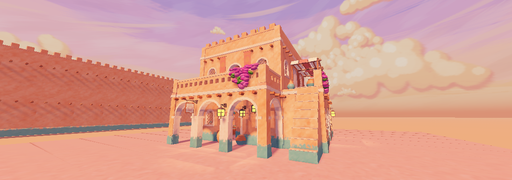

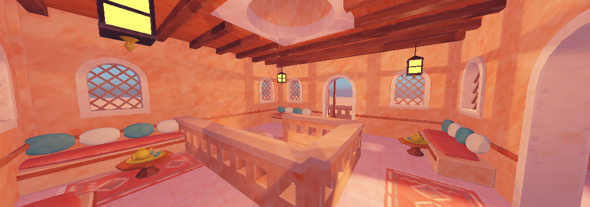

`Workspace.Buildings.TeaHouse` stands on a paved yard outside the town's south wall (x 150-182, z 420-452), and players spawn in front of it. It is the standard for every building from here on.

- **What it is:** 32 x 32 studs, 197 pieces. A porch of three arches; a hall round an arcaded atrium that is open through both stories to the dome; a counter with shelves behind it; stairs inside up to a gallery with balustrades; doors onto the porch roof and onto the wing roof, which has a pergola; a second flight of stairs outside. Divans, rugs, tea tables, 21 lanterns that light up, a sign, banners, bougainvillea.
- **How it is made:** the recipe `assets/buildings/teahouse.py` places kit pieces story by story. The Blender preview and the game both build from that one list (`BuildingData`, stood up by `Buildings/BuildingBuilder.luau`; `build/07_build_teahouse.luau` runs it).
- **24 new pieces** (see `assets/README.md`, "Dressed pieces and buildings"), 49 uploads, all approved (the first dome was replaced by one on a taller drum; models 92275624113220 and image 82345400361931 are unused). `stairs_narrow` is in use here. The kit is at 56 pieces.
- **Checked:** bots walk in at both doors, up both flights of stairs and onto both terraces (`build/tests/walk_teahouse.luau`, 6 of 6). Fourteen kinds of new piece were shot to zero health in a playtest and came apart without errors.
- **Lamps and low graphics.** The playtest client here runs on automatic (low) graphics, where lamps cast no shadows and shine through walls: at the first brightness the rooms washed out to white. Lamp range is set for that case (`BuildingConfig.luau`): a lamp lights its own cell and little more.
- **Indoor light (the owner: "something seems off... mainly interior lighting").** The rooms were purple and flat. Cause: Roblox's shade light leaks through walls and roofs one stud thick, so a room takes `Lighting.OutdoorAmbient` (violet), hardly `Lighting.Ambient`. Tested by setting OutdoorAmbient to orange: every room turned orange. Fix: the lamps do the warming (warmer and stronger, golden glass, four more lanterns in the atrium and a soft fill light under the dome), and OutdoorAmbient is a rosier violet. Target was the owner's interior concept, `reference/zones/tea-house.webp`: golden-pink rooms. Before and after: `assets/studio/teahouse-gallery-light-before-after.png`.
- **Light outside.** `build/03_lighting.luau` now also turns the bare ground to sand (it was the template's dark checkerboard), sets a peach-to-violet haze, switches the depth-of-field blur off and keeps bloom low enough that lamps do not throw a star off the rifle.
- **The sky is painted** (the owner said the indoor light was "much better", then this was finished). `assets/sky.py` paints the concept's violet sky with peach clouds stroke by stroke, 10,246 strokes on one flat picture of the whole sphere, and cuts it into six box faces; `build/08_sky.luau` sets them. Checked in Studio across the box edges from two opposite corners: no seams.
- **How Roblox turns the sky box** (found with `python sky.py test`, six labelled faces looked at along every axis): `SkyboxFt` looks along -Z and `SkyboxBk` along +Z, both upright; `SkyboxRt` is on the **-X** side and `SkyboxLf` on **+X**; on `SkyboxUp` the picture's right edge points to -Z and its top edge to +X; on `SkyboxDn` the right edge points to -Z and the top edge to -X. The table is in `sky.py`.
- Unused uploads from that test, safe to archive: images 107254333365792, 112165538698504, 113010172024457, 88017870290511, 108595521409435, 82504491675380.
- **The building is turned to face the afternoon sun.** A front in its own shade reads as dark terracotta. This will matter when the town is laid out.
- **Not done:** no painted background behind the wall (far towns, hills), no sandstorm. What hangs on a wall (lantern, banner, shelf, sign) stays in the air when the wall behind it is shot down. Frame rate is still unmeasured (this Studio session runs at 14 frames a second regardless). No door leaves in the doorways, no palm trees, no awnings on this building. The owner has not seen it in person yet.
- The old town (`Workspace.Map`) is still there, untouched, until the owner says what to do with it.

### The compact town, planned and grayboxed (same session)

The owner: "Yes, plan the town. Make it FPS optimized."

- **Plan v2** is in `plan/town.py` and written up at the top of `plan/PLAN.md`: 40 x 40 cells (320 studs), a market square, a landmark on each side (Tea House, Dye Works, Cistern Hall, Courtyard House), four houses in every corner. Five arenas, each a band of the town; all pass the planner's checks.
- **Graybox:** `Workspace.Graybox_town` at x = -700 (`build/09_graybox_town.luau`). Bots pass 41 of 41 routes (`build/tests/time_town_routes.luau`), within 3.2% of the planner's times.
- **"FPS optimized" was read both ways:** laid out for shooter play (lanes, timings, capped views, mirrored for fairness) and cheap to draw (small, short views, budgets per building, fewer shadow-casting lamps). The budgets are in `plan/PLAN.md`.
- **Frame rate could not be measured here**: 16 frames a second with an empty sky on screen. Triangle and draw-call counts were measured instead.
- **Redrawn uneven.** The owner: "No need to make it so symmetrical... give each player (when they spawn) enough options that its actually a hunt to find the player and a little bit tense (valorant kind of but for duels)". The first draft was a four-way mirror. The town in `plan/town.py` is now drawn by hand with every block different, the Tea House at its real 4 x 4 cells, and judged on new measures: places a player can be 4 and 7 s after spawning, places the two can collide, how much one spot can see, and an even split of the ground. Spawns are picked by search. All five arenas pass; bots pass 35 of 35 routes within 4.3%. The numbers above (41 routes, 3.2%) were the mirrored draft.
- The old town (`Workspace.Map`, 57,000 instances) is still in the place. It is the heaviest thing in it and can go once the owner agrees; `build/06_build_map.luau` rebuilds it.
- `GrayboxBuilder.build` now takes a town as well as a zone, and where to put it. `plan/out/plan.json` and `routes.json` carry the town under `towns.town`; `python plan/town.py` adds it (run it after `planner.py` or `routes.py`, which rewrite those files).

### Real buildings in the town: the Courtyard House (same session)

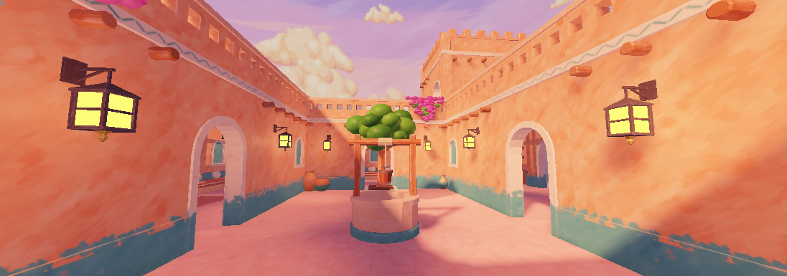

The owner: "Yes, build on" (stand the tea house in the town, build the next landmark to the same standard).

- **The town now has two real buildings** standing at their plan cells, the rest still gray boxes: `build/10_build_town.luau` (`Town/TownBuilder.luau`, `Town/TownConfig.luau`). The standalone tea house outside the old town is gone; `07_build_teahouse.luau` brings it back if wanted. Players spawn on the street in front of the Tea House.
- **Courtyard House** (`assets/buildings/courtyard.py`): 7 x 9 cells, 355 pieces, 90,000 triangles. A ring of long rooms two cells deep round a court with two orange trees and the well; a reception room, a kitchen under a one-room loft, a sitting room, a store, a guest room; 12 hanging lanterns, 16 wall lanterns; shuttered windows and pilasters on the street fronts; a pergola on the roof.
- **Its walls are generated from the plan** (`assets/buildings/layout.py`), so what is built is what was tested. Two new pieces: `wall2_shutter` and `tree`; 4 uploads, approved.
- **Bots: 35 of 35 routes pass through the real buildings**, five of them 10% to 16% slower than planned. The first run failed two routes and corrected the planner (no slantwise steps through doorways or past piers); see `plan/PLAN.md`.
- **Tea House changes:** its outside stairs are the full-width flight now (it fills its plan cell); the narrow flight is still the one inside.
- **The sun moved** to the south-west (latitude 58 in `03_lighting.luau`), so south and west fronts are both lit.
- **Not done / not checked:** the loft and both roofs of the Courtyard House cannot be reached (the plan has no stairs or ladder there). `build/tests/walk_teahouse.luau` was not re-run after the stairs changed. Nothing was shot down in the Courtyard House. The Courtyard House has not been seen by the owner. Frame rate unmeasured, as before.

### Roof props, the Dye Works, a paved town (same session)

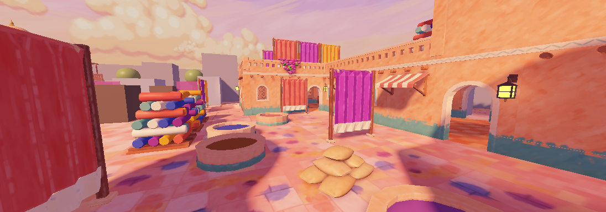


The owner: "Decorate the top of courtyard house with props. Then do Dye works and set up the map floor so its not grey, that way we can see the blend with buildings."

- **Courtyard House roof:** two orange trees in planters, three racks of drying cloth, a sitting corner, barrels, crates, sacks, a stack of cloth bolts, pots, a tea table under the pergolas, lanterns on the loft. 384 pieces, about 116,000 triangles now. The roof still cannot be reached.
- **Dye Works** (`assets/buildings/dyeworks.py`): 301 pieces, about 86,000 triangles. An L of workshops round the vat yard, an office over the south end, awnings, the dyers' sign. Walls and everything in the yard are generated from the plan. Eight new pieces (16 uploads, approved): three cloth racks, three more vat colours, the bolt stack, the sign. Three dye colour families measured from the owner's concept.
- **The plan gained two vats** in the dyers' yard; all five arenas still pass.
- **The town floor is flagstone** (`Workspace.TownGround`, 1,115 tiles). The gray slab is still underneath.
- **Bots: 35 of 35 routes** with all three buildings in; six are 10% to 19% slower than planned.
- **Not done / not checked:** nothing in the Dye Works or on the roof was shot down. The Dye Works roof and office cannot be reached. The awnings were placed without a close look at how they meet the wall. The yard was checked in Studio, not in a Blender render. Frame rate unmeasured.

### Floors with detail, props with a reason (same session)


The owner: "this is okay but make the floor much better and more detailed to fit the theme also dont just slap random props because you feel like it. make it fill space but make sense to portray a theme".

- **Floors.** Seven new pieces (14 uploads, approved): three flagstone layouts for streets, clay tiles with turquoise insets for rooms, brick for courts, yards, the porch and the Market Square, dye-splashed stones round the vats, and sand drifts at wall feet (173 of them, picked by cell). Every stone has its own tone. See `assets/README.md`.
- **Props.** The Courtyard House roof was scattered filler (barrels, crates, bolts, sacks, pots). It is now four uses: a washing line on the north wing, a roof garden on the west wing (two orange trees, a row of pots), a sitting terrace under the pergolas (rug, tea table, two divans), and the kitchen's store by the loft door (grain sacks, two barrels). The Dye Works roof is two: drying lines over the dye kitchen, finished bolts by the office door. Its office has a desk and ledgers instead of a bolt stack; two banners instead of four.
- **Rule for every building from here on:** name what each area is for, then place only the groups that belong to it.
- Bots: 35 of 35 routes after the change.
- **Not done:** the upper floors and roofs still use the plain `floor` piece (flagstones in one tone). The streets' cover, trees and unbuilt houses are still boxes. Tea House props were not reviewed against the new rule.

### The Cistern Hall, started (same session)


The owner: "fix up the above with this feedback then start next building".

- **What stands:** `assets/buildings/cistern.py`, 226 pieces, about 29,000 triangles, in the town at its plan cells. A pillared hall with two channels of water between the pillars, two spouts in the north wall, the well head over the middle, jars waiting to be filled; the keepers' room at the south end with the counter, barrels and jars; three rain tanks on the roof; a trough outside. Three new pieces (6 uploads, approved): `paving_channel`, `paving_pool`, `spout`.
- **The plan changed:** six cells of the hall are now shallow water indoors (`u`, a cell kind added in `plan/town.py`; the game side knows it too). All five arenas still pass. The pool south of the hall is laid in `paving_pool`.
- **Bots:** 35 of 35; the seven Cistern Hall routes are within 3% of the plan.
- **Still to do on it:** it is the plainest of the four. No arches between the pillars (the concept has them), the outside was not looked at closely, the fall of water from the spouts was not checked in Studio, and nothing was shot down. The water looks bluer in Studio than painted, because the shade light is violet. Wading does not slow anyone yet.

### The whole town, built, and it comes down (overnight, 2026-11-27)

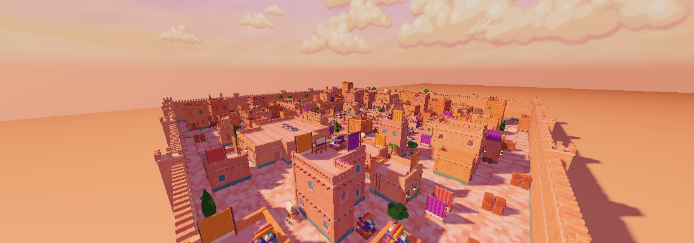


The owner, going to bed: "finish this entire map structure by structure... Do it in as much painstaking detail. Obsess over every building like it owes you money", "remember to make the environment fully destructible and physics based (buildings can collapse)", "Each house should feel, look, and be different. It should feel like a lively desert village".

**What stands now.** No gray boxes are left. `Workspace.Buildings` holds 52 recipes: the four large buildings, two small ones you can walk into, 44 houses, the street dressing and the town wall. 4,071 pieces, about 1,080,000 triangles, 210 lamps (52 of them cast shadows), on 1,034 paving pieces with 141 sand drifts. The kit has 95 pieces (19 new, 38 uploads, all approved).

- **The Cistern Hall is finished:** arcades over both channels, the water sellers' sign. 
- **44 houses** (`assets/buildings/houses.py`). Every solid block of the plan is a real, hollow, closed house. Each has an entry in `HOUSES`: who lives or works there, its own shade of plaster, its door, its sign, what its roof is used for, what stands outside it and what is inside. The list is in [assets/out/town-houses.md](assets/out/town-houses.md) and below. 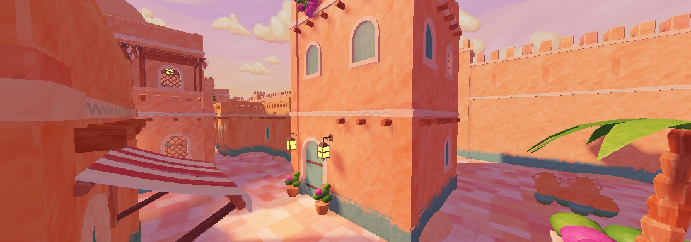 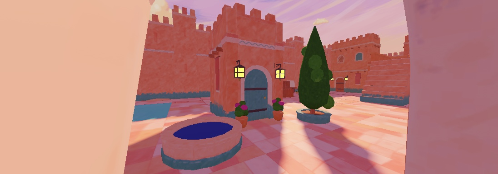
- **The Potters' Workshop** (`buildings/potters.py`): a U of open workrooms round the kiln yard; the kiln's fire is a light that goes out when the kiln is broken. **The Guard House** (`buildings/guardhouse.py`): one hall with the duty desk, two bunks and the guards' stores. Both take their walls from the plan like the large buildings. 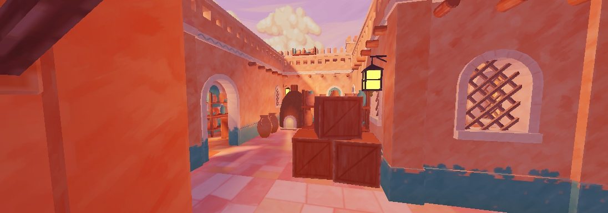 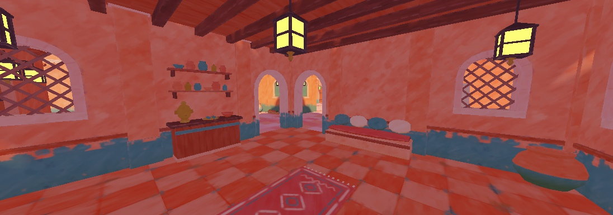
- **The streets** (`buildings/streets.py`): every cover spot, tree, cloth line, well, pillar, ladder, flight of stairs and plank of the plan, each named in a table with what it is and why it is there: stalls round the market well all facing it, the water carrier's cart loading at the well, the dyers' cloth across the east entrance of the square, pots waiting for the kiln, carts and a trough by the stable, seats outside the Tea House. A spot the plan has and the table does not name stops the build. 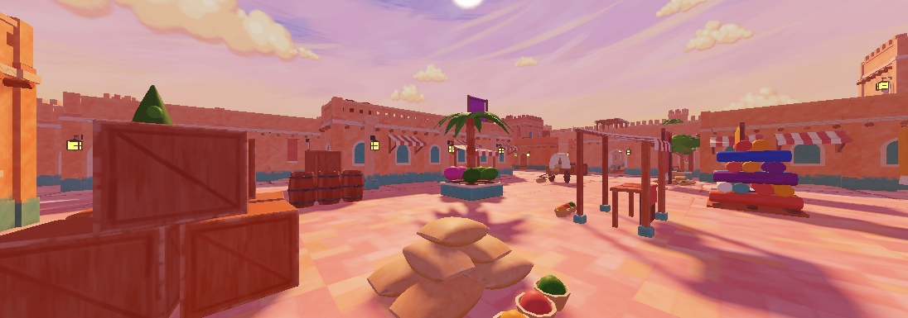 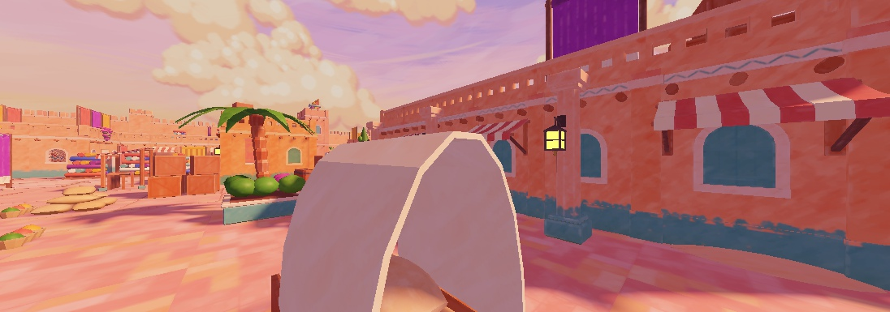
- **The town wall** (`buildings/walls.py`): two stories of plaster and battlements in the ring of cells the plan keeps solid, 21 towers, and the gate in the south wall at the end of the street through the Gate Quarter. Behind it stand unseen walls 80 studs high (`Workspace.TownEdge`), so a hole shot in the town wall lets nobody out. 
- **One command writes all of it:** `python -m buildings.town` in `assets/` writes every generated recipe and `out/town.json` (which recipe stands at which plan cell, and where no sand is banked); `pack.py` packs that as `Town/TownData`; `TownBuilder.build()` stands the town in about 2 seconds. `TownBuilder.build({ "house_04_03" })` rebuilds one recipe.

**Buildings collapse** (`Destruction/Structure.luau`, rules in `DestructionConfig.Structure`).


- At the start of a game every piece in `Workspace.Buildings` is linked to what holds it up, worked out from the boxes round the pieces: a floor rests on the walls under it, an upper wall on the wall or floor below, a parapet on its wall, furniture on its floor; a lantern hangs from its ceiling; a sign, a banner, an awning, a door leaf and a corner post are fixed to their wall. 3,661 pieces, 6,699 links, and not one piece with nothing to hold it.
- When a piece is destroyed, whatever it was the last thing holding comes down too, and so on up the building, running outward at 45 studs a second. Breakable pieces crumble into their shards from the bottom (`Breakable.collapse`); loose pieces (lanterns, signs, rugs, banners) drop and lie as rubble.
- A floor slab with no wall under it stands while two slabs beside it stand. So the end of a house falls when its walls go and the middle of a hall does not.
- A shot knocks a lantern, a sign or a banner down directly.
- **Tested in a playtest** (`build/tests/test_collapse.luau`): with the four ground walls of its west end destroyed, the Captain's House went from 72 pieces to 49, that end down through both stories and the rest standing; with all eight ground walls destroyed the three-story Watchtower went from 68 pieces to 2 (the crates and the bunk inside). With the dev rebuild on, everything stood again 30 seconds later, lamps and banners included.
- A rifle (30 damage, 600 shots a minute) takes about 4 seconds to bring down one wall, so about 12 seconds for the end of a small house. There is no explosive yet; `Breakable.blast` is ready for one.

**The plan still holds.** Bots walked all 35 routes through the finished town: **35 of 35**, four of them more than 10% slower than planned, the worst 14%. `plan/town.py` knows the piers of the Cistern Hall's arcades; all five arenas still pass every check.

**Decisions made while the owner was asleep. Say if any should change.**
- **Houses are closed.** The plan tested them as solid boxes, so their doors are shut and their ground floors have shutters, not open windows. A house can be shot open and is hollow inside, with a few things that say whose it is.
- **House doors take four times their health** (`DestructionConfig.Tough`): 400, a second and a half of rifle fire. At their real strength every house could be opened in half a second, and the plan counts on houses being closed.
- **Each house's shade of plaster** is the painted texture multiplied by a colour (`SurfaceAppearance.Color`, ten tints in `houses.py`), not a new painting per house. It keeps to the wall family and costs no uploads, but it shifts the turquoise band a little too.
- **Goods in the street keep off the cells the test bots walk through** unless they are shallow (pots of plants, baskets, vases). 67 street cells have goods.
- **The gate** is in the south wall at column 8. The plan only says "the gatehouse".
- **`DevConfig.TestHooks`** (on): a `DevDamage` function a test script can call. Turn it off with the other dev switches for the real game.
- **The old town (`Workspace.Map`, about 57,000 instances) and `Workspace.KitShowcase` were left alone.** Deleting them was never asked for. (The owner said yes the next morning; they are gone. See "The optimisation test".)

**Not done, not verified.**
- **Frame rate is still not measured.** (It is now: see "The optimisation test".) The town is about 1,080,000 triangles; the estimate in `plan/PLAN.md` was 700,000. Houses are 568,000 of it and the street dressing 135,000. The heaviest pieces by count are barrels, plain and shuttered walls, bougainvillea, divans and trees.
- Nothing was judged by a person. Every picture here was looked at, but the owner has not seen any of it.
- Rubble does not hurt anyone, and a player standing on a roof that falls just drops.
- All roofs but six cannot be reached; what is on them is to be looked at.
- Collapse was tested on two houses, not on every building. The large buildings were not shot at all.
- Water still does not slow anyone. Arena barriers, rounds and team spawns are not built.
- The low-detail meshes every piece has are still not used.

| The 44 houses | | | | | | | |
|---|---|---|---|---|---|---|---|
| CharcoalShed | the charcoal burner's shed | 4 | 1 | clay | store | 37 | 10432 |
| TeaMerchantsHouse | the tea merchant's house, behind the tea garden | 8 | 2 | apricot | sitting | 78 | 24524 |
| ClayStore | the potters' clay store | 2 | 1 | terracotta | pots | 27 | 6188 |
| Watchtower | the watchtower | 4 | 3 | sand | lookout | 79 | 16756 |
| Barracks | the barracks: an L of two stories | 12 | 2 | peach | sleeping | 140 | 24996 |
| TeaStore | the tea store and packing rooms, across the lane from the Tea House | 8 | 1 | sand | drying | 90 | 22532 |
| Inn | the inn: a tall house with a low porch | 5 | 1/2 | rose | garden + sitting | 78 | 26692 |
| MasterPotter | the master potter's house | 4 | 2 | ochre | pots | 64 | 15088 |
| WatchmansHouse | the watchman's house | 2 | 1 | blush | garden | 34 | 9352 |
| GlazeStore | the glaze store, against the town wall | 2 | 1 | clay | kitchen | 27 | 6132 |
| Quartermaster | the quartermaster's store; a ladder goes up to its roof | 7 | 1 | sand | store | 67 | 17052 |
| ScribesHouse | the scribe's house, narrow and tall | 3 | 2 | dusk | garden | 59 | 15360 |
| OilStore | the lamp-oil store, against the town wall | 2 | 1 | ochre | tanks | 26 | 5776 |
| Bakery | the bakery | 4 | 1 | apricot | kitchen | 48 | 10752 |
| DryingLoft | the drying loft; a ladder goes up to its roof, where pots dry | 4 | 1 | peach | pots | 47 | 11168 |
| CaptainsHouse | the captain's house | 6 | 2 | lilac | sitting | 86 | 19780 |
| PottersGuild | the potters' guild hall, and its shop at the south end | 8 | 1/2 | terracotta | pots + pots | 113 | 26056 |
| Armourer | the armourer's workshop | 3 | 2 | clay | washing | 57 | 13468 |
| GlazeMixer | the glaze mixer's shed | 2 | 1 | sand | kitchen | 38 | 8056 |
| Cobbler | the cobbler's shop | 2 | 1 | rose | sleeping | 33 | 7240 |
| ShopRow | a row of six lock-up shops facing the market street | 6 | 1 | sand | shops | 82 | 19184 |
| MarketKiosk | the sherbet seller's kiosk; stairs go up to its roof terrace | 4 | 1 | peach | sitting | 45 | 11236 |
| MordantStore | the dyers' mordant store, built onto the Dye Works | 2 | 1 | dusk | cloth | 25 | 6564 |
| GardenersShed | the gardener's shed, against the town wall | 2 | 1 | blush | garden | 28 | 8816 |
| WeighHouse | the weigh house | 4 | 1 | ochre | store | 51 | 13228 |
| Carpenter | the carpenter's workshop | 2 | 1 | clay | store | 33 | 7880 |
| Arcade | the arcade: six cloth merchants' shops behind the pillars | 6 | 1 | peach | shops | 78 | 23756 |
| DyersHouse | the dyer's house | 2 | 2 | lilac | cloth | 46 | 10968 |
| WoolStore | the wool store | 2 | 1 | sand | drying | 35 | 6068 |
| Farrier | the farrier's forge | 2 | 1 | terracotta | store | 36 | 8988 |
| Grocer | the grocer's | 2 | 1 | apricot | drying | 38 | 8360 |
| CustomsHouse | the customs house, on the street to the gate | 4 | 2 | dusk | lookout | 66 | 14700 |
| WeaversWorkshop | the weavers' workshop; a plank crosses to its roof | 6 | 1 | rose | cloth | 61 | 10712 |
| FodderBarn | the fodder barn | 4 | 1 | sand | store | 43 | 9760 |
| CardersHouse | the carder's house; a ladder goes up to its roof | 4 | 1 | peach | washing | 38 | 7320 |
| WaterCarriers | the water carriers' house | 4 | 1 | blush | tanks | 46 | 10236 |
| MasterWeaver | the master weaver's house | 7 | 2 | lilac | cloth | 93 | 25412 |
| CartersLodge | the carters' lodging house | 6 | 2 | clay | washing | 80 | 16792 |
| Stable | the stable; stairs go up to its hay roof | 4 | 1 | ochre | store | 45 | 9608 |
| SpinnersCottage | the spinner's cottage | 2 | 1 | blush | cloth | 35 | 8624 |
| Shrine | a wayside shrine: one small whitewashed room | 1 | 1 | peach | bare | 26 | 5132 |
| Gatehouse | the gatehouse, beside the town gate | 2 | 2 | sand | lookout | 49 | 11480 |
| WashHouse | the wash house, by the overflow pool | 4 | 1 | dusk | washing | 46 | 9092 |
| WeaversShed | the weavers' shed, against the town wall | 4 | 1 | apricot | cloth | 33 | 6264 |

Notes for the next session:
- Studio's command bar (and an MCP `execute_luau`) gets its own copies of the modules. A test that calls `Breakable.damage` itself breaks the wall, but the running game's `Structure` never hears of it. Go through `ServerStorage.DesertFps.DevDamage`.
- `python -m buildings.town` needs `plan/out/town.json` and `routes.json` (run `plan/town.py` first after changing the plan).
- The Studio viewport on this machine is 1096 x 385, so screenshots are small and wide. `python preview.py teahouse` gives a larger Blender render for judging shape.
- `bmesh.ops.triangulate` and friends need `normal_update()` first on a freshly built mesh, or faces with a notch in them are cut wrongly.
- Test bots made with `CreateHumanoidModelFromDescription` log "Unable to load rbxasset://avatar/characterR15V3.rbxm" and six asset-type warnings in this Studio. They still walk.
- `Lighting.Technology` cannot be set by script any more. "Future" is now `LightingStyle = Realistic` with `PrioritizeLightingQuality = true`.
- `plan/planner.py` loads its fonts from a Linux path, so it cannot redraw the plan images on Windows. `plan/routes.py` works.
- Script changes go in `game/`, then `python build/pack.py`, then run `build/01_install_modules.luau` (it replaces scripts one by one and leaves the imported meshes alone).
- Uploads go through the Studio MCP from an approved folder. A `desert-fps` folder in the owner's Documents is approved; the repo is cloned in it, with a Python environment (`.venv`, Blender module 5.3) beside the clone.
- `assets/run.py` on Windows repaints the crate, barrel, door and two of the walls differently from the committed textures (the texture layout shifts with tiny rounding differences). So the committed meshes and textures were kept, and `assets/rebundle.py` rewrote only the `.fbx` files from the `.obj` meshes. Do not re-run `run.py` just to change export settings.
- Unused test uploads on the owner's Roblox account, safe to archive in the Creator Dashboard: models 99802333338004, 136057078609739, 126807788706610, 91141018994234.
- Roblox has no roughness number on a SurfaceAppearance. Nothing shines because `EnvironmentSpecularScale` is 0 and no roughness or metalness map is set.
- Shade in Roblox is lavender (look rule). In the Blender render it is warmer, because Blender bounces light off the orange ground.
- A few dark pin-pricks show along shard seams once a wall is in shards. Not investigated.
- Clients preload every kit mesh at start (`Preload.client.luau`). Without it, the shards of a piece appear one by one over about a second the first time it cracks.

### The optimisation test (2026-11-27)

The owner: "Can we test optimization on this map", with a list of what matters more than the triangle total (reused meshes, draw calls and materials, collisions, streaming) and "see what applies; due to our method some things may not apply here". The old town and the kit showcase were deleted first, on the owner's yes.

**The outcome.** Standing still, the town is cheap: it holds 60 frames a second from every viewpoint at the highest graphics level on this PC's integrated graphics. What was slow was a building coming down, and that is fixed for a house and four times better for the largest building.

**Measured standing still** (`build/tests/measure_views.luau`; graphics level 21, a 1096 x 385 window, Intel UHD P630; Studio caps at 60):

| Viewpoint | Draw calls | Triangles on screen | Frames a second |
|---|---|---|---|
| Spawn, looking south to the market | 86 | 393,000 | 60 |
| Market middle, looking west | 73 | 276,000 | 60 |
| Watchtower roof, the whole town in view | 93 | 703,000 | 60 |
| South-east street, looking north-west | 86 | 487,000 | 60 |
| Gate street, looking north | 91 | 681,000 | 58 |

- The processor spends 5 to 9 ms of each 16.7 ms frame on drawing. The game's own scripts are 0.1% of script time.
- From the watchtower roof the graphics chip is about 93% busy at level 21 and 58% at level 1. So this chip is at its limit there at the top level, in a small window.
- The triangle count is the same at every graphics level. Roblox only swaps in lighter meshes beyond 250 studs, and the town is 320 studs across.

**The owner's four points, checked.**
- **Reused meshes:** good as it is. 5,454 mesh parts are 70 different meshes and 80 textures.
- **Draw calls and materials:** good as it is. 65 to 93 draw calls for anything in view (211 at graphics level 10). One material, no transparency.
- **Collisions:** this is where the cost was. See below.
- **Streaming:** on already (192 / 384 studs). The whole town fits inside that, so everything stays loaded, which is right for a duel map this size: with a shorter reach, far walls would vanish from the roofs.

**What was wrong with collisions.**
- `KitImporter` set each mesh's collision shape after the mesh part existed. The property changed, the shape did not, and every clone went back to the default. So every placed piece and all 539 kinds of rubble collided as the default set of blocks. Now the shape is asked for as the part is made (`AssetService:CreateMeshPartAsync`), and it sticks: in the town, 616 pieces are precise, 2,109 are boxes, 4 are hulls and 2,725 are default; every shard is a hull.
- On its own that changed little. The cost of a collapse was rubble colliding with rubble.

**What changed for a collapse** (`DestructionConfig`):
- `RubbleStacks = false`: rubble lands on the ground and on what stands, and passes through other rubble.
- `RubbleBudget = 300`, `LightRubbleSeconds = 1.5`: with 300 shards already down, the next piece to crumble drops through the ground in one piece and is gone in a second and a half.

| Brought down at once (`build/tests/measure_collapse.luau`) | Before | After |
|---|---|---|
| Watchtower, 68 pieces: worst server frame | 169 ms | 34 ms |
| Watchtower: server frames over 33 ms | 69 | 1 |
| Watchtower: contacts at the peak | 35,610 | 4,651 |
| Watchtower: worst frame on the client | 162 ms | 37 ms |
| Courtyard House, 263 pieces: worst server frame | 689 ms | 119 ms |
| Courtyard House: pieces moving at the peak | 1,765 | 587 |

The Courtyard House "before" is with hull shards and no stacking but no budget; it was not measured in the first state. Pictures: `assets/studio/perf-watchtower-roof-view.jpg`, `assets/studio/perf-courtyard-house-collapse.jpg`.

**Also changed.**
- Clients no longer preload the 95 low-detail meshes, which are not placed anywhere (`Main.server.luau`).
- `Workspace.Map` (the old town) and `Workspace.KitShowcase` are gone: 57,888 instances. A copy is in `backups/old_town_and_showcase.rbxm`, and `build/05_kit_showcase.luau` and `06_build_map.luau` rebuild them. Four tests need them: `break_wall.luau`, `climb_stairs.luau`, `time_all_routes.luau`, `time_market_routes.luau`.
- The kit was imported again (4 minutes 51 seconds for 779 meshes) and the town rebuilt from it. Backup: `backups/town_optimized_with_kit.rbxm`. Place version 56.

**Checked after the change.** The test bots pass 35 of 35 routes; two run more than 10% slower than planned (worst 14%), where it was four before. The Watchtower still comes down to 2 pieces of 68.

**Decisions made here.**
- Rubble not piling up is a change to how a collapse looks: the rubble spreads flatter. It was judged on two screenshots. One line in `DestructionConfig` turns it back.
- The budget of 300 was picked by measuring, on this PC, which runs the server, the client and Studio together.

**Not done, not verified.**
- **Not measured on a phone, on a normal graphics card, or at full window size.** The graphics chip's own time per frame cannot be read here; "percent busy" is a rough guide.
- The collapse numbers are from Studio, where the server and the client share one processor. A live server has its own.
- The Courtyard House still gives a 119 ms frame when all 48 of its ground walls go in the same instant. No weapon does that yet.
- 700,000 triangles from a roof at the lowest graphics level is untested on a weak phone. The low-detail meshes every piece has (35% fewer triangles for the whole town) are still not used.
- The Captain's House test and `walk_teahouse.luau` were not run again.

Notes for the next session:
- Set a MeshPart's collision shape only through `CreateMeshPartAsync`. To check a shape, clone the part and read the clone, or cast rays at it: the property on the original can lie. At run time it always reads as Default.
- Studio's frame rate here is capped at 60 and sometimes drops to 15 for no reason the game causes. Before trusting a timing, set the graphics level by hand (Automatic falls to level 1) and read the frame time with the camera on the sky.
- Run `time_town_routes.luau` once per playtest. A second run in the same playtest comes out about 30% slow on every route.
- A Studio plugin (Elttob Reclass) costs about 9 ms of every frame in a playtest. It is not part of the game.
- After a collapse the dev rebuild sometimes takes two rounds: a few pieces stand up before what holds them and fall again.

### Job 0: set up
1. Check out branch `claude/stoic-faraday-5tm9kr` and pull.
2. Read `desert-fps/README.md`, `plan/PLAN.md` and `assets/README.md`.
3. Confirm Roblox Studio is open and its MCP server is on (Studio: Assistant, Manage MCP servers, enable Studio as MCP server). Inspect the open place before changing it.
4. If the place has never been saved, ask the owner once where it should live, then save there.

### Job 1: import and scale test
1. Import `wall_plain`, `crate` and `rifle` (try the `.fbx` first).
2. Measure them. Expected: the wall is 8 wide, 12 tall, 1 thick (plus a small plinth); the crate is 3 studs; the rifle is 3.3 studs long.
3. If the scale or the up-axis is wrong, fix the export in `assets/build.py` (`Piece.export`), re-run `python3 assets/run.py`, and import again. Do not rescale by hand in Studio.
4. Stand a Roblox character next to the wall and the doorway (4 x 7.6 studs) and take a screenshot.

### Job 2: the matte painted look
1. Apply each texture as a SurfaceAppearance colour map with full roughness and zero metalness.
2. Set the lighting from section 2.
3. Screenshot the pieces and compare with `assets/out/compare.png`. Adjust the lighting, not the textures, until they match.

### Job 3: import the rest
Import the other pieces, including the shards and the weapon parts. If Studio's importer is too slow for this many files, upload by code with a Roblox Open Cloud API key (ask the owner for one; never have it pasted into chat).

### Job 4: break test
1. Assemble one `wall_plain` from its 12 shards using `center` from `wall_plain.break.json`.
2. Write a small server script that removes every shard within a radius of a point, and drops any shard left with no path through `neighbors` to a `grounded` shard.
3. Screenshot the result. It should look like `assets/out/broken.png`.
4. Suggested design: show the single whole mesh until a piece is first damaged, then swap it for its shards, so undamaged walls cost one part each.

### Job 5: graybox
1. Write a Luau builder that reads `plan/out/plan.json` and builds one zone (start with Market Square) from gray parts: buildings by height, thin walls on the edges of interior cells with gaps for doors and windows, cover, stairs, ladders, planks, spawns, and barriers on the zone's border openings.
2. Playtest it. Time the routes from each spawn to the middle and compare with `plan/out/metrics.json`.
3. Report the differences. Fix the map in `plan/zones.py` and re-run the planner; do not hand-edit the graybox.

### After that
Ask the owner what to pilot next. The likely order is: the rifle in first person with a basic fire and reload, then the rest of the kit.

## 7. Roblox limits to keep in mind
- 20,000 triangles per mesh.
- Roblox only draws the front of a face. Inside-out faces vanish.
- Two faces in the same place flicker. Keep them at least 1/20 stud apart.
- Skybox: two side faces and the top are oriented differently from a plain cube unwrap.
- Red particles read as blood and can trigger moderation.

## 8. Rebuilding assets
Only needed to change a piece. On any machine with Python 3.11 or newer:

```bash
pip install bpy pillow numpy
```

```bash
python3 desert-fps/assets/run.py
```

```bash
python3 desert-fps/assets/preview.py
```

`run.py` exits with an error if any piece breaks a geometry rule. A piece is not done until it passes and a render has been looked at.
