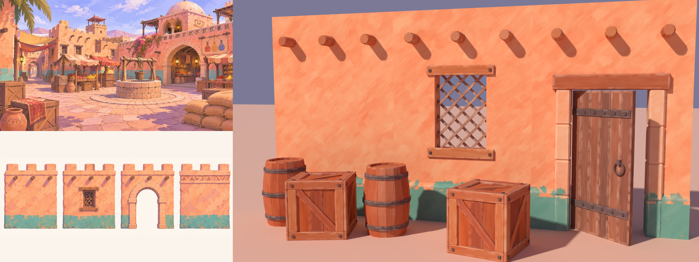

# Desert Village asset kit

Every piece is a **recipe**: a small program that builds the model and paints its texture. Nothing is generated by an image or 3D model; nothing is edited by hand. To change a piece, change its recipe or a number in `config.py` and run it again.



## Run

```bash
pip install bpy pillow numpy
```

```bash
python3 run.py
```

```bash
python3 preview.py
```

`run.py` builds every piece (or the ones you name, e.g. `python3 run.py crate barrel`). `preview.py` renders them together and puts the render next to the concept art.

## Pilot pieces

| Piece | Triangles | Low-detail | Brush strokes | Texture density |
|---|---|---|---|---|
| `wall_plain` | 256 | 160 | 5,423 | 52.6 px/stud |
| `wall_window` | 676 | 468 | 7,009 | 52.6 px/stud |
| `wall_door` | 700 | 316 | 11,939 | 45.0 px/stud |
| `door` | 688 | 216 | 6,096 | 70.2 px/stud |
| `crate` | 1,468 | 588 | 20,082 | 52.2 px/stud |
| `barrel` | 728 | 360 | 2,697 | 125.8 px/stud |

Each piece folder in `out/` holds the mesh (`.fbx` and `.obj`), the low-detail mesh (`_low`), one 1024 px texture shared by both, and `report.json`.

## Files

| File | What it does |
|---|---|
| `config.py` | Every number: scale, texture size, palette, paint rules, piece sizes, triangle budgets |
| `recipes/` | One file per kind of piece |
| `build.py` | Builds closed solids, unwraps them, bakes the paint guides, checks and exports |
| `brush.py` | Flat-brush engine: each stroke is a centre, length, width, angle and colour |
| `paint.py` | The look rules, applied stroke by stroke |
| `run.py` | Runs recipes |
| `preview.py` | Renders the pieces and the comparison sheet |

## Rules built into the scripts

**Look**
- One colour family per material, measured from the concept art.
- Every surface starts as one flat colour.
- Each stroke is one small step lighter or darker than the paint under it.
- Plaster strokes all lean up and to the right; wood strokes follow the grain.
- Turquoise only as a band at the foot of the walls, with a wandering top edge.
- No painted shadows. Where surfaces meet, a dark glaze that leans toward lavender, never gray.
- A pale glaze on protruding edges.
- No noise, no gradients, no generated textures.

**Geometry** (`run.py` fails a piece that breaks one)
- Every part is a closed solid, with no inside-out faces.
- No two parts show the same plane in the same place (would flicker in Roblox).
- Under Roblox's 20,000 triangle limit and under the piece's own budget.
- Wall pieces all share one base colour and get no edge highlight where they meet, so neighbours join without a seam.

## Not verified yet
- Nothing has been imported into Roblox Studio. The scale (1 unit = 1 stud; the `.fbx` is exported at 0.01) and the matte look need checking on the first import.
- The preview is a Blender render with a sun and lavender ambient light set up to resemble the planned Roblox lighting. It is not Roblox.
