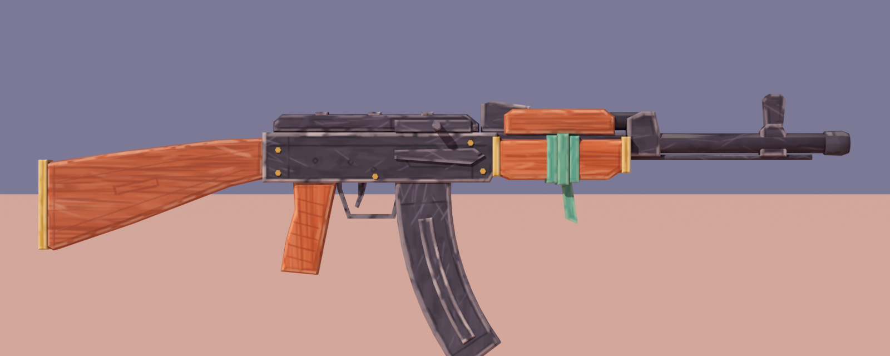
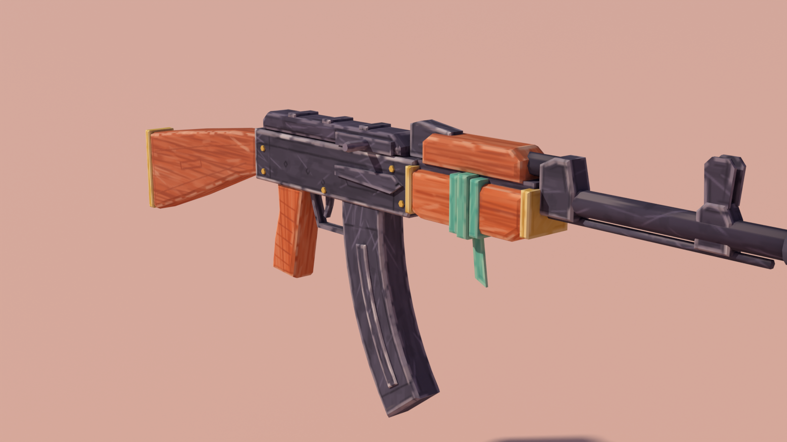

# Desert Village asset kit

Every piece is a **recipe**: a small program that builds the model and paints its texture. Nothing is generated by an image or 3D model; nothing is edited by hand. To change a piece, change its recipe or a number in `config.py` and run it again.


## Run

```bash
pip install bpy pillow numpy
```

```bash
python3 run.py
```

```bash
python3 preview.py
```

`run.py` builds every piece (or the ones you name, e.g. `python3 run.py crate barrel`). `preview.py` renders them whole, renders a blast-damage scene, and puts the render next to the concept art. `python3 preview.py rifle` renders the rifle.

## Pilot pieces

| Piece | Triangles | Low-detail | Breaks into | Shard triangles (all) | Brush strokes | Texture density |
|---|---|---|---|---|---|---|
| `wall_plain` | 256 | 160 | 12 shards | 496 | 6,606 | 45.5 px/stud |
| `wall_window` | 676 | 468 | 12 shards + lattice | 948 | 7,260 | 45.5 px/stud |
| `wall_door` | 700 | 316 | 11 shards + lintel | 900 | 10,904 | 44.8 px/stud |
| `door` | 688 | 216 | 6 shards | 1,412 | 6,771 | 62.5 px/stud |
| `crate` | 1,468 | 588 | 8 shards (debris) | 1,660 | 22,890 | 47.0 px/stud |
| `barrel` | 728 | 360 | 7 shards (debris) | 828 | 4,828 | 75.7 px/stud |
| `rifle` | 1,676 | 708 | not breakable: 4 moving parts | 1,676 | 12,639 | 271.0 px/stud |

Each piece folder in `out/` holds:
- the whole mesh (`.fbx` and `.obj`) and a low-detail mesh (`_low`)
- `chunks/`: one mesh per shard
- one 1024 px texture shared by all of them
- `<piece>.break.json`: the data the game needs to break it
- `report.json`

These are finished files. Importing them into Roblox later needs no rebuild.

## Destruction


Every piece is cut into jagged shards ahead of time, because cutting meshes live is too heavy for Roblox. Random points are scattered through the piece and each shard is the region closest to one point, so shards are angular, uneven in size, and their break faces lean through the wall. Every cut face is filled in and painted with what is inside: mud brick for walls, raw wood for boards.

Two modes, set per piece in `config.py` under `BREAK`:

| Mode | Used for | How it works |
|---|---|---|
| `chunks` | walls, doors | Each shard has its own health and stays until it is destroyed. A blast removes the shards it reaches and leaves a jagged hole. |
| `shatter` | crates, barrels | The prop has one health. When it breaks, it is swapped for its shards as flying debris. These shards are cut from the low-detail mesh. |

What rides along:
- Beam ends, studs and jamb blocks stay whole and belong to the shard they sit in.
- The window lattice and the door lintel break on their own, with their own health.

`<piece>.break.json` lists, for every shard: its mesh, bounding-box centre and size (Roblox axes), main material, health, whether it stands on the ground, which piece edges it touches, and which shards it touches. That is enough for the game to drop anything left with no path to the ground.

To change how a piece breaks, edit its line in `BREAK`: `shards` (how many), `slant` (how far the break faces lean), `apart` (even sizes vs a mix of slabs and bits), `seed` (a different crack pattern). Health values are placeholders until weapon damage exists.

**Suggested use in the game:** show the single whole mesh until a piece is first damaged, then swap it for its shards. Undamaged walls then cost one part each, not twelve.

## Weapons





The assault rifle was built without concept art, from the proportions of a real wooden-furniture, curved-magazine service rifle (about 880 mm long), thickened by 20% so it reads on screen, then painted with the same brush rules as the map.

- **Size:** 3.3 studs long. The barrel points along +X and the origin is the top of the pistol grip.
- **Not breakable.** It splits into four separate meshes so it can be animated: `body`, `magazine`, `bolt` (carrier and charging handle) and `trigger`. `rifle.parts.json` gives where each one sits.
- **Finer brush.** Small objects use the map's paint rules at one fifth the brush size (`DETAIL_SCALE` in `config.py`).
- **Extra hand-painted detail** (`STYLE` in `config.py`), only on pieces seen up close:
  - every sharp edge gets a brushed highlight in the material's own colour, with a thin dark stroke just inside it
  - wood gets dark grain lines and pale scuffs; metal gets grime dabs and bright scratches; the cloth gets folds
  - the round barrel gets a brushed highlight along its length
  - detail lines painted where modelling isn't worth it (`p.mark` in the recipe): ejection port, panel lines, pins, magazine seams, sling slot, grip hatching, handguard grooves
- **Shape language.** Every part is a side-view outline in millimetres in `recipes/rifle.py`, pushed through its thickness and rounded. Change a number and run it again.

## Files

| File | What it does |
|---|---|
| `config.py` | Every number: scale, texture size, palette, paint rules, piece sizes, triangle budgets |
| `recipes/` | One file per kind of piece |
| `build.py` | Builds closed solids, unwraps them, bakes the paint guides, checks and exports |
| `chunks.py` | Cuts a piece into jagged shards, fills the cut faces, writes the break data. Also splits off moving parts (weapons). |
| `brush.py` | Flat-brush engine: each stroke is a centre, length, width, angle and colour |
| `paint.py` | The look rules, applied stroke by stroke |
| `run.py` | Runs recipes |
| `preview.py` | Renders the pieces and the comparison sheet |

## Rules built into the scripts

**Look**
- One colour family per material, measured from the concept art.
- Every surface starts as one flat colour.
- Each stroke is one small step lighter or darker than the paint under it.
- Plaster strokes all lean up and to the right; wood strokes follow the grain.
- Turquoise only as a band at the foot of the walls, with a wandering top edge.
- No painted shadows. Where surfaces meet, a dark glaze that leans toward lavender, never gray.
- A pale glaze on protruding edges.
- No noise, no gradients, no generated textures.

**Geometry** (`run.py` fails a piece that breaks one)
- Every part is a closed solid, with no inside-out faces.
- No two parts show the same plane in the same place (would flicker in Roblox).
- Under Roblox's 20,000 triangle limit and under the piece's own budget.
- Wall pieces all share one base colour and get no edge highlight where they meet, so neighbours join without a seam.
- Every shard is checked the same way as a whole piece.
- Contact shading is only painted between parts of the same shard, so a destroyed shard leaves no shadow behind on the wall.
- Break lines get no edge highlight, so cracks are invisible until the piece breaks.

## Not verified yet
- Nothing has been imported into Roblox Studio. The scale (1 unit = 1 stud; the `.fbx` is exported at 0.01) and the matte look need checking on the first import.
- The rifle has no animations, sounds or firing code, and has not been seen in first person in Roblox.
- No destruction code exists in the game yet. The shards and break data are ready for it, but removing shards, debris and falling unsupported shards are untested in Roblox.
- The preview is a Blender render with a sun and lavender ambient light set up to resemble the planned Roblox lighting. It is not Roblox.
