# Desert Village asset kit

Every piece is a **recipe**: a small program that builds the model and paints its texture. Nothing is generated by an image or 3D model; nothing is edited by hand. To change a piece, change its recipe or a number in `config.py` and run it again.


## Run

```bash
pip install bpy pillow numpy
```

```bash
python3 run.py
```

```bash
python3 preview.py
```

`run.py` builds every piece (or the ones you name, e.g. `python3 run.py crate barrel`). `preview.py` renders them whole, renders a blast-damage scene, and puts the render next to the concept art. `python3 preview.py rifle pistol knife smoke` renders the weapons.

## Pilot pieces

| Piece | Triangles | Low-detail | Breaks into | Shard triangles (all) | Brush strokes | Texture density |
|---|---|---|---|---|---|---|
| `wall_plain` | 256 | 160 | 12 shards | 496 | 6,606 | 45.5 px/stud |
| `wall_window` | 676 | 468 | 12 shards + lattice | 948 | 7,260 | 45.5 px/stud |
| `wall_door` | 700 | 316 | 11 shards + lintel | 900 | 10,904 | 44.8 px/stud |
| `door` | 688 | 216 | 6 shards | 1,412 | 6,771 | 62.5 px/stud |
| `crate` | 1,468 | 588 | 8 shards (debris) | 1,660 | 22,890 | 47.0 px/stud |
| `barrel` | 728 | 360 | 7 shards (debris) | 828 | 4,828 | 75.7 px/stud |
| `rifle` | 1,772 | 756 | not breakable: 11 parts | 1,772 | 11,039 | 265.9 px/stud |
| `pistol` | 996 | 476 | not breakable: 8 parts | 996 | 10,103 | 453.5 px/stud |
| `knife` | 1,328 | 560 | not breakable: 4 parts | 1,328 | 3,973 | 1,094.4 px/stud |
| `smoke` | 632 | 348 | not breakable: 4 parts | 632 | 3,634 | 931.5 px/stud |

## The rest of the kit

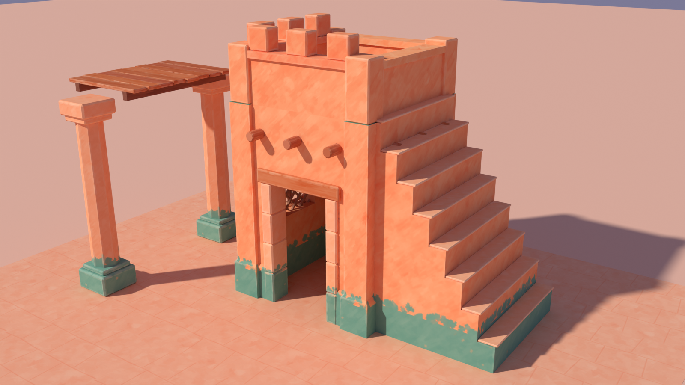

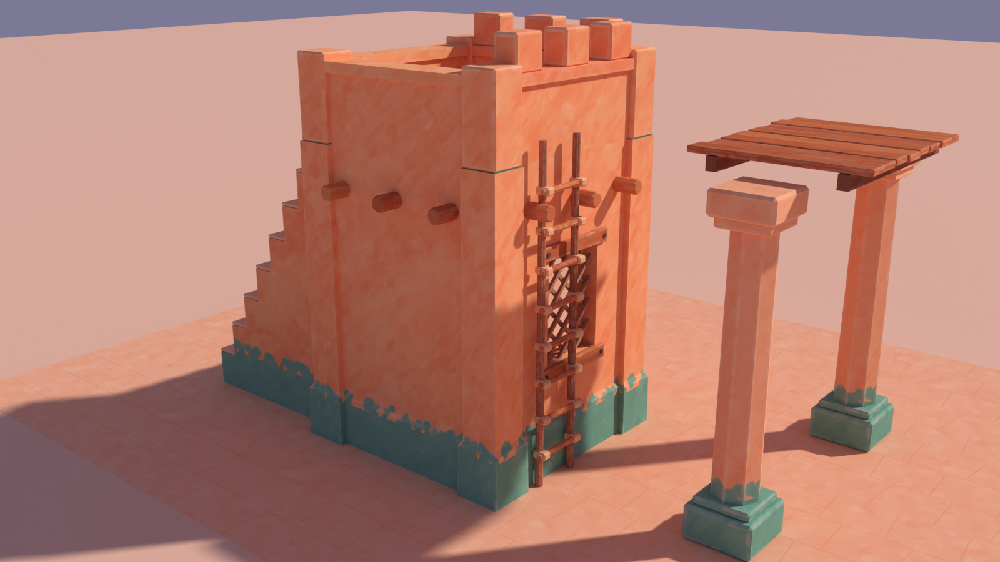

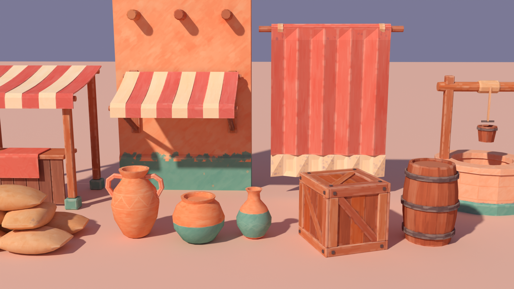

Built on the PC session, with the same rules. Everything snaps to the 8-stud cell and the 12-stud story.

| Piece | Triangles | Low-detail | Breaks into | Brush strokes | Texture density |
|---|---|---|---|---|---|
| `corner` | 28 | 44 | 4 shards | 2,628 | 69.5 px/stud |
| `pillar` | 204 | 68 | 5 shards | 3,452 | 66.3 px/stud |
| `parapet_plain` | 24 | 24 | 5 shards | 2,618 | 65.2 px/stud |
| `parapet_crenel` | 156 | 60 | 5 shards | 3,658 | 61.7 px/stud |
| `parapet_corner` | 44 | 12 | 2 shards | 580 | 175.9 px/stud |
| `roof` | 120 | 72 | 7 shards | 8,710 | 48.8 px/stud |
| `stairs` | 420 | 164 | 6 shards | 30,444 | 23.5 px/stud |
| `ladder` | 984 | 248 | 5 shards (debris) | 8,643 | 64.8 px/stud |
| `plank` | 376 | 120 | 6 shards (debris) | 8,396 | 57.6 px/stud |
| `ground` | 12 | 12 | not breakable | 1,750 | 61.7 px/stud |
| `stall` | 1,196 | 828 | 10 shards (debris) | 30,218 | 33.4 px/stud |
| `awning` | 712 | 632 | 5 shards (debris) | 10,421 | 46.2 px/stud |
| `cloth` | 400 | 336 | 4 shards (debris) | 3,553 | 59.2 px/stud |
| `sacks` | 1,484 | 476 | 6 shards (debris) | 8,034 | 70.0 px/stud |
| `well` | 804 | 408 | 10 shards (debris) | 22,387 | 52.2 px/stud |
| `pot_tall` | 456 | 222 | 5 shards (debris) | 5,248 | 114.2 px/stud |
| `pot_round` | 300 | 146 | 5 shards (debris) | 3,596 | 132.6 px/stud |
| `vase` | 380 | 184 | 4 shards (debris) | 2,914 | 158.5 px/stud |

How they fit together:
- **Walls stand on the cell edges.** Where two walls meet, a `corner` post closes the notch between them. A `parapet_corner` does the same for parapets.
- **A `roof` slab fills a cell** at the top of the story. Its top is 0.06 studs above the wall tops, so it covers the inner half of them without flickering. Its three beams line up with the beam ends on the wall pieces.
- **Parapets stand on top of the walls.** They have no plinth and no turquoise band; the band belongs at the foot of the ground floor.
- **`stairs` fill one cell** and climb one story towards the building (8 steps, 1.5 studs each). In Roblox they collide as one ramp.
- **A `ladder` is only the look.** It needs a TrussPart beside it to be climbed.
- **`cloth` spans one cell** between two walls and does not block players.
- **`ground` is one cell of paving.** Its top is 0.5 studs above its origin.

New materials, measured from `reference/props` and `reference/kit/awnings`: `canvas` and `redcloth` (awnings, stall roofs, hanging cloth), `burlap` (sacks), `clay` (pots), `rope`, `paving`. Patterns follow the same rule as the crate boards: stripes are separate strips of cloth in two colours, and a pot's glaze is its own solid. Nothing is painted as a picture. The zigzag on the tall jar, the diamonds on the vase, the well's block joints and the paving joints are painted detail lines.

Each piece folder in `out/` holds:
- the whole mesh (`.fbx` and `.obj`) and a low-detail mesh (`_low`)
- `<piece>.bundle.fbx`: every mesh of the piece as separate objects in one file, so a piece is one upload to Roblox
- `chunks/`: one mesh per shard
- one 1024 px texture shared by all of them
- `<piece>.break.json`: the data the game needs to break it
- `report.json`

These are finished files. Importing them into Roblox later needs no rebuild.

## Dressed pieces and buildings

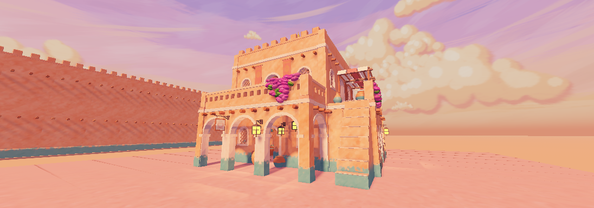

The plain kit above makes boxes. Buildings that are meant to be looked at use a second set of pieces, and a building is a recipe of its own.

| Piece | What it is |
|---|---|
| `wall2_plain`, `wall2_door`, `wall2_window`, `wall2_arcade` | Ground-floor walls: plinth with the turquoise band, a stone course with a painted zigzag under the roof line, a wooden rail on the room side. Openings are round arches framed in cut stone; the arcade bay stands on two stone piers |
| `wall2_upper`, `wall2_upper_door`, `wall2_upper_window` | The same for upper floors: no band, a plain cornice |
| `corner2`, `corner2_upper` | Pilasters with a stone cap where two dressed walls meet |
| `floor` | Upper floor or roof terrace: flagstones on top, planks on three beams underneath |
| `dome` | A roof cell with a round opening, a drum with painted blind arches, a plaster dome and a brass finial. Wider than its cell. From the room below you look up into it |
| `parapet_pierced` | Balustrade with a row of openings |
| `pergola` | Posts, beams, slats and three lengths of cloth |
| `lantern`, `lantern_wall` | Iron lanterns, hanging or on a wall arm. The glass is a part of its own, so the game makes it glow |
| `rug`, `tea_table`, `divan`, `shelf`, `counter` | Furniture for the tea house |
| `sign_tea`, `banner`, `bougainvillea` | What hangs outside |

- **Painted patterns.** `p.mark(..., family="band")` paints a line in a second colour family instead of a darker tone: the zigzag on the stone course, the borders and diamonds on the rug, the tea glass on the sign. Still strokes written as numbers.
- **Arched openings** are outlines pushed through the wall thickness (`p.extrude`). `chunks.py` now cuts such faces as triangles; cut as one face they came out with holes.
- **A building is a recipe:** `buildings/teahouse.py` places pieces on the grid story by story, inside and out. `python buildings/teahouse.py` writes `out/buildings/teahouse.json`; `build/pack.py` packs it for the game (`BuildingData`), and `python preview.py teahouse teahouse-hall teahouse-gallery` renders the same list in Blender, lamps lit. Check a building in the render before uploading its pieces.
- **A building's walls come from the plan.** `buildings/layout.py` reads a building's cells from `plan/out/town.json` and stands a wall, door or window on every edge exactly as the planner has it (`shell`). A recipe may swap a blank wall for a shuttered window (`wall2_shutter`, same blocking) and add pilasters; it then adds roof, furniture and lamps by hand. `buildings/courtyard.py` is built this way; `teahouse.py` predates it and places its walls by hand.
- **Furniture keeps to the walls.** The plan lets a player walk through every room cell, so nothing stands within a stud of a cell's middle.
- Two more pieces: `wall2_shutter` (an arched window closed by painted turquoise shutters) and `tree` (an orange tree in a stone planter). 58 pieces in the kit.
- **The Dye Works** (`buildings/dyeworks.py`) also takes what stands in its yard from the plan: a vat cell is a vat, a hanging-cloth cell is a rack of dyed cloth, high cover is a stack of cloth bolts. Eight pieces for it: `rack_red`, `rack_saffron`, `rack_plum` (dyed cloth on two posts), `vat_indigo`, `vat_saffron`, `vat_plum`, `bolts`, `sign_dye` (three flasks painted on a panel). Dye colours `saffron`, `plum` and `indigo` are measured from `reference/zones/dye-works.webp`. 66 pieces in the kit.
- **Floors** (`recipes/paving.py`). Every stone is painted in its own tone with a cut joint round it; the piece itself stays one flat slab of 12 triangles (`stones` on a part: outlines filled before the strokes go on). Streets: `paving_a`, `paving_b`, `paving_c` (uneven flagstones, a few creamier ones). Rooms: `paving_tiles` (clay tiles, a small turquoise tile at every crossing). Courts, yards, the porch and the Market Square: `paving_bricks`. Round the dye vats: `paving_dyed` (splashes of the four dyes). `sand_drift` is sand blown against the foot of a wall. 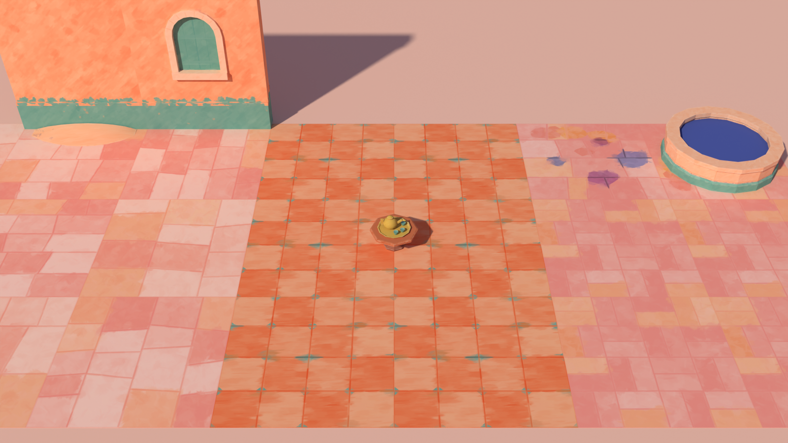
- **Props have to say what a place is for.** A recipe names the use of each area and places only what belongs to it, kept together: a washing line, a roof garden, a sitting terrace, a store by the kitchen door. No scattered filler.
- New colour families: `leaf`, `bloom`, `glow`. Paving is now pinker and paler than the walls, as in the concept.

## Destruction

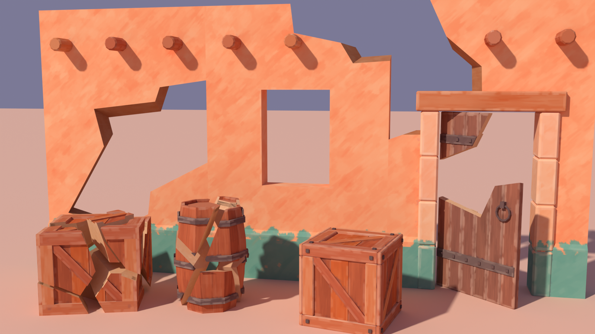

Every piece is cut into jagged shards ahead of time, because cutting meshes live is too heavy for Roblox. Random points are scattered through the piece and each shard is the region closest to one point, so shards are angular, uneven in size, and their break faces lean through the wall. Every cut face is filled in and painted with what is inside: mud brick for walls, raw wood for boards.

Two modes, set per piece in `config.py` under `BREAK`:

| Mode | Used for | How it works |
|---|---|---|
| `chunks` | walls, doors | Each shard has its own health and stays until it is destroyed. A blast removes the shards it reaches and leaves a jagged hole. |
| `shatter` | crates, barrels | The prop has one health. When it breaks, it is swapped for its shards as flying debris. These shards are cut from the low-detail mesh. |

What rides along:
- Beam ends, studs and jamb blocks stay whole and belong to the shard they sit in.
- The window lattice and the door lintel break on their own, with their own health.

`<piece>.break.json` lists, for every shard: its mesh, bounding-box centre and size (Roblox axes), main material, health, whether it stands on the ground, which piece edges it touches, and which shards it touches. That is enough for the game to drop anything left with no path to the ground.

To change how a piece breaks, edit its line in `BREAK`: `shards` (how many), `slant` (how far the break faces lean), `apart` (even sizes vs a mix of slabs and bits), `seed` (a different crack pattern). Health values are placeholders until weapon damage exists.

**Suggested use in the game:** show the single whole mesh until a piece is first damaged, then swap it for its shards. Undamaged walls then cost one part each, not twelve.

## Weapons


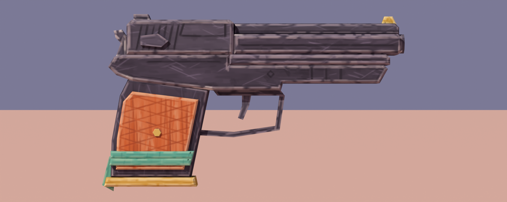

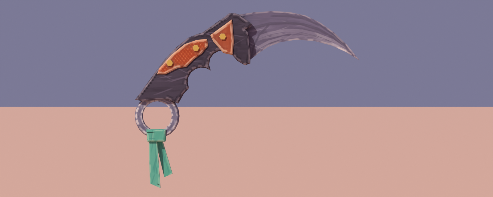

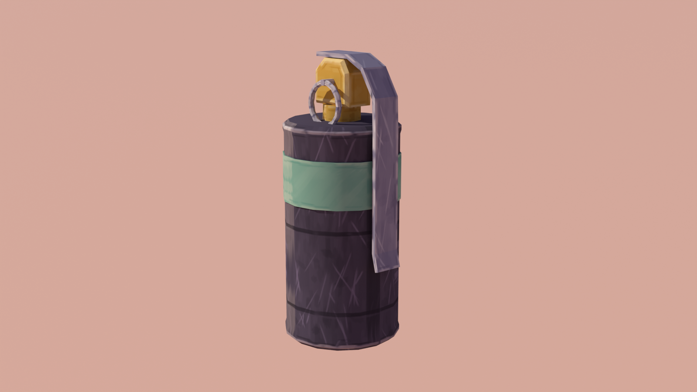

The weapons were built without concept art, from the proportions of real ones, then painted with the same brush rules as the map. They share one scale (`GUN_MM` in `config.py`: an 880 mm rifle is 3.3 studs), so they are in proportion to each other.

| Gun | Based on | Length | Triangles | Parts |
|---|---|---|---|---|
| `rifle` | a wooden-furniture, curved-magazine service rifle | 3.3 studs | 1,772 | body, cover, stock, grip, handguard, barrel, muzzle, magazine, bolt, trigger, selector |
| `pistol` | the Desert Eagle | 1.1 studs | 996 | body, slide, barrel, grip, magazine, trigger, hammer, charm |
| `knife` | a karambit, traced from a reference photo | 0.7 studs | 1,328 | blade, handle, ring, charm |
| `smoke` | the standard military smoke canister | 0.55 studs tall | 632 | body, fuze, lever, pin |

### Every gun is modular

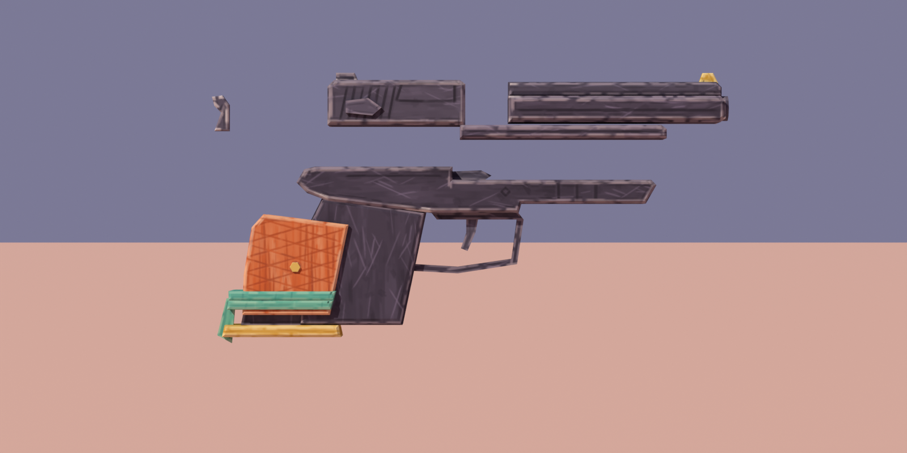

Guns are not breakable. They are built from named parts, and each part is its own mesh in `out/<gun>/parts/`, all sharing the gun's one texture. That is what animation, rigging and attachments need:

- **Animate:** the slide or bolt, trigger, hammer, selector and magazine are separate.
- **Swap:** a stock, grip, handguard, barrel, muzzle or dust cover can be replaced by an attachment built to the same socket.
- **Sockets** (`<gun>.parts.json`): named points with a position and direction for `muzzle`, `optic`, `underbarrel`, `magazine` (and `stock` on the rifle), plus `aim_rear` and `aim_front` so the sights can be lined up when aiming.
- **Joints** (`<gun>.parts.json`): how each moving part moves. `slide` gives a direction and distance, `hinge` a pivot, axis and angle, `detach` the direction a magazine pulls out.

The piece origin is the top of the grip, where the hand goes, and the barrel points along +X.

### How a gun is written
`recipes/gun.py` is the shared toolkit. A gun recipe is a list of side-view outlines in millimetres, each given a part name, a material and a real width:

```python
stock = g.shape("stock", "wood", [(2, 6), (2, -40), ...], 30, bevel=7, segments=2)
g.tube("barrel", "gunmetal", 258, 640, 0, 9.5)
g.muzzle("muzzle", "gunmetal", 640, 668, 0, 9.5, 5.0, 12)   # a ring with a dark bore, never a solid plug
g.socket("muzzle", 668, 0)
g.joint("bolt", "slide", 198, 19, (-1, 0, 0), 70)
```

### The knife
The karambit uses the same toolkit, scale and part system as the guns. Its outline was traced from a reference photo: `recipes/knife.py` lists pixel positions measured on the photo and converts them to millimetres, so the sickle blade, the hooked guard, the two finger grooves and the ring sit where they do on the real knife. The style is ours: steel blade, the guns' dark metal for the handle frame, wooden grip panels, brass pins, a turquoise cloth on the ring.

- **Blade:** a `loft`, a row of cross-sections from guard to tip. Each is flat near the spine and ground down to a thin edge, so the blade has a real bevel and gets thinner toward the point.
- **Painted detail:** the grind line, the plunge line at the base, ribs on the front panel, checkering on the rear panel, jimping along the spine.
- **Sockets:** `blade_base` and `blade_tip` (for slash trails and hit checks), `ring` and `charm`.
- **Joint:** the spin round the finger ring.

### The smoke grenade
A can with rolled rims, a brass fuze, a steel safety lever bent over the fuze and down the side, and a pull pin with its ring. The turquoise band is the game's accent colour, used here the way real cans use a colour band; the stencilled bars stand in for lettering.

- **Parts:** the `lever` and the `pin` are separate so the pin can be pulled and the lever can fly off when it is thrown.
- **Socket:** `smoke`, on the lid, where the smoke comes out.
- **Joints:** the pin pulls out sideways; the lever hinges at the top of the fuze.

### Paint
- **Finer brush.** Small objects use the map's paint rules with a smaller brush (`DETAIL_SCALE` in `config.py`).
- **Extra hand-painted detail** (`STYLE` in `config.py`), only on pieces seen up close:
  - every sharp edge gets a brushed highlight in the material's own colour, with a thin dark stroke just inside it
  - wood gets dark grain lines and pale scuffs; metal gets grime dabs and bright scratches; the cloth gets folds
  - round barrels get a brushed highlight along their length
  - detail lines are painted where modelling isn't worth it: ejection ports, panel lines, pins, slide serrations, magazine seams, grip checkering
- **No shading between parts.** Contact shading is only painted within a part, so a swapped or removed part leaves no shadow behind.

## Files

| File | What it does |
|---|---|
| `config.py` | Every number: scale, texture size, palette, paint rules, piece sizes, triangle budgets |
| `recipes/` | One file per kind of piece. `gun.py` is the shared toolkit for firearms, `drape.py` for cloth. |
| `build.py` | Builds closed solids, unwraps them, bakes the paint guides, checks and exports |
| `chunks.py` | Cuts a piece into jagged shards, fills the cut faces, writes the break data. Also splits off moving parts (weapons). |
| `brush.py` | Flat-brush engine: each stroke is a centre, length, width, angle and colour |
| `paint.py` | The look rules, applied stroke by stroke |
| `run.py` | Runs recipes |
| `preview.py` | Renders the pieces and the comparison sheet. `python3 preview.py building props` renders the kit scenes. |
| `rebundle.py` | Rewrites the `.fbx` files from the `.obj` meshes without repainting |

## Rules built into the scripts

**Look**
- One colour family per material, measured from the concept art.
- Every surface starts as one flat colour.
- Each stroke is one small step lighter or darker than the paint under it.
- Plaster strokes all lean up and to the right; wood strokes follow the grain.
- Turquoise only as a band at the foot of the walls, with a wandering top edge.
- No painted shadows. Where surfaces meet, a dark glaze that leans toward lavender, never gray.
- A pale glaze on protruding edges.
- No noise, no gradients, no generated textures.

**Geometry** (`run.py` fails a piece that breaks one)
- Every part is a closed solid, with no inside-out faces.
- No two parts show the same plane in the same place (would flicker in Roblox).
- Under Roblox's 20,000 triangle limit and under the piece's own budget.
- Wall pieces all share one base colour and get no edge highlight where they meet, so neighbours join without a seam.
- Every shard is checked the same way as a whole piece.
- Contact shading is only painted between parts of the same shard, so a destroyed shard leaves no shadow behind on the wall.
- Break lines get no edge highlight, so cracks are invisible until the piece breaks.
- Parts that are cut into shards may not run through each other (a cloth through its pole, a post into its foot): their cut faces would land on top of each other and flicker. They touch, or keep a gap.
- Texture density is at least 24 px per stud (`DENSITY_MIN`). The stairs, the biggest solid in the kit, are allowed 22.
- Pale cloth and sacking get much less of the dark corner glaze, which reads as stains on them (`STYLE`).

## In Roblox Studio

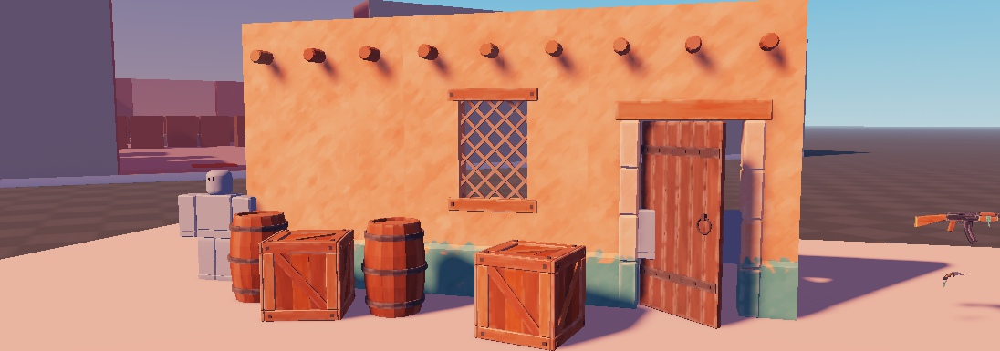

All ten pieces are imported (see `../build/README.md`). The scale is exact: the `.fbx` files are exported at 0.01 and arrive at 1 unit = 1 stud. Roblox's importer turns every `.fbx` half a turn about the vertical axis, so the exporter turns the `.fbx` meshes the other way first (`FBX_TURN` in `build.py`); the `.obj` files and the break and parts data are unchanged. More screenshots are in `studio/`.

## Not verified yet
- `run.py` is not repeatable across machines: on Windows it repaints five of the pieces differently from the committed textures, because the texture layout shifts with tiny rounding differences. To change only how the `.fbx` files are written, run `python3 rebundle.py`, which rewrites them from the `.obj` meshes and repaints nothing.
- The weapons have no animations, sounds or firing code, and have not been seen in first person in Roblox.
- The sockets and joints are positions and directions in a data file. Nothing has been rigged or attached with them yet.
- In the game a piece is never left with shards missing (the owner's call after seeing holes in Studio): walls and doors crack along the cuts as they take damage and then crumble whole; crates and barrels burst. The modes in the table above describe the data, not the game any more. See `../HANDOFF.md`.
- The preview is a Blender render with a sun and lavender ambient light set up to resemble the planned Roblox lighting. It is not Roblox.
