# Desert Village: grid plan

**Plan v2, the compact town, is the current plan.** Plan v1 (nine districts, 736 studs across) is kept below for reference; it was built and judged the wrong kind of map.

## Plan v2: the compact town

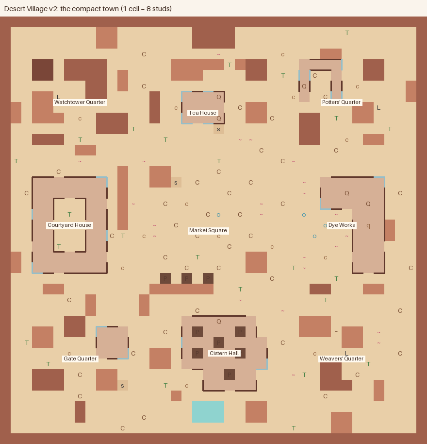

- **Size:** 40 x 40 cells of 8 studs, 320 studs across inside its wall. Plan v1 was 92 x 92.
- **Layout:** a market square in the middle, a landmark building on each side of it, a quarter of small houses in every corner. **Nothing is mirrored**: every block has its own shape.
- **Source:** `plan/town.py`. The town is drawn row by row in `ROWS`. `python town.py` picks the spawns, checks every arena, draws the pictures and exports the town for the game.

| | West | Middle | East |
|---|---|---|---|
| **North** | Watchtower Quarter: the tower, an L-shaped house, a small house | Tea House (the pilot building, at its real 4 x 4 cells), its walled garden behind | Potters' Quarter: a U of workshops round the kiln yard |
| **Middle** | Courtyard House: rooms round a court | Market Square: the well, stalls, a kiosk, an arcade | Dye Works: an L of workshops round a yard of vats |
| **South** | Gate Quarter: guard house, stable, gatehouse | Cistern Hall: a pillared hall, its overflow pool | Weavers' Quarter: three houses, a plank between two roofs |

### The brief: a hunt
The owner on the layout: no need for symmetry; "give each player (when they spawn) enough options that its actually a hunt to find the player and a little bit tense (valorant kind of but for duels)". An arena is judged on these, on top of the v1 checks:

| Measure | Target | What it means |
|---|---|---|
| Places to be after 4 s | at least 3 per player | Separate places a player can have gone 4 seconds after spawning. Two spots with a wall between them are two places |
| Places to be after 7 s | at least 4 per player | The same, further in. You cannot know which one the other player took |
| Places to collide | at least 4 | Separate spots both players can reach at the same moment (within half a second). Yellow in the pictures |
| Most one spot can see | at most 30% | Share of the arena's ground visible from the best vantage spot. Nowhere to stand and watch everything |
| Even without a mirror | 44% to 56% | Share of the ground one player reaches first; and neither has more than one option more than the other |

These targets are first guesses. They need a real duel to confirm them.

Spawns are not drawn by hand. For each arena `town.py` tries every pair of spots in the two spawn yards and keeps the pair that splits the ground most evenly, with the most options, inside the meeting time.

### Arenas
A duel uses one part of town per round. An arena is a band three blocks long: two corner quarters with a landmark between them. The streets out of the band are closed for the round (pink squares). Bands overlap, so every building is fought over in two arenas.

| Arena | Places after 4 s (A / B) | Places after 7 s (A / B) | Places to collide | Most one spot sees | Ground A reaches first | Meet | First sight | Longest view (studs) |
|---|---|---|---|---|---|---|---|---|
| Tea House | 4 / 4 | 5 / 5 | 4 | 23% | 50% | 9.41 s | 6.21 s | 170 |
| Cistern Hall | 3 / 3 | 5 / 5 | 4 | 26% | 49% | 9.62 s | 4.91 s | 193 |
| Courtyard House | 4 / 4 | 5 / 4 | 4 | 22% | 50% | 9.41 s | 5.21 s | 183 |
| Dye Works | 5 / 4 | 4 / 4 | 5 | 21% | 48% | 9.62 s | 5.41 s | 185 |
| Market Square | 4 / 4 | 8 / 7 | 4 | 17% | 48% | 9.62 s | 7.12 s | 177 |

All five pass every check.

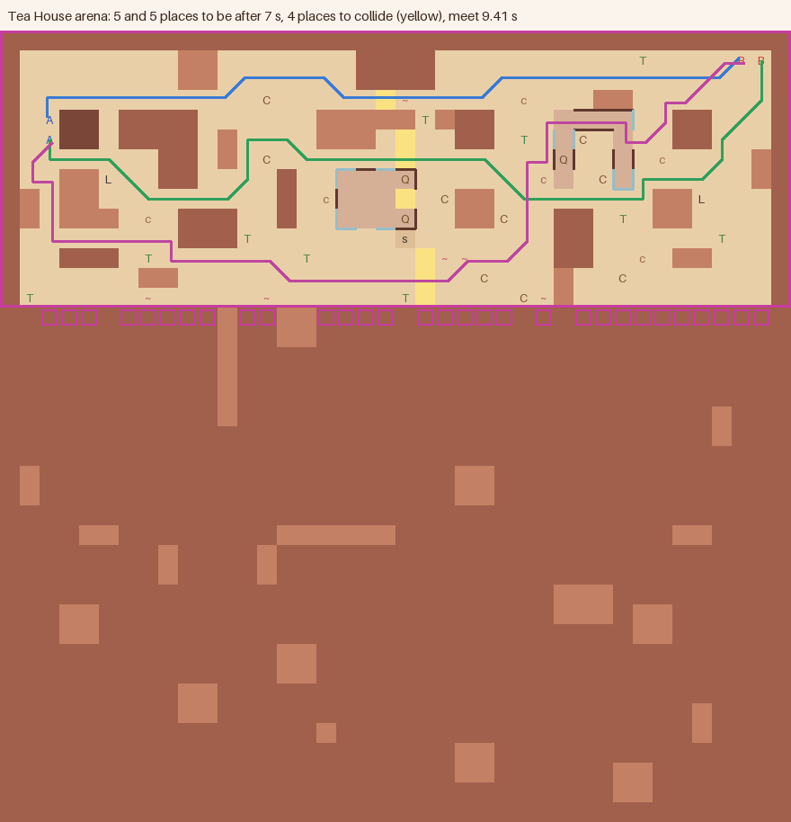

How it got there:
- The first uneven draft failed nearly everything: views of 299 studs, a spot by the cistern that saw 40% of its arena, three places to collide.
- **Views through buildings were the surprise.** A row of rooms with a window or a door at each end is a tunnel you can see through. Six of those were closed with a shelf or a blank wall.
- **Wide streets count as one place.** Splitting them with a run of small buildings is what raised the options: a wall of houses down the street east of the Courtyard House, a garden wall behind the Tea House that leaves a one-cell alley, sheds in the south streets.
- **Stairs are entered from the foot.** The planner used to treat a stairs cell as open ground; `town.py` corrects that, so routes and built flights agree.
- **The real buildings corrected the planner twice more.** With the Tea House and the Courtyard House standing in the town, bots failed two routes: the plan let them step slantwise across the corner of the Tea House porch, where a pier stands, and slantwise through doorways. `town.py` now forbids both. That moved the timings enough to fail the Dye Works arena, which was fixed by fencing its vat yard from the street and moving one workshop door.

### Built as gray boxes and walked by bots

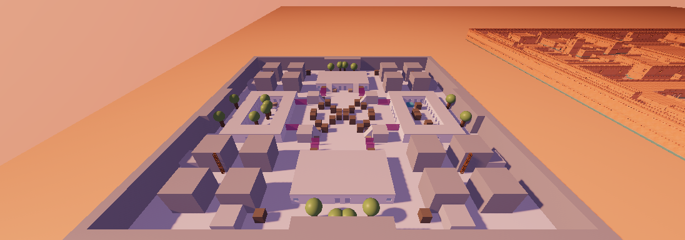
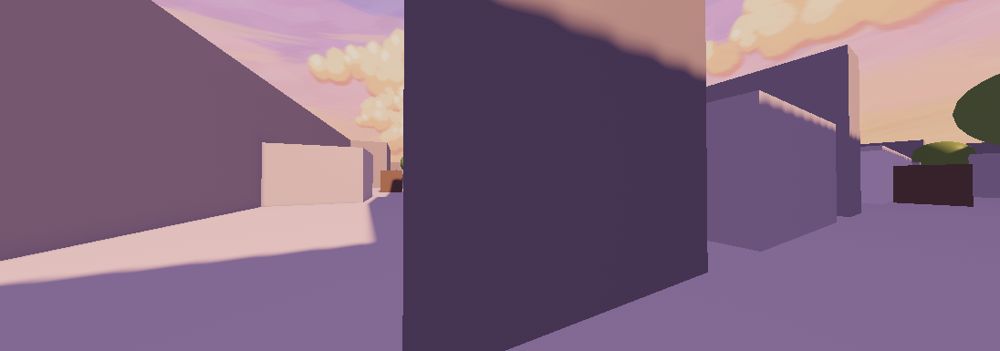

`build/09_graybox_town.luau` builds it all as gray boxes; `build/10_build_town.luau` builds the real town (see below) and leaves only the slab of the gray-box town, which the route tests measure from. `build/tests/time_town_routes.luau` walks a bot along every route the planner exports: 35 of 35 pass. On gray boxes alone the bots were within 4.3% of the planner's times.

### Real buildings in the town

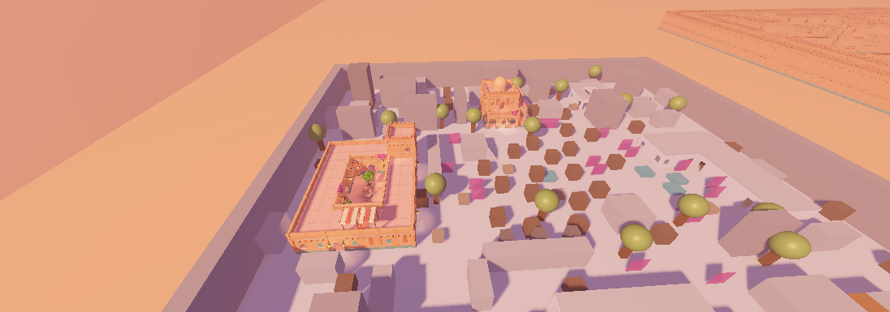

**Every cell of the plan is built now** (2026-11-27). `python -m buildings.town` in `assets/` writes a recipe for every house, the Potters' Workshop, the Guard House, the street dressing and the town wall, and `Town/TownData`: which recipe stands at which plan cell. `TownBuilder` stands them all. The pictures below are from the way there.

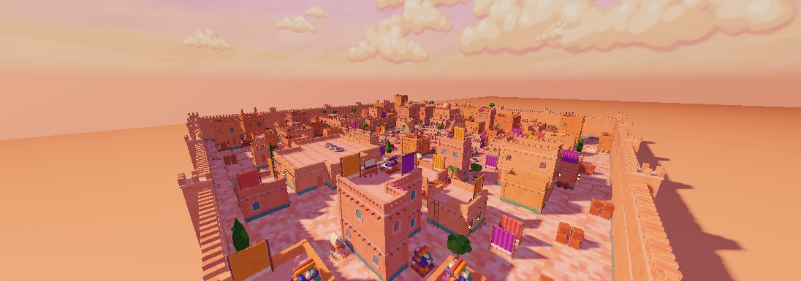

- A solid block of the plan is a closed house: walls on every outside edge, a shut door, a roof behind a parapet. Where the plan gives a roof a ladder, stairs or a plank, the parapet is left open there and the roof is kept clear.
- High cover is a group that fills its cell and stands taller than a player (a stall, a cart, stacked crates, cloth bolts, the kiln); low cover blocks the way but not the view (sacks, pots, a trough, seats); hanging cloth is a rack you walk through, hung across the way people walk.
- Goods outside houses keep off the cells the test routes use, unless they reach no further than 2.6 studs from the wall.
- **35 of 35 routes pass** in the finished town; four run more than 10% slower than planned, the worst 14%.
- Everything can be shot down, so the layout the plan tested is the layout at the start of a round.

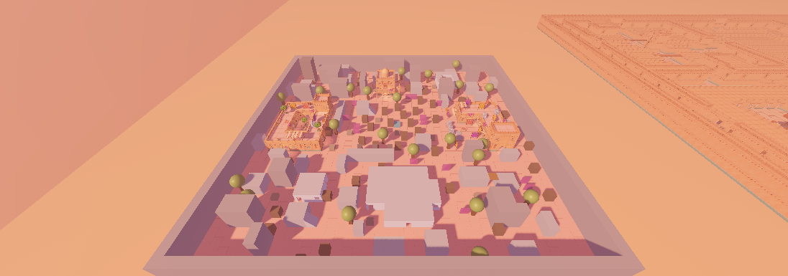

- **The floor is flagstone, not gray**: `TownBuilder` lays the kit's paving piece on every street, yard and unbuilt room cell (1,115 of them), each turned a different way so the one painted tile does not read as a pattern.
- The bots walk the same routes straight through the real buildings: **35 of 35 pass**.
- **Six routes run 10% to 19% slower than planned**, all of them through or past a real building (door frames and furniture to brush past): two Market Square lanes, one Tea House lane and the climbs up outside stairs. The planner still times a building as open floor.

- **Fairness is measured, not given.** The two players' runs to the meeting point were 0.1 to 0.5 s apart in the bot test. The mirrored first draft showed the same 0.5 s, so that gap is the bots, not the layout.
- **The Tea House in the plan is the real building's footprint** (hall, wing, porch, outside stairs, the three doors). The planner cannot see its upper floor: it treats the roof as one flat level.

### Built for frame rate
What the plan itself does for frame rate:

- **Small.** 320 studs across instead of 736; an arena is 112 x 320 studs.
- **Short views.** No view at eye level is longer than 193 studs, and no spot sees more than 26% of its arena. Less of the town is on screen at once.
- **One arena per round.** Whatever lies outside the band can be drawn in low detail or not at all during a round. Not built yet.

Budgets, from what the tea house costs (measured in a playtest with nothing else in the picture):

| | Triangles | Draw calls |
|---|---|---|
| Whole tea house, seen from its yard | 53,000 | 46 |
| Inside its hall | 31,000 | 36 |
| Inside its gallery | 37,000 | 37 |

- **Landmark building** (5 of them): about 1,500 triangles per plan cell, up to 12 lamps that cast shadows. The Tea House (16 cells, two stories) is 72,000; the Courtyard House (63 cells) is 116,000 with its roof dressed; the Dye Works (72 cells with its yard) is 86,000. The first budget here said 75,000 for any landmark; that was set from the Tea House alone and does not fit a building four times its footprint.
- **Small house** (16 of them): up to 15,000 triangles, 2 lamps that cast shadows.
- **Whole town:** the estimate was about 700,000 triangles and 6,000 pieces. Built, it is 4,071 pieces (5,246 with the paving and sand) and about 1,080,000 triangles: 44 houses 568,000, the six buildings 345,000, street dressing 135,000, the wall 34,000. A house averages 13,000. The source video's town is about 2,000,000.
- **Any view in a round:** aim for under 150,000 triangles.
- **Lamps:** hanging lanterns cast shadows, wall lanterns do not. Rugs, banners, signs, tables, shelves and small pots cast no shadows (`Buildings/BuildingConfig.luau`).

**Frame rate itself is not measured.** This Studio session draws 16 frames a second whether the whole tea house or an empty sky is on screen, so it says nothing. It needs a run on a phone and on an ordinary PC.

### Not done
- The whole town is built. Nothing in it has been seen by the owner yet.
- The plan has one cell kind the v1 planner lacks: `u`, shallow water indoors (the Cistern Hall's two channels). `town.py` adds it.
- Sight is still only checked at eye level on the ground, not from roofs.
- Barriers that close an arena, rounds and team spawns are not built.

---

# Plan v1 (superseded)


## Layout
- **Grid:** 1 cell = 8 studs. Each zone is 28 x 28 cells (224 studs).
- **Town:** 3 x 3 districts plus a ring road and the town wall, 92 x 92 cells (736 studs across).
- **Rounds:** each round uses one duel zone. The streets into the other zones are closed with barriers (a storm wall or gates).
- **Fairness:** each zone's bottom half is the top half rotated 180°. Spawn A and spawn B get exactly the same routes, cover and timings. Decoration can still differ between the two halves.

| | West | Middle | East |
|---|---|---|---|
| **North** | Rooftops | Tea House | Caravan Yard (reserve) |
| **Middle** | Courtyard House | Market Square | Dye Works |
| **South** | Gate | Potters' Row (reserve) | Cistern (underground) |

The two reserve districts are placeholder housing blocks for now. Either can become an 8th or 9th zone later.

## Fairness checks
`planner.py` measures every zone with Roblox default movement: walk at 16 studs/s, climb ladders at about 11 studs/s.

| Check | Target | What it means |
|---|---|---|
| Meet time | 6-10 s | Earliest moment both teams can stand on the same spot |
| First sight | at least 3.5 s | Earliest moment a player from each team can see the other at eye level. This rules out spawn-to-spawn sightlines. |
| Longest sightline | at most 200 studs | Keeps long-range fights within reach of non-sniper weapons |
| Lanes | at least 3 | Separate routes from spawn A to spawn B |
| Reachable | all cells | No sealed-off pockets |

## Results

| Zone | Spawns | Meet | First sight | Longest sightline (studs) | Lane times A→B (s, * = uses roofs) | Low / high cover cells |
|---|---|---|---|---|---|---|
| Market Square | N / S | 7.33 s | 4.12 s | 192 | 14.45 / 14.74 / 20.04 | 2 / 44 |
| Tea House | W / E | 6.91 s | 4.41 s | 152 | 13.74 / 14.04 / 23.56* | 10 / 10 |
| Courtyard House | N / S | 7.41 s | 3.91 s | 190 | 14.36 / 24.45 / 24.45 | 8 / 28 |
| Dye Works | W / E | 6.00 s | 3.91 s | 192 | 11.91 / 12.62 / 14.54 | 2 / 12 |
| Cistern | N / S | 7.74 s | 4.21 s | 192 | 14.99 / 15.28 / 20.33 | 8 / 14 |
| Gate | N / S | 8.41 s | 6.41 s | 193 | 16.33 / 16.62 / 18.40 | 16 / 20 |
| Rooftops | W / E | 6.00 s | 4.21 s | 186 | 11.91 / 20.21* / 19.97* | 0 / 14 |

All 7 zones pass all checks.

## Zones

### Market Square


- An open plaza around the well, with a ring of stalls.
- A spice hall on one flank for close-quarters fights.
- A ladder to a 2-story roof that overlooks the plaza.
- This is the most exposed zone, with lots of high cover.

### Tea House
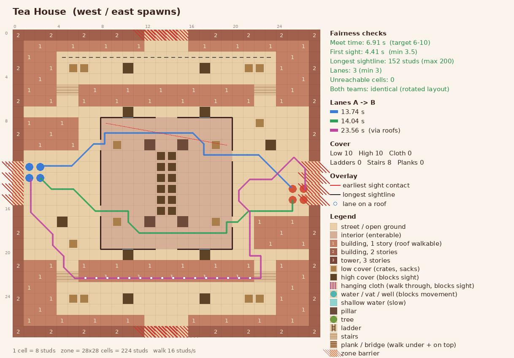

- A big hall in the middle, split by a long counter. The doors are offset so you can't see straight through.
- A ring street runs around the hall.
- Stairs lead up to a raised terrace that connects to the hall roof, which gives a slower route over the roofs.

### Courtyard House


- A courtyard with a tree and a planter, surrounded by arcade wings full of doorways.
- Stairs and a ladder up to the gallery roof.
- Zig-zag side streets on both flanks.

### Dye Works
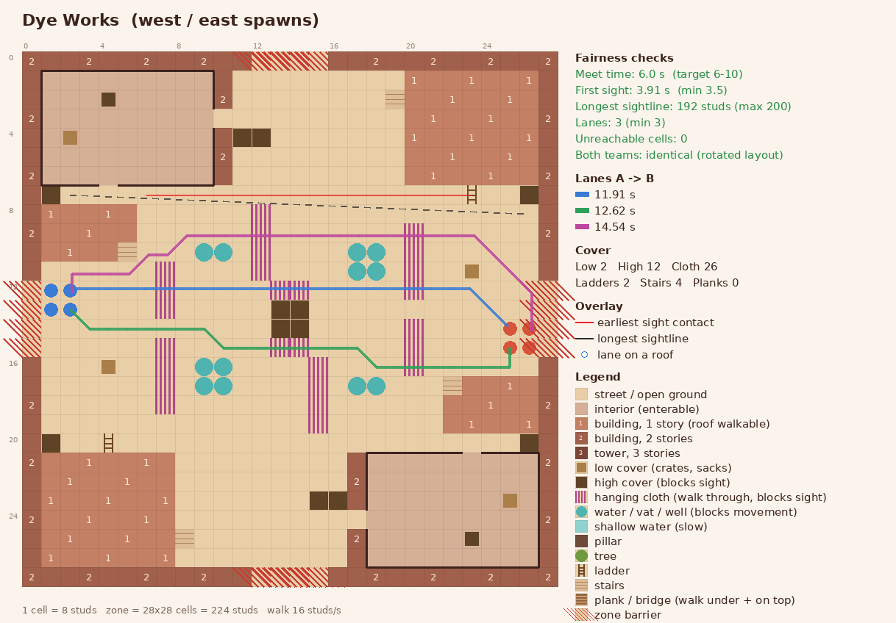

- A workshop interior, a yard of dye vats, and rows of hanging cloth.
- The cloth can be walked through but blocks sight, so it's good for utility plays and ambushes.
- A roof terrace reached by stairs and a ladder.

### Cistern (underground)
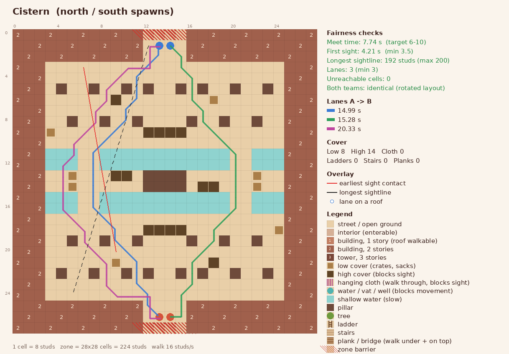

- A hall of staggered pillars.
- Two shallow water channels that slow you down, with dry bridges across them.
- A well shaft in the middle.
- Spawns come down stairwells.

### Gate
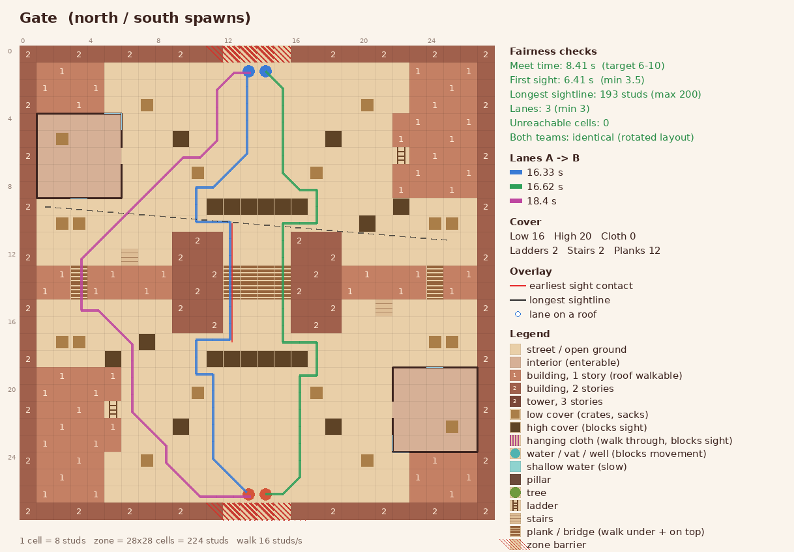

- An inner wall splits the zone. The main gate is in the middle, with a side gate near each end.
- Stairs lead up to the wall-walk.
- Wagons in front of the gate block direct sight through it.

### Rooftops


- House blocks with walkable roofs, joined by plank bridges and ladders.
- Narrow alleys underneath.
- A central watchtower with a ladder.
- Two of the three lanes use the roofs.

## How to change a zone
1. Edit the zone's 14 rows in `zones.py`. You only draw the top half; the legend is at the top of the file.
2. Run:

   ```bash
   python3 planner.py
   ```

3. Look at `out/zone-<name>.png`. The red line is the earliest sight contact, the dashed line is the longest sightline, and the coloured lines are the lanes.

`out/plan.json` holds every zone as a full grid. The graybox builder will read it.

## Known limits of v1
- **Sightlines are only checked at eye level on the ground.** Roof-to-street and tower sightlines are not measured yet; check them in the graybox.
- **Heights are simplified.** One story is 12 studs, and roofs only connect to roofs of the same height. Parapets and dome shapes are not modelled.
- **Walls inside a cell are thin walls on the cell's edges.** The graybox builder will turn them into real walls with door and window gaps.
- **Timings are estimates.** Bot or friend playtests in the graybox are the real check.

## Graybox check: Market Square


`game/ServerStorage/DesertFps/Graybox/GrayboxBuilder.luau` builds a zone from `out/plan.json` as gray parts. Bots then walked the planner's own routes (`routes.py` exports them to `out/routes.json`) in a Studio playtest at the default walk speed.

| Route | Planner | Bot in Studio |
|---|---|---|
| Lane 1, A to B | 14.45 s | 14.20 s |
| Lane 2, A to B | 14.74 s | 14.47 s |
| Lane 3, A to B | 20.04 s | 19.57 s |
| A to the meet point | 7.12 s | 6.97 s |
| B to the meet point | 7.33 s | 7.20 s |
| A up the ladder to the 2-story roof | 5.00 s | 4.92 s |
| B up the ladder to the 2-story roof | 5.00 s | 4.89 s |
| A up the ladder to the 1-story roof | 9.23 s | 9.17 s |
| B up the ladder to the 1-story roof | 9.23 s | 9.17 s |

Every route is within 3 % of the planner, and the two teams match each other. The planner's walk and ladder speeds hold in Roblox, so `zones.py` needed no change.

What the graybox showed that the planner does not model:
- **Players cut corners.** The planner moves cell to cell. Bots steered by Roblox's pathfinder took straighter lines and were about 5 % faster (A to B in 14.2 s on a 214-stud line, a meet point at about 6.9 s). Still inside the 6 to 10 s target.
- **Low cover can be climbed.** It is 3.5 studs tall and the default jump clears 7.2, so a player can stand on it. The planner treats it as blocking movement. Not tested with a player yet.
- **A ladder cell with buildings on several sides gets one ladder,** against the first wall in north, south, west, east order. The planner counts every side. The roofs join, so the routes are the same.
- **Roblox's pathfinder struggles in tight spots.** It found no way up the ladder in the one-cell alcove with a 2-stud agent, and it clipped door jambs and cover corners. This only matters if the game gets bots.

Still unchecked: sightlines from roofs and over low cover, shallow-water slowdown (no zone with water has been built), stairs, planks and windows (Market Square has none), and a playtest with real players.

## The town built from the kit


`game/ServerStorage/DesertFps/Map/MapBuilder.luau` builds the whole plan out of kit pieces: all nine districts, the ring road and the town wall, about 20,800 pieces. Bots then walked every route the planner exports (`build/tests/time_all_routes.luau`) and every flight of stairs (`build/tests/climb_stairs.luau`).

| Zone | Lanes and meet points | Gap to the planner | Ladder climbs | Stairs onto roofs |
|---|---|---|---|---|
| Market Square | 5 of 5 | within 9% | 4 of 4 | none |
| Tea House | 5 of 5 | within 4% (lane 3 once 11% slow) | none | 8 of 8 |
| Courtyard House | 5 of 5 | within 3% | see below | 4 of 4 |
| Dye Works | 5 of 5 | within 3% | 2 of 2 | 6 of 6 |
| Cistern | 5 of 5 | lane 3 is 13% fast | none | none |
| Gate | 5 of 5 | within 4% | 2 of 2 | 2 of 2 |
| Rooftops | 4 of 5 | within 6% | see below | 4 of 4 |

What the build showed:
- **Stairs are one-way objects; the planner treats them as open ground.** A stairs cell in the plan can be walked through and climbs to any roof beside it. A real flight fills its cell, is entered from its low end and ends in a 12-stud drop. Where a street runs through a stairs cell (Rooftops, Courtyard House), a player can climb over and drop down going one way but not the other. Flights are turned so both teams get the same direction. Thirteen of the 71 routes cross a stairs cell from the side or step sideways off one; the straight-line bots cannot do that, so those routes are not confirmed (the stairs test confirms the flights themselves).
- **Rooftops lane 3 is one of them.** It goes up a flight and sideways onto a roof. The stairs test does that climb, but the lane as a whole has not been timed.
- **A ladder cell needs a ladder on every building it touches.** The graybox gave it one; on Rooftops the two buildings beside a ladder cell are not joined, and one roof could not be reached. The town builder stands a ladder against every side.
- **Parapets block the top of the stairs.** The last step is one stud deep, so a parapet running past it stops the step sideways onto the roof. The builder leaves parapets off next to stairs.
- **The Cistern is 13% faster than planned** because wading through shallow water does not slow anyone yet.
- **Market stalls hide less than the plan assumes.** The plan's high cover blocks the view; a stall is open between counter and roof. Other zones use stacked crates.
- **Solid buildings are hollow shells.** Their walls can be shot down, which opens them up. The plan treats them as solid.
- **The Cistern is a covered hall at street level,** not underground.

Still unchecked: sightlines (from roofs, over cover, through stalls and windows), the 13 routes above, frame rate (the Studio session this was built in runs at 14 frames a second with or without the map, so it says nothing), and a playtest with real players.

## Next step
- Decide what a stairs cell should be: change the plan so streets do not run through them, or make a narrower flight that leaves room to pass.
- Rounds: a zone picker, barriers that close, spawns by team.
