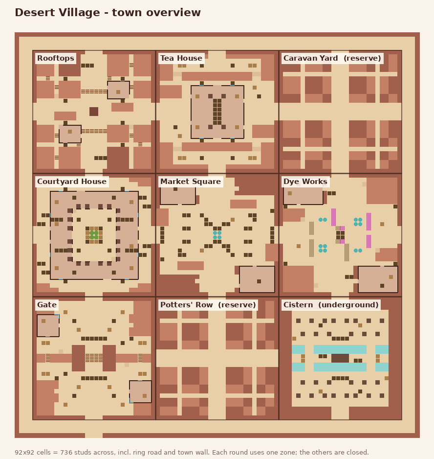
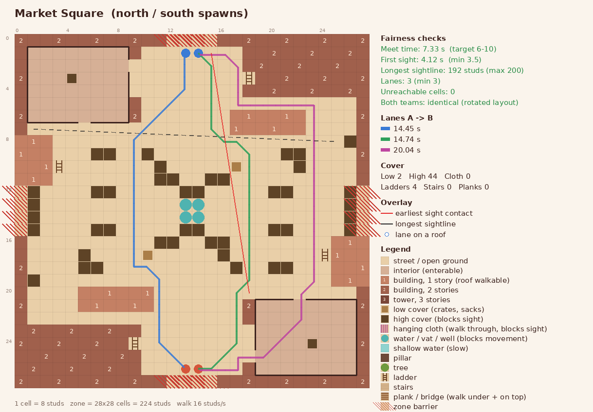
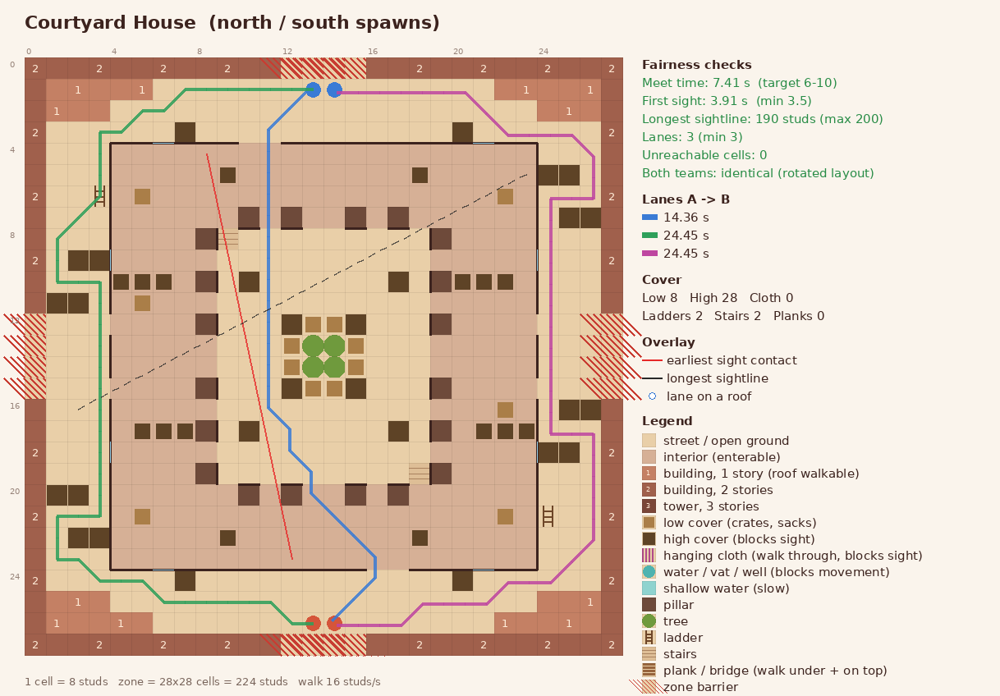
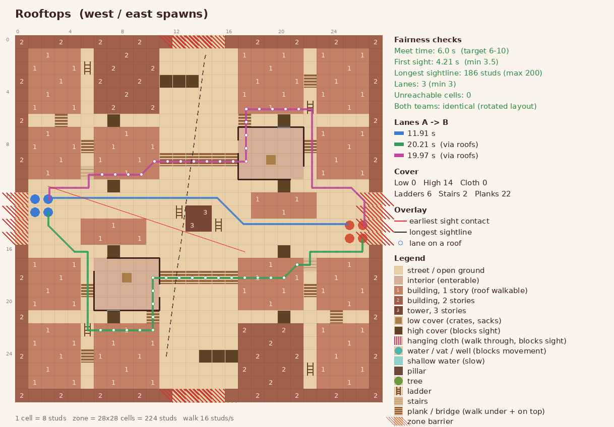
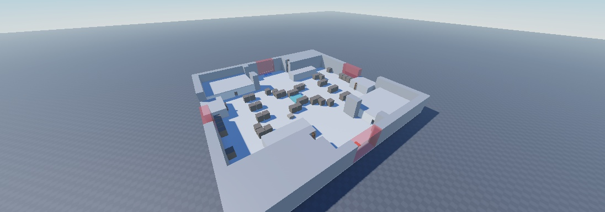
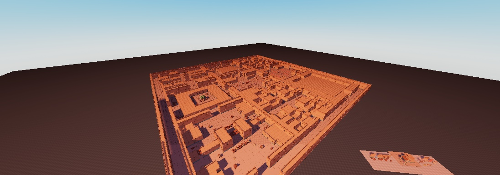

# Desert Village: grid plan (v1)



## Layout
- **Grid:** 1 cell = 8 studs. Each zone is 28 x 28 cells (224 studs).
- **Town:** 3 x 3 districts plus a ring road and the town wall, 92 x 92 cells (736 studs across).
- **Rounds:** each round uses one duel zone. The streets into the other zones are closed with barriers (a storm wall or gates).
- **Fairness:** each zone's bottom half is the top half rotated 180°. Spawn A and spawn B get exactly the same routes, cover and timings. Decoration can still differ between the two halves.

| | West | Middle | East |
|---|---|---|---|
| **North** | Rooftops | Tea House | Caravan Yard (reserve) |
| **Middle** | Courtyard House | Market Square | Dye Works |
| **South** | Gate | Potters' Row (reserve) | Cistern (underground) |

The two reserve districts are placeholder housing blocks for now. Either can become an 8th or 9th zone later.

## Fairness checks
`planner.py` measures every zone with Roblox default movement: walk at 16 studs/s, climb ladders at about 11 studs/s.

| Check | Target | What it means |
|---|---|---|
| Meet time | 6-10 s | Earliest moment both teams can stand on the same spot |
| First sight | at least 3.5 s | Earliest moment a player from each team can see the other at eye level. This rules out spawn-to-spawn sightlines. |
| Longest sightline | at most 200 studs | Keeps long-range fights within reach of non-sniper weapons |
| Lanes | at least 3 | Separate routes from spawn A to spawn B |
| Reachable | all cells | No sealed-off pockets |

## Results

| Zone | Spawns | Meet | First sight | Longest sightline (studs) | Lane times A→B (s, * = uses roofs) | Low / high cover cells |
|---|---|---|---|---|---|---|
| Market Square | N / S | 7.33 s | 4.12 s | 192 | 14.45 / 14.74 / 20.04 | 2 / 44 |
| Tea House | W / E | 6.91 s | 4.41 s | 152 | 13.74 / 14.04 / 23.56* | 10 / 10 |
| Courtyard House | N / S | 7.41 s | 3.91 s | 190 | 14.36 / 24.45 / 24.45 | 8 / 28 |
| Dye Works | W / E | 6.00 s | 3.91 s | 192 | 11.91 / 12.62 / 14.54 | 2 / 12 |
| Cistern | N / S | 7.74 s | 4.21 s | 192 | 14.99 / 15.28 / 20.33 | 8 / 14 |
| Gate | N / S | 8.41 s | 6.41 s | 193 | 16.33 / 16.62 / 18.40 | 16 / 20 |
| Rooftops | W / E | 6.00 s | 4.21 s | 186 | 11.91 / 20.21* / 19.97* | 0 / 14 |

All 7 zones pass all checks.

## Zones

### Market Square


- An open plaza around the well, with a ring of stalls.
- A spice hall on one flank for close-quarters fights.
- A ladder to a 2-story roof that overlooks the plaza.
- This is the most exposed zone, with lots of high cover.

### Tea House


- A big hall in the middle, split by a long counter. The doors are offset so you can't see straight through.
- A ring street runs around the hall.
- Stairs lead up to a raised terrace that connects to the hall roof, which gives a slower route over the roofs.

### Courtyard House


- A courtyard with a tree and a planter, surrounded by arcade wings full of doorways.
- Stairs and a ladder up to the gallery roof.
- Zig-zag side streets on both flanks.

### Dye Works


- A workshop interior, a yard of dye vats, and rows of hanging cloth.
- The cloth can be walked through but blocks sight, so it's good for utility plays and ambushes.
- A roof terrace reached by stairs and a ladder.

### Cistern (underground)


- A hall of staggered pillars.
- Two shallow water channels that slow you down, with dry bridges across them.
- A well shaft in the middle.
- Spawns come down stairwells.

### Gate


- An inner wall splits the zone. The main gate is in the middle, with a side gate near each end.
- Stairs lead up to the wall-walk.
- Wagons in front of the gate block direct sight through it.

### Rooftops


- House blocks with walkable roofs, joined by plank bridges and ladders.
- Narrow alleys underneath.
- A central watchtower with a ladder.
- Two of the three lanes use the roofs.

## How to change a zone
1. Edit the zone's 14 rows in `zones.py`. You only draw the top half; the legend is at the top of the file.
2. Run:

   ```bash
   python3 planner.py
   ```

3. Look at `out/zone-<name>.png`. The red line is the earliest sight contact, the dashed line is the longest sightline, and the coloured lines are the lanes.

`out/plan.json` holds every zone as a full grid. The graybox builder will read it.

## Known limits of v1
- **Sightlines are only checked at eye level on the ground.** Roof-to-street and tower sightlines are not measured yet; check them in the graybox.
- **Heights are simplified.** One story is 12 studs, and roofs only connect to roofs of the same height. Parapets and dome shapes are not modelled.
- **Walls inside a cell are thin walls on the cell's edges.** The graybox builder will turn them into real walls with door and window gaps.
- **Timings are estimates.** Bot or friend playtests in the graybox are the real check.

## Graybox check: Market Square



`game/ServerStorage/DesertFps/Graybox/GrayboxBuilder.luau` builds a zone from `out/plan.json` as gray parts. Bots then walked the planner's own routes (`routes.py` exports them to `out/routes.json`) in a Studio playtest at the default walk speed.

| Route | Planner | Bot in Studio |
|---|---|---|
| Lane 1, A to B | 14.45 s | 14.20 s |
| Lane 2, A to B | 14.74 s | 14.47 s |
| Lane 3, A to B | 20.04 s | 19.57 s |
| A to the meet point | 7.12 s | 6.97 s |
| B to the meet point | 7.33 s | 7.20 s |
| A up the ladder to the 2-story roof | 5.00 s | 4.92 s |
| B up the ladder to the 2-story roof | 5.00 s | 4.89 s |
| A up the ladder to the 1-story roof | 9.23 s | 9.17 s |
| B up the ladder to the 1-story roof | 9.23 s | 9.17 s |

Every route is within 3 % of the planner, and the two teams match each other. The planner's walk and ladder speeds hold in Roblox, so `zones.py` needed no change.

What the graybox showed that the planner does not model:
- **Players cut corners.** The planner moves cell to cell. Bots steered by Roblox's pathfinder took straighter lines and were about 5 % faster (A to B in 14.2 s on a 214-stud line, a meet point at about 6.9 s). Still inside the 6 to 10 s target.
- **Low cover can be climbed.** It is 3.5 studs tall and the default jump clears 7.2, so a player can stand on it. The planner treats it as blocking movement. Not tested with a player yet.
- **A ladder cell with buildings on several sides gets one ladder,** against the first wall in north, south, west, east order. The planner counts every side. The roofs join, so the routes are the same.
- **Roblox's pathfinder struggles in tight spots.** It found no way up the ladder in the one-cell alcove with a 2-stud agent, and it clipped door jambs and cover corners. This only matters if the game gets bots.

Still unchecked: sightlines from roofs and over low cover, shallow-water slowdown (no zone with water has been built), stairs, planks and windows (Market Square has none), and a playtest with real players.

## The town built from the kit



`game/ServerStorage/DesertFps/Map/MapBuilder.luau` builds the whole plan out of kit pieces: all nine districts, the ring road and the town wall, about 20,800 pieces. Bots then walked every route the planner exports (`build/tests/time_all_routes.luau`) and every flight of stairs (`build/tests/climb_stairs.luau`).

| Zone | Lanes and meet points | Gap to the planner | Ladder climbs | Stairs onto roofs |
|---|---|---|---|---|
| Market Square | 5 of 5 | within 9% | 4 of 4 | none |
| Tea House | 5 of 5 | within 4% (lane 3 once 11% slow) | none | 8 of 8 |
| Courtyard House | 5 of 5 | within 3% | see below | 4 of 4 |
| Dye Works | 5 of 5 | within 3% | 2 of 2 | 6 of 6 |
| Cistern | 5 of 5 | lane 3 is 13% fast | none | none |
| Gate | 5 of 5 | within 4% | 2 of 2 | 2 of 2 |
| Rooftops | 4 of 5 | within 6% | see below | 4 of 4 |

What the build showed:
- **Stairs are one-way objects; the planner treats them as open ground.** A stairs cell in the plan can be walked through and climbs to any roof beside it. A real flight fills its cell, is entered from its low end and ends in a 12-stud drop. Where a street runs through a stairs cell (Rooftops, Courtyard House), a player can climb over and drop down going one way but not the other. Flights are turned so both teams get the same direction. Thirteen of the 71 routes cross a stairs cell from the side or step sideways off one; the straight-line bots cannot do that, so those routes are not confirmed (the stairs test confirms the flights themselves).
- **Rooftops lane 3 is one of them.** It goes up a flight and sideways onto a roof. The stairs test does that climb, but the lane as a whole has not been timed.
- **A ladder cell needs a ladder on every building it touches.** The graybox gave it one; on Rooftops the two buildings beside a ladder cell are not joined, and one roof could not be reached. The town builder stands a ladder against every side.
- **Parapets block the top of the stairs.** The last step is one stud deep, so a parapet running past it stops the step sideways onto the roof. The builder leaves parapets off next to stairs.
- **The Cistern is 13% faster than planned** because wading through shallow water does not slow anyone yet.
- **Market stalls hide less than the plan assumes.** The plan's high cover blocks the view; a stall is open between counter and roof. Other zones use stacked crates.
- **Solid buildings are hollow shells.** Their walls can be shot down, which opens them up. The plan treats them as solid.
- **The Cistern is a covered hall at street level,** not underground.

Still unchecked: sightlines (from roofs, over cover, through stalls and windows), the 13 routes above, frame rate (the Studio session this was built in runs at 14 frames a second with or without the map, so it says nothing), and a playtest with real players.

## Next step
- Decide what a stairs cell should be: change the plan so streets do not run through them, or make a narrower flight that leaves room to pass.
- Rounds: a zone picker, barriers that close, spawns by team.
